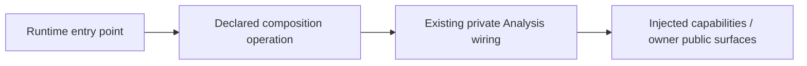

# Composition entry points

Owner: #501. This runtime-root-only surface explicitly exports the existing typed
`CoverageRequest`, `coverage_settings_digest` and async `prepare_coverage`.
It does not introduce a feature registry, coordinator, default settings or
provider. Domains must never import this package; roots alone bind concrete
implementations to the existing receiving capabilities.

Importing the public surface performs no I/O or startup. Explicit execution keeps
the existing bounded acquisition, immutable evidence and owner policy calls;
publication/Study effects remain separate owning operations. There is no change
to existing settings, scope, timeout or lifecycle behavior.

This checkpoint routes the qualified #483 repertoire surface. Other concrete
Analysis/Study/wire imports await the allocated owners' exact compatible public
surfaces. Games, HTTP, worker and frontend entry points are not exported until
their qualified source is integrated. In particular, the legacy background
worker→`main.coordinator` edge and operational health composition remain explicit
#501 follow-up work; this barrel does not disguise them as completed isolation.
