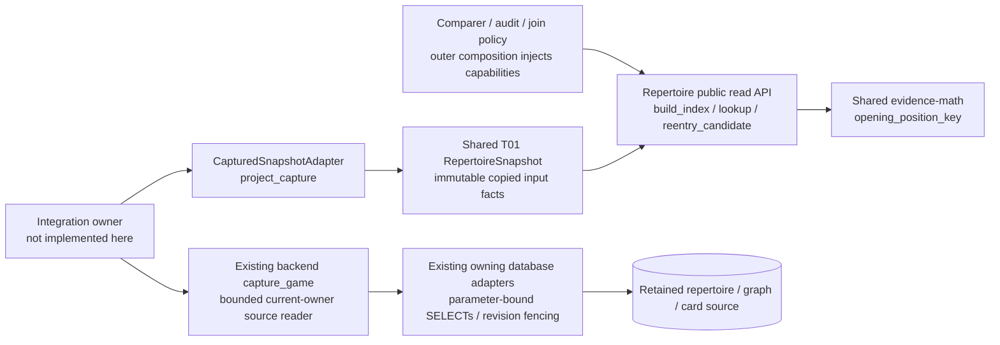
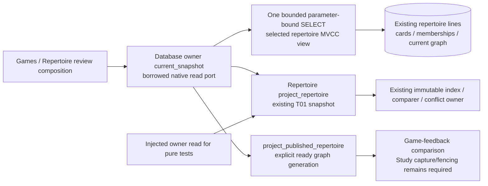

# Read-only repertoire index and capture projection

This is the source implementation for #483 / T02, SPEC v0.2 P01/P02, G01 and
C02's route facts. It is not wired into the live product. No Study effect,
conflict resolution, content edit, migration, provider or engine runs here.

The public API in [__init__.py](__init__.py) is:

- `build_index(RepertoireSnapshot) -> PositionIndex`: consumes the shared
  [T01 interface 0.2.0](../contracts/product_v02/repertoire.py), revalidates and
  copies it into immutable tuples, frozen records and read-only mappings.
- `position_key(repertoire_id, full_fen, variant='standard') -> PositionKey` and
  `index.lookup(...) -> PositionNode | None`: board, turn, castling, legal EP and
  repertoire define exact identity. Clocks are ignored for lookup. Original
  full route FEN, ordered history, variant, color and source revision survive.
- `node.selected_response`, `node.own_responses`, `node.conflict`,
  `node.opponent_edges`, and `node.occurrences`: one lookup node can retain many
  authored routes. Conflicts have no selected winner. Opponent forks are valid.
- `index.routes[(repertoire_id, route_id)]`: ordered occurrences including the
  final boundary. `index.adjacency` relates consecutive learner decisions only
  within the same route, with their actual moves and intervening opponent cue.
  It does not authorize a join or prove Study eligibility.
- `index.reentry_candidate(...) -> RouteOccurrence | None`: requires one legal
  selected response, one route occurrence, one explicit current physical mapping
  and a supplied reentry authority. It makes no lapse or introduction decision.
- `project_capture(retained_owner_capture, comparison_game=None) -> RepertoireSnapshot`
  and `CapturedSnapshotAdapter(capture_callable, comparison_game=None).snapshot(repertoire_id)`: adapt one
  existing bounded owner read. Outer composition binds the selected game and
  injects the callable. Nothing in this module imports a sibling implementation.

`occurrence.binding` is the existing shared `DecisionPresentation`, or `None`
when missing/ambiguous. Its presentation ID is the actual physical card ID in
this current-owner adapter. It is never a position-key alias. `route_id` and
zero-based `route_ply` restrict the mapping to the exact proven occurrence. An
unbound transposed route stays unknown while its mapped neighbour retains its
physical evidence. A paired null route scope remains an explicitly global
owner mapping. All competing applicable mappings remain in `occurrence.bindings`.

## Ownership and source boundary



The diagram describes this source boundary and its existing capture dependency;
product composition and deployment/resource isolation remain unverified.
Repertoire owns index policy. Existing capture/storage owners retain complete SQL,
connection, transaction, revision and traversal authority. Study owns all
introduction evidence, schedules, queues and mutations. Optional consumers do
not become a Study dependency.

The existing donor conflict scanner remains untouched: it silently stops on an
illegal tail and lacks route occurrences. This index reuses the public
`tempo_evidence_math.opening_position_key` instead of copying that normalization.
The existing read capture already supplies finite consistent route/card/graph
facts, so no new SQL projection is added. Capture owns 64-row pages, the
32,768-row / 520-page / 20-second / 32-MiB traversal budget and per-stream
revision checks. This adapter accepts at most 32 MiB, 64 retained candidate
routes, 128 cards and 256 graph bindings. Each route has at most 1,000 plies. A supplied whole-catalogue index is bounded
to 10,000 routes and 100,000 total plies; exceeded bounds fail explicitly before
index allocation. Occurrences share an immutable route move tuple and materialize
ordered history on access, avoiding quadratic retained prefix copies.
It keeps no connection or cursor.

An actual `capture_game` result is a complete *decision scope*, not the whole
repertoire catalogue. Its `catalogue_scope` public proof supplies exhausted
stream manifests and retained candidate IDs. The snapshot scope identifies that
capture and binds the exact game ID/content/moves/root/color. The public scope
proof's exclusive-policy anchor fences physical mappings before any omitted
ended/diverged competing policy ceases to apply. Callers must acquire a
whole-catalogue owner snapshot for a global audit.
This module never resumes the graph migration or reads live data itself.

## Diagnostics, identity and safe unknowns

`index.diagnostics` is deterministically ordered by repertoire, route, ply and
code. `index.mapping_diagnostics` separately reports missing or ambiguous physical
mappings without mislabeling valid authored content as incomplete. Illegal moves retain only the legal prefix with `illegal_move`; that route
is incomplete and its last retained position is not a deliberate terminal.
Invalid starting positions, unsupported variants, incomplete route boundaries,
ambiguous physical mappings, invalid reentry plies and own-response conflicts
are explicit. `index.complete` is false for unavailable/incomplete source or any
such diagnostic. A terminal-only occurrence has no own response and cannot
prove missing content. Unsupported variants produce no normalized nodes.

Physical mapping needs an explicit same-generation graph reference to that
route and card, matching color and the exact ordered legal executable at one
unambiguous route root. Card existence, matching FEN or SAN alone never binds
anything. Missing, duplicate, stale, archived, deleted or ambiguous evidence
remains unknown. The index does not decide forgetting or compare game time.
The [T01 route/game addon](https://github.com/aaweaver-actuary/tempo/pull/516)
retains the exact route occurrence and game-scoped Study chronology. UTC
introduction instants remain intact. A supplied Study `introduced_before_game`
boolean can survive a day-only stored date with `introduced_at=None` when
`comparison_game` supplies the exact canonical source. The adapter checks game
ID, provider, learner color, normalized root/moves and occurrence time against
the retained capture. It copies source revision/digest into `introduction_game`;
callers/comparers must match all four scope fields before using the boolean.
Missing exact source or nonboolean Study evidence remains null/null. No timestamp
is fabricated. Legacy capture has neither original PGN bytes nor a source
revision label: composition authenticates those supplied canonical provenance
facts; this adapter cannot authenticate absent original bytes. `available` is true only after explicit
membership, availability flags and exact graph/executable checks.
`introduction_matches_current_content` preserves a supplied owner fact; without
one, only the donor's original physical revision 1 compatibility invariant is
retained. A changed revision requires explicit Study evidence.

Capture revision changes, changed digests, unknown completeness, unsupported
canonical-prefix captures, wrong requested scope and exceeded bounds raise
explicit `ValueError` reasons. `membership.revision` is the positive captured
graph generation; `source_revision` hashes the full authority token, including
its scope source revision and catalogue generation. This avoids mistaking a
single generation number for all source identity.

## Focused validation and regression ownership

Run only the named component files:

```sh
make python-file FILE=backend/tests/test_product_position_index.py
make python-file FILE=backend/tests/test_product_snapshot.py
```

Use an existing Python environment with chess, Pydantic and pytest plus these
source paths: `packages/{evidence-math,chess-core,game-review-contracts}/src` and
`contracts/game-evidence/src`. No software installation or live database is
needed. The implementation checkpoint used a task-owned interpreter wrapper to
supply these package paths and held/released the existing nontruncating advisory
validation lock. Runtime/dependency registration belongs to integration #488.

The index file owns the issue's named identity/transposition/conflict/opponent
fork/terminal/illegal-tail/mapping/immutability acceptance cases and explicit
reentry tests. The snapshot file owns consistent revision and read-only capture,
physical identity, game-scoped day-precision chronology without fabricated
timestamps, route-only binding, introduction unknowns, source bounds and
wrong-scope tests.
No existing helper changed, so unchanged donor identity/conflict tests are reused
as retained evidence, not rerun or claimed as newly tested. The changed import
boundary uses T01's scoped dependency guard. Actual provider, PostgreSQL,
product/browser and live acceptance remain integration-owner work.

## Repertoire-only current read (#491 / #501 / #492 follow-on)

This separate follow-on does not require a selected game, clean integrity state,
completed capture, or graph rebuild. Existing authored routes remain readable
when conflicted. No schema or stored relationship changes are introduced.

- Infrastructure/composition imports
  `tempo_legacy_database.adapters.authored_repertoires.product_snapshot.current_snapshot(database, repertoire_id)`.
  It accepts the existing borrowed `execute_native` port or raw psycopg
  connection. Use it as #492's current snapshot callback on the same transaction;
  no SQL or physical mapping policy belongs in composition.
- Policy/tests may use `project_repertoire(owner_facts)` or
  `CurrentSnapshotAdapter(read_callable).snapshot(repertoire_id)` from the public
  `app.repertoire` API. These return the same immutable T01 `RepertoireSnapshot`;
  there is no second snapshot model.
- The concrete adapter owns one parameter-bound PostgreSQL SELECT and one MVCC
  view, including inside a READ COMMITTED writer transaction. It creates no
  connection, transaction, cursor frontier, lock, worker, commit, or settings
  change. The caller retains connection lifetime and its configured deadline.
- The selected repertoire, lines, opening cards/current memberships and ready
  graph bindings are read together. The workspace comes from the existing
  authority identity. No imported game, integrity certificate, review, schedule
  or queue is queried. Empty/mixed learner color and nonempty canonical-prefix
  sources fail explicitly instead of inventing factual values.
- Each source category is bounded to 10,000 rows; current graph bindings to
  20,000. One extra sentinel row detects overflow. Raw row text is bounded to
  64 KiB before JSON aggregation. A conservative JSON-escape estimate and final
  encoded-size check enforce 32 MiB. Overflow raises
  `repertoire_snapshot_exceeds_bound`; it never certifies a bounded prefix.
- `membership.revision = scope_source_revision + 1` represents the retained
  zero-based owner counter as a positive public revision. `source_revision` and
  `digest` hash canonical selected owner facts. Capture time is excluded, so
  unchanged rereads are stable; card, membership, source or graph changes alter
  the digest even when a counter alone is insufficient. Approval publication
  must reseal from the actual owner reread, not a hypothetical after-hash.
- Physical bindings reuse the existing exact graph/card/executable/route law.
  A non-ready/missing graph leaves mapping unknown without hiding authored
  source. An explicit current binding may retain an unavailable card reference
  with `available=False`; it grants no eligibility. Exact UTC introduction time
  is retained. Date-only chronology and every game-scoped before-game fact remain
  unknown because no comparison game is supplied.



This source diagram does not claim live adoption or deployment isolation.
The original game-specific capture API remains separate and usable by #488.

Follow-on checks are the six `repertoire_only` / `repertoire_read_port` cases in
`test_product_snapshot.py`, the owning file after the shared mapping-helper
change, the existing scoped dependency guard, and
`make python-file FILE=backend/tests/test_product_snapshot_postgres.py`.
Native tests require an explicitly local task-owned `tempo483_snapshot` database
via `TEMPO_483_SNAPSHOT_TEST_DSN`; absent infrastructure is skipped, never claimed
as a native pass. The actual eight-case contract uses real PostgreSQL, including
read-only execution, single-statement source consistency, borrowed rollback,
conflict visibility, SQL parameter binding and overflow refusal. It has no live
or engine/provider dependency. #491/#501 own runtime wiring and central test
registration; #492 owns its approval/publication transaction and callback.

### Authored revision and feedback publication are distinct

The generic audit's authored counter is not a Study publication generation. Use
the existing immutable snapshot type through separately named views:

| Consumer | Concrete owner read | `membership.revision` |
| --- | --- | --- |
| Audit / approved change preview | `current_snapshot(database, repertoire_id)` | `scope_source_revision + 1` |
| Game-feedback comparison | `current_published_snapshot(database, repertoire_id)` | explicit ready `graph_generation` |
| Retained-history feedback | unchanged `project_capture(capture, ...)` | captured graph generation |

The concrete functions live in
`tempo_legacy_database.adapters.authored_repertoires.product_snapshot`. Pure
injected readers use `project_published_repertoire(owner_facts)` or
`PublishedSnapshotAdapter(read_callable)`. The audit APIs remain unchanged.

A published view requires a positive stored integer generation and a ready
publication; missing/non-ready/invalid facts raise
`repertoire_publication_unavailable`. There is no fallback from the authored
counter to a guessed generation. The audit still exposes source/conflicts when
publication is unavailable. A ready generation alone cannot manufacture physical
mapping, availability, introduction or chronology evidence: unknown stays unknown.

Both views retain the actual authored counter and all selected owner facts in
their freshness digest, including when that counter changes but publication
generation does not. Distinct `repertoire:` / `publication:` scope/identity
namespaces prevent confusing an audit index with a feedback index. No existing
finding or queued command is rewritten to another revision. #491 must select
the feedback view before comparison and leave retry/recomparison controls with
their current owners.

This view is detector input, not mutation authority. It cannot replace the
retained capture supplied to Study's current-owner factory. The unchanged Study
receiver still validates and fences that actual capture, source generations,
publication, integrity, exact mapping and card facts in its writer transaction.
No stale-source rejection, receiver check or retained-history path is weakened.

The focused regression uses authored counter 7, audit revision 8 and publication
3. The public feedback mapping matches retained Study revision 3; authored
freshness remains distinct. Four PostgreSQL cases prove that distinction,
unavailable-publication refusal without hiding audits, and source-freshness/
unknown-mapping preservation. The existing SQL read statement is unchanged;
its eight-case native contract remains retained evidence. This adds no model,
schema, migration, generation writer or versioning framework.

### Reserve the complete source through an Analysis publication commit

`product_snapshot.reserve_current_snapshot(borrowed_database, repertoire_id)` is
an explicit writer-only capability returning the existing audit
`RepertoireSnapshot`. Ordinary `current_snapshot` / published-feedback reads
remain unchanged and take no reservations. Existing repair `lock_retained_sources`
serializes repair publication, but does not alone freeze all card introduction,
availability and relationship facts in the generic snapshot digest. The bounded
Study target fencer likewise is not a full-catalogue snapshot reservation.

The caller must already own a Read Committed writer transaction, so the final
read can see every completed source change. Historical transaction snapshots
are explicitly unavailable. This operation opens no
connection, commits/rolls back nothing, changes no transaction setting and writes
no content, Study or Analysis state. Call it only for the short final publication
transaction after expensive Analysis work, not while fetching providers,
evaluating candidates or waiting for user input. Analysis owns its remaining
settings/personal/evidence fences and its publication write.

It reuses the existing bounded read and projection. Immutable projection is
prepared before source reservations; after acquiring the reservations it runs
the same fresh bounded read and compares **all** returned facts. Only identical
facts permit returning the prepared immutable value. Introduction, blocked,
deleted, membership and other changes are rejected even if the source counter
stays the same. No chess/policy replay runs while the source reservations are held.

Reservations reuse current owning order and namespaces:

1. Current graph-task row, then shared prefix-transition and repertoire graph
   reservations, then the repertoire row. All use NOWAIT/try operations.
2. Existing workspace/publication/route rows; bounded existing candidate cards
   (including nonopening cards which could enter the snapshot), sorted per-card
   `card-edit` reservations plus card rows; current membership and graph rows.
3. Every existing integrity-block/tombstone row for the included physical cards,
   including blocks owned by another repertoire.

The existing repertoire/card UPDATE row reservations close FK insert phantoms
for routes, memberships, graph publications and card integrity blocks. Actual
retained source-counter/promotion triggers are preserved; candidate card locks
also cover empty-move content transitions which do not advance that counter. Existing `card-edit` reservations serialize permanent deletion and
recreation, including an absent tombstone. No new table-wide lock, advisory
namespace, source version table, engine, admission or canonical writer is added.
All lock reads remain bounded; auxiliary relationship overflow refuses a partial
fence. The locks are transaction-scoped and survive until the caller commits.

`SnapshotReservationUnavailable.reason` reports
`borrowed_writer_transaction_required`,
`borrowed_read_committed_transaction_required`, `snapshot_source_busy`,
`snapshot_source_changed` or `snapshot_reservation_exceeds_bound`. A busy row or
advisory owner causes an immediate yield. **The caller must roll back on any
failure**, releasing partial reservations; do not catch and continue using the
same transaction. No retry loop or independent scheduler is implemented here.

```mermaid
sequenceDiagram
  participant A as Analysis publication owner
  participant R as Repertoire reservation adapter
  participant D as Existing borrowed database
  A->>R: reserve_current_snapshot(database, repertoire_id)
  R->>D: Bounded owner read (prepare immutable value)
  R->>D: Existing try/NOWAIT source and card reservations
  R->>D: Fresh same bounded read; compare every fact
  R-->>A: Existing immutable RepertoireSnapshot or explicit unavailable
  A->>D: Own fenced publication and caller commit / rollback
```

The source-level fake-port proof is
`make python-file FILE=backend/tests/test_product_snapshot_reservation.py`.
It covers ordering, writer-only operation, full-fact change refusal, immediate
busy/overflow outcomes and lack of commit/rollback authority. Changed source AST,
whitespace and conflict checks remain cheap. The new `snapshot_reservation`
PostgreSQL cases are prepared in `test_product_snapshot_postgres.py` to prove
actual FK/retained-trigger phantom protection, introduction stability through
commit, owner contention and borrowed rollback. **Their native execution is
pending the deployment owner's validation slot**; unit proof is not claimed as
native or product qualification. No live resource or deployment is involved.
