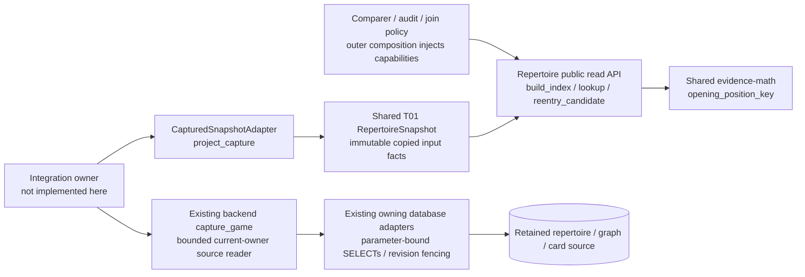

# Read-only repertoire index and capture projection

This is the source implementation for #483 / T02, SPEC v0.2 P01/P02, G01 and
C02's route facts. It is not wired into the live product. No Study effect,
conflict resolution, content edit, migration, provider or engine runs here.

The public API in [__init__.py](__init__.py) is:

- `build_index(RepertoireSnapshot) -> PositionIndex`: consumes the shared
  [T01 interface 0.2.0](../contracts/product_v02/repertoire.py), revalidates and
  copies it into immutable tuples, frozen records and read-only mappings.
- `position_key(repertoire_id, full_fen, variant='standard') -> PositionKey` and
  `index.lookup(...) -> PositionNode | None`: board, turn, castling, legal EP and
  repertoire define exact identity. Clocks are ignored for lookup. Original
  full route FEN, ordered history, variant, color and source revision survive.
- `node.selected_response`, `node.own_responses`, `node.conflict`,
  `node.opponent_edges`, and `node.occurrences`: one lookup node can retain many
  authored routes. Conflicts have no selected winner. Opponent forks are valid.
- `index.routes[(repertoire_id, route_id)]`: ordered occurrences including the
  final boundary. `index.adjacency` relates consecutive learner decisions only
  within the same route, with their actual moves and intervening opponent cue.
  It does not authorize a join or prove Study eligibility.
- `index.reentry_candidate(...) -> RouteOccurrence | None`: requires one legal
  selected response, one route occurrence, one explicit current physical mapping
  and a supplied reentry authority. It makes no lapse or introduction decision.
- `project_capture(retained_owner_capture, comparison_game=None) -> RepertoireSnapshot`
  and `CapturedSnapshotAdapter(capture_callable, comparison_game=None).snapshot(repertoire_id)`: adapt one
  existing bounded owner read. Outer composition binds the selected game and
  injects the callable. Nothing in this module imports a sibling implementation.

`occurrence.binding` is the existing shared `DecisionPresentation`, or `None`
when missing/ambiguous. Its presentation ID is the actual physical card ID in
this current-owner adapter. It is never a position-key alias. `route_id` and
zero-based `route_ply` restrict the mapping to the exact proven occurrence. An
unbound transposed route stays unknown while its mapped neighbour retains its
physical evidence. A paired null route scope remains an explicitly global
owner mapping. All competing applicable mappings remain in `occurrence.bindings`.

## Ownership and source boundary



The diagram describes this source boundary and its existing capture dependency;
product composition and deployment/resource isolation remain unverified.
Repertoire owns index policy. Existing capture/storage owners retain complete SQL,
connection, transaction, revision and traversal authority. Study owns all
introduction evidence, schedules, queues and mutations. Optional consumers do
not become a Study dependency.

The existing donor conflict scanner remains untouched: it silently stops on an
illegal tail and lacks route occurrences. This index reuses the public
`tempo_evidence_math.opening_position_key` instead of copying that normalization.
The existing read capture already supplies finite consistent route/card/graph
facts, so no new SQL projection is added. Capture owns 64-row pages, the
32,768-row / 520-page / 20-second / 32-MiB traversal budget and per-stream
revision checks. This adapter accepts at most 32 MiB, 64 retained candidate
routes, 128 cards and 256 graph bindings. Each route has at most 1,000 plies. A supplied whole-catalogue index is bounded
to 10,000 routes and 100,000 total plies; exceeded bounds fail explicitly before
index allocation. Occurrences share an immutable route move tuple and materialize
ordered history on access, avoiding quadratic retained prefix copies.
It keeps no connection or cursor.

An actual `capture_game` result is a complete *decision scope*, not the whole
repertoire catalogue. Its `catalogue_scope` public proof supplies exhausted
stream manifests and retained candidate IDs. The snapshot scope identifies that
capture and binds the exact game ID/content/moves/root/color. The public scope
proof's exclusive-policy anchor fences physical mappings before any omitted
ended/diverged competing policy ceases to apply. Callers must acquire a
whole-catalogue owner snapshot for a global audit.
This module never resumes the graph migration or reads live data itself.

## Diagnostics, identity and safe unknowns

`index.diagnostics` is deterministically ordered by repertoire, route, ply and
code. `index.mapping_diagnostics` separately reports missing or ambiguous physical
mappings without mislabeling valid authored content as incomplete. Illegal moves retain only the legal prefix with `illegal_move`; that route
is incomplete and its last retained position is not a deliberate terminal.
Invalid starting positions, unsupported variants, incomplete route boundaries,
ambiguous physical mappings, invalid reentry plies and own-response conflicts
are explicit. `index.complete` is false for unavailable/incomplete source or any
such diagnostic. A terminal-only occurrence has no own response and cannot
prove missing content. Unsupported variants produce no normalized nodes.

Physical mapping needs an explicit same-generation graph reference to that
route and card, matching color and the exact ordered legal executable at one
unambiguous route root. Card existence, matching FEN or SAN alone never binds
anything. Missing, duplicate, stale, archived, deleted or ambiguous evidence
remains unknown. The index does not decide forgetting or compare game time.
The [T01 route/game addon](https://github.com/aaweaver-actuary/tempo/pull/516)
retains the exact route occurrence and game-scoped Study chronology. UTC
introduction instants remain intact. A supplied Study `introduced_before_game`
boolean can survive a day-only stored date with `introduced_at=None` when
`comparison_game` supplies the exact canonical source. The adapter checks game
ID, provider, learner color, normalized root/moves and occurrence time against
the retained capture. It copies source revision/digest into `introduction_game`;
callers/comparers must match all four scope fields before using the boolean.
Missing exact source or nonboolean Study evidence remains null/null. The retained
`chess.com` importer namespace and product `chesscom` namespace are the only
Chess.com aliases accepted for chronology scope. Only the scope provider is
normalized; original source provider, game identity, revision and digest remain
unchanged. Unknown provider spellings are rejected. No timestamp
is fabricated. Legacy capture has neither original PGN bytes nor a source
revision label: composition authenticates those supplied canonical provenance
facts; this adapter cannot authenticate absent original bytes. `available` is true only after explicit
membership, availability flags and exact graph/executable checks.
`introduction_matches_current_content` preserves a supplied owner fact; without
one, only the donor's original physical revision 1 compatibility invariant is
retained. A changed revision requires explicit Study evidence.

Capture revision changes, changed digests, unknown completeness, unsupported
canonical-prefix captures, wrong requested scope and exceeded bounds raise
explicit `ValueError` reasons. `membership.revision` is the positive captured
graph generation; `source_revision` hashes the full authority token, including
its scope source revision and catalogue generation. This avoids mistaking a
single generation number for all source identity.

## Focused validation and regression ownership

Run only the named component files:

```sh
make python-file FILE=backend/tests/test_product_position_index.py
make python-file FILE=backend/tests/test_product_snapshot.py
```

Use an existing Python environment with chess, Pydantic and pytest plus these
source paths: `packages/{evidence-math,chess-core,game-review-contracts}/src` and
`contracts/game-evidence/src`. No software installation or live database is
needed. The implementation checkpoint used a task-owned interpreter wrapper to
supply these package paths and held/released the existing nontruncating advisory
validation lock. Runtime/dependency registration belongs to integration #488.

The index file owns the issue's named identity/transposition/conflict/opponent
fork/terminal/illegal-tail/mapping/immutability acceptance cases and explicit
reentry tests. The snapshot file owns consistent revision and read-only capture,
physical identity, game-scoped day-precision chronology without fabricated
timestamps, route-only binding, introduction unknowns, source bounds and
wrong-scope tests.
No existing helper changed, so unchanged donor identity/conflict tests are reused
as retained evidence, not rerun or claimed as newly tested. The changed import
boundary uses T01's scoped dependency guard. Actual provider, PostgreSQL,
product/browser and live acceptance remain integration-owner work.
