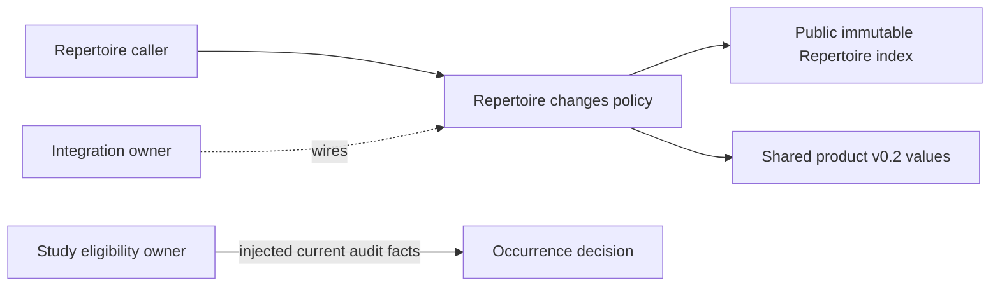

# Approved repertoire changes (#492)

Implemented source, unmerged and not wired to live product. `conflict_report`
uses #483's public `build_index(RepertoireSnapshot)` with #482 values; it reports
exact repertoire/position, competing UCI responses, route/ply, mapped presentation
IDs, source revision/digest and all invalid-source diagnostics. Invalid input is
never a clean certificate. `study_eligibility` requires the current exact source
fence and returns occurrence-local denial/suspend-without-lapse facts. Study owns
actual suspension; there is no recall or schedule write here.

Policy imports neither transport, SQL, optional producer nor Study internals.
Content edits and training presentation regrouping remain separate. No physical
card identity is inferred from FEN, SAN or route equality. Root wiring and Study
hooks are reserved for their existing owners; the shared engine/proposal seam is
pending #482. No engine is launched by this module.
