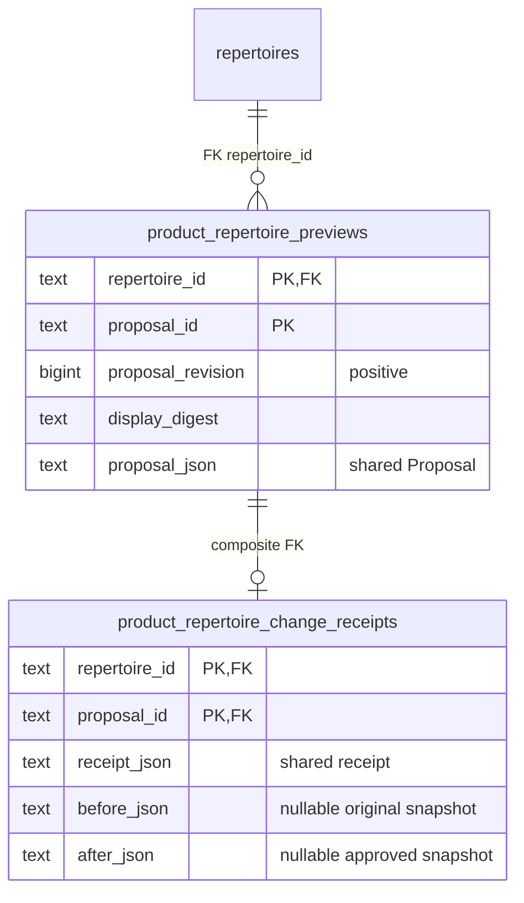
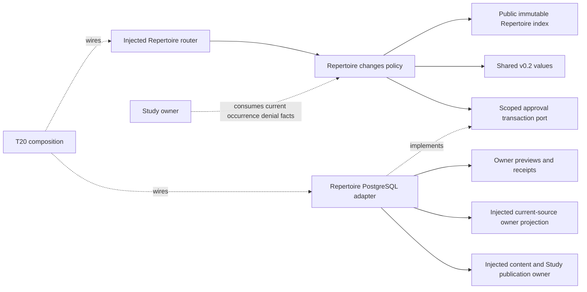

# Approved repertoire changes — #492

Implemented source, unmerged; product wiring and live behavior are unverified.
Repertoire owns approved moves, conflicts, proposals and approval receipts. Study
owns every schedule, review, active attempt, queue occurrence and physical-card
publication. Content approval is distinct from R11 presentation regrouping.

## Public interfaces

`application.py` consumes #482's immutable `RepertoireSnapshot`, `Proposal`,
`ProposalDecision` and `RepertoireChangeReceipt`; it uses #483's public
`build_index`. It defines no competing shared proposal/card DTO.

- `conflict_report(snapshot) -> ConflictReport`: exact repertoire/position,
  competing UCI responses, affected route/zero-based ply and supplied presentation
  IDs, source label/revision/digest and deterministic diagnostics. `clean` is
  false for unavailable, incomplete or invalid source. Mapping unknown stays
  unknown. A physical identity is never inferred from FEN, SAN or route equality.
- `study_eligibility(snapshot, repertoire_id, route_id, ply, source_revision,
  revision, digest) -> EligibilityDecision`: requires an independently current
  source fence. Denies stale/unpublished results and malformed target routes;
  response conflicts deny only affected occurrences. Returns
  `suspend_without_lapse=True`; Study must enact it without Again. Other routes
  and repertoire memberships remain available. This pure function does not
  publish eligibility or mutate an active attempt.
- `manual_resolution(snapshot, repertoire_id, position, selected_uci,
  proposal_id) -> Proposal`: shows the exact winner and all losing-route changes,
  including before/after PGN in the explanation. Each losing route retains its
  original prefix, selects the winner and ends there. It never grafts a losing
  tail onto a different move. Original routes/tails stay in receipt evidence;
  unaffected routes and opponent forks are preserved. Repeated identical-position
  occurrences within one route require an explicit unambiguous edit.
- `validate_proposal(snapshot, proposal) -> ValidatedChange`: binds current source
  revision/digest, every displayed edit and new card, legal full-route PGN and the
  one-own-response invariant. No newly conflicting material can publish. Another
  pre-existing conflict can remain blocked while one selected conflict resolves.
  Changed mappings lose availability/current-content proof until the publication
  owner revalidates them; old reentry grants on changed routes are cleared.
- `RepertoireChanges(store)` implements shared `RepertoireChangePort.preview` and
  `.decide`, with named `preview_change`, `accept_change`, `edit_proposal`,
  `dismiss_proposal` entry points. A store instance is scoped to one repertoire.
  Preview and edit never publish; edit increments the proposal revision and
  requires fresh acceptance. Dismissal only writes its decision receipt. Replay
  of the exact accepted decision returns the original receipt. Reused identity
  with changed display/revision/content conflicts.
- `http.routes(changes_factory, snapshots)` returns an injected router at
  `/api/product/repertoires/{repertoire_id}/{conflicts,changes/preview,changes/decide}`.
  Root registration belongs to #501. Invalid wire values return 422 and owner
  freshness/invariant conflicts return 409. Strict shared values are parsed from
  JSON so immutable tuple fields work with HTTP JSON arrays.

Engine-backed edits require supplied explicit candidate evidence at the exact
start FEN/history/target FEN/variant/learner side. Best and candidate must have
comparable conclusive learner-oriented CP scores and depth, and loss must meet
30 CP (or a displayed explicit contract threshold adjustment). Mate, missing
scores, unmatched context and an absent explicit candidate do not authorize an
edit. Engine-free structural resolution may only choose an already-existing
response at a diagnosed conflict. This module launches no engine or provider.

Displayed additions must be exact legal subroutes of the resulting approved
content. Existing update/reuse actions also need explicit current presentation
identity/revision. Only the injected content/Study publication owner may create,
update or reuse physical cards and preserve their history. A snapshot alone does
not prove a complete current physical-card executable; that final owner check is
required in the publication command.

## Current import/edit guard coverage

Reserved existing entries now call the same pure `validate_source_rows` before
source changes: `pgn_import_commands.admit_pgn_import`,
`branch_commands.add_repertoire_branch`, `card_commands.revise_card`, and
`integrity_repair_commands.resolve_integrity_issue`. The new owner storage
projection locks the existing repertoire row and reads at most 10,001 source
lines/current opening-card memberships, rejecting overflow. Imports keep their
existing main-repertoire lock; repairs keep their existing graph-task-first lock.
Per-card edits lock repertoire IDs in sorted order before existing card locks.
No old card/history writer was rewritten. New commands return
`conflict_pending_resolution` before importing competing alternatives. The
existing operation payload is not discarded; UI retention/manual import-preview
resolution is still an integration task, not an automatic winner selection.

`app.chess.pgn.parse_pgn` rejects parser-recovered illegal tails rather than
returning a falsely valid legal prefix. Legal lines/variations/annotations retain
existing behavior. Its existing root upload endpoint still needs #501's bounded
`ValueError` → 422 translation; no root file was edited here.

Still unwired: root router registration; current-owner snapshot/publication
composition; persistent import-preview UI; existing non-command SQLite repair,
analysis-paste, discovery acceptance and independent Content bridge importer.
`services/content/.../bridge/application.py::map_import` still builds accepted
own alternatives; it must not be exposed as a bypass around this approval owner.
There is no claim that every legacy mutation path is now covered. Existing
PostgreSQL graph/integrity invalidation and current-certificate fences remain in
place; their owning Study eligibility adapter still rejects stale publication.

## Transactions and stored evidence

`database/.../authored_repertoires/product_changes.py::PostgresChangeStore` borrows
the caller's connection and transaction. An inner psycopg transaction becomes a
savepoint; it does not independently commit a caller-owned command. The existing
repertoire row serializes current source/preview/approval writes. Lock timeout is
2 seconds, statement timeout 5 seconds; no worker/process/pool is created.

Composition injects a current-source reader and an owning publication command
using that **same connection**. Publication must enlist source and associated
content/Study additions atomically, preserve history/other memberships, and
supply the accepted source revision/digest. A no-op/un-enlisted publication
cannot receive an accepted receipt. Full before/after source snapshots and the
exact shared proposal remain retained as evidence; receipt insertion and source
publication roll back together.

`SCHEMA_SQL` is the exact two-table disposable-fixture/schema handoff. It is never
run on import or application startup. #501 must allocate an additive migration
number and coordinate its schema index/registration; no live migration ran.

Before/after snapshots are either both present (acceptance) or both absent
(dismissal). No FK or write to queue, reviews, schedules or physical cards is
introduced. This diagram describes proposed additive source DDL, not live schema.

Study integration must inject the read-only eligibility capability; it must not
import optional Games, probability, engine or proposal producers. The policy has
no database, HTTP, sibling-domain or composition implementation dependency. Shared
host/DB limits and actual product shutdown/resource isolation remain unverified.

## Focused verification and integration handoff

The regular owning suites are `backend/tests/test_product_repertoire_changes.py`
and `test_product_repertoire_changes_postgres.py`. Run each via
`make python-file FILE=...`. The latter requires `TEMPO_492_TEST_DSN` identifying
a task-owned local database named `tempo492`; it refuses an unspecified/non-task
target. It creates/removes only its unique schema. Native PG acceptance, replay,
revision race, publication/outer rollback, eligibility visibility and current
source membership reads are real. The content publisher is an explicit task-only
fake; normal Study suspension/card publication/browser integration are unverified.
No engine executes; engine cases use the shared synthetic contract fixture.

T20 receives the router factory, source reader/publisher requirements, two-table
schema handoff and current source guards. Central dependency registration must
make #482's analysis-jobs/game-review values and #483's evidence-math importable;
no dependency/lock/root changes belong to this PR. Register these two suites in
`tests/REGRESSIONS.md`, link this canonical drawing from the diagram index, and
adapt old storage-split fixtures that currently expect e4/d4 to both be accepted.
The existing #482 scoped product dependency guard covers the new directory.
A component pass is ready for scoped review, not A05 product completion.
