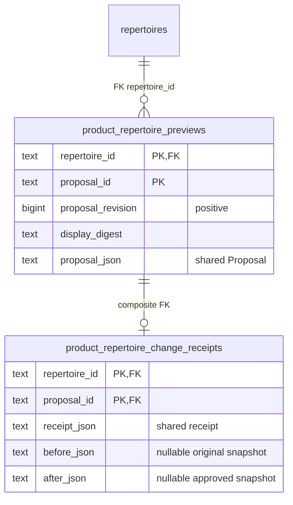
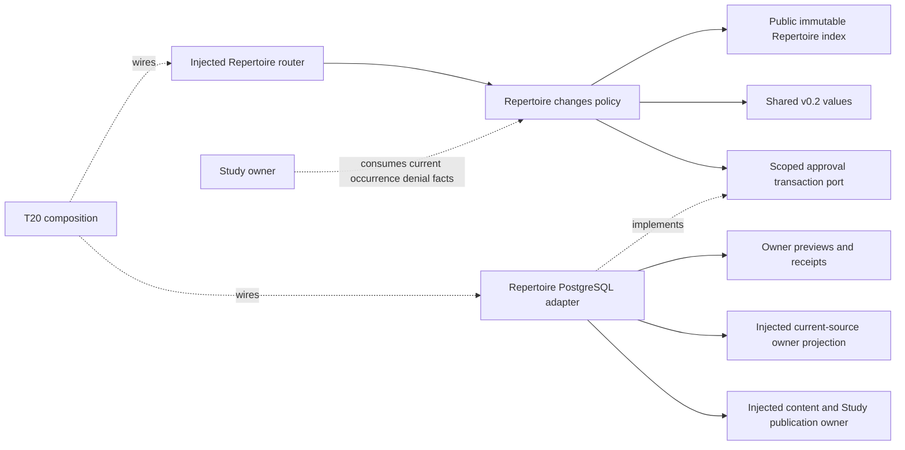

# Approved repertoire changes — #492

Implemented source, unmerged; product wiring and live behavior are unverified.
Repertoire owns approved moves, conflicts, proposals and approval receipts. Study
owns every schedule, review, active attempt, queue occurrence and physical-card
publication. Content approval is distinct from R11 presentation regrouping.

## Public interfaces

`application.py` consumes #482's immutable `RepertoireSnapshot`, `Proposal`,
`ProposalDecision` and `RepertoireChangeReceipt`; it uses #483's public
`build_index`. It defines no competing shared proposal/card DTO.

- `conflict_report(snapshot) -> ConflictReport`: exact repertoire/position,
  competing UCI responses, affected route/zero-based ply and supplied presentation
  IDs, source label/revision/digest and deterministic diagnostics. `clean` is
  false for unavailable, incomplete or invalid source. Mapping unknown stays
  unknown. A physical identity is never inferred from FEN, SAN or route equality.
- `study_eligibility(snapshot, repertoire_id, route_id, ply, source_revision,
  revision, digest) -> EligibilityDecision`: requires an independently current
  source fence. Denies stale/unpublished results and malformed target routes;
  response conflicts deny only affected occurrences. Returns
  `suspend_without_lapse=True`; Study must enact it without Again. Other routes
  and repertoire memberships remain available. This pure function does not
  publish eligibility or mutate an active attempt.
- `manual_resolution(snapshot, repertoire_id, position, selected_uci,
  proposal_id) -> Proposal`: shows the exact winner and all losing-route changes,
  including before/after PGN in the explanation. Each losing route retains its
  original prefix, selects the winner and ends there. It never grafts a losing
  tail onto a different move. Original routes/tails stay in receipt evidence;
  unaffected routes and opponent forks are preserved. Repeated identical-position
  occurrences within one route require an explicit unambiguous edit.
- `validate_proposal(snapshot, proposal) -> ValidatedChange`: binds current source
  revision/digest, every displayed edit and new card, legal full-route PGN and the
  one-own-response invariant. No newly conflicting material can publish. Another
  pre-existing conflict can remain blocked while one selected conflict resolves.
  Changed mappings lose availability/current-content proof until the publication
  owner revalidates them; old reentry grants on changed routes are cleared.
- `RepertoireChanges(store)` implements shared `RepertoireChangePort.preview` and
  `.decide`, with named `preview_change`, `accept_change`, `edit_proposal`,
  `dismiss_proposal` entry points. A store instance is scoped to one repertoire.
  Preview and edit never publish; edit increments the proposal revision and
  requires fresh acceptance. Dismissal only writes its decision receipt. Replay
  of the exact accepted decision returns the original receipt. Reused identity
  with changed display/revision/content conflicts.
- `http.routes(changes_factory, snapshots)` returns an injected router at
  `/api/product/repertoires/{repertoire_id}/{conflicts,changes/preview,changes/decide}`.
  Root registration belongs to #501. Invalid wire values return 422 and owner
  freshness/invariant conflicts return 409. Strict shared values are parsed from
  JSON so immutable tuple fields work with HTTP JSON arrays.

Engine-backed edits require supplied explicit candidate evidence at the exact
start FEN/history/target FEN/variant/learner side. Best and candidate must have
comparable conclusive learner-oriented CP scores and depth, and loss must meet
30 CP (or a displayed explicit contract threshold adjustment). Mate, missing
scores, unmatched context and an absent explicit candidate do not authorize an
edit. Engine-free structural resolution may only choose an already-existing
response at a diagnosed conflict. This module launches no engine or provider.

Displayed additions must be exact legal subroutes of the resulting approved
content. Existing update/reuse actions also need explicit current presentation
identity/revision. Only the injected content/Study publication owner may create,
update or reuse physical cards and preserve their history. A snapshot alone does
not prove a complete current physical-card executable; that final owner check is
required in the publication command.

## Current import/edit guard coverage

This branch ports the previously qualified private C1 owner from PR #520 onto
integration `adfc8de8` (including merged #553 and #554). It does **not** claim
that the old shared command hooks are already present on this integration base.
The current importer already rejects conflicting/invalid sources through
`pgn_import_validation.validate_sources` before writes, preserves main selection,
and retains its failed command payload. Its parser rejects illegal tails.

Three existing C1 regressions demonstrate missing shared hooks in
`branch_commands.add_repertoire_branch`, `card_commands.revise_card`, and
`integrity_repair_commands.resolve_integrity_issue`. The old owner branch has
those narrow guards; adopting them requires the shared-file reservation. No
shared command file was changed in this checkpoint. These failures remain
visible; the focused passing selection explicitly excludes those three cases.
Root router/schema registration and Study suspension remain #501's responsibility.

## Transactions and stored evidence

`database/.../authored_repertoires/product_changes.py::PostgresChangeStore` borrows
the caller's connection and transaction. An inner psycopg transaction becomes a
savepoint; it does not independently commit a caller-owned command. The existing
repertoire row serializes current source/preview/approval writes. Lock timeout is
2 seconds, statement timeout 5 seconds; no worker/process/pool is created.

Composition injects a current-source reader and an owning publication command
using that **same connection**. Publication must enlist source and associated
content/Study additions atomically, preserve history/other memberships, and
supply the accepted source revision/digest. A no-op/un-enlisted publication
cannot receive an accepted receipt. Full before/after source snapshots and the
exact shared proposal remain retained as evidence; receipt insertion and source
publication roll back together.

`SCHEMA_SQL` is the exact two-table disposable-fixture/schema handoff. It is never
run on import or application startup. #501 must allocate an additive migration
number and coordinate its schema index/registration; no live migration ran.



Before/after snapshots are either both present (acceptance) or both absent
(dismissal). No FK or write to queue, reviews, schedules or physical cards is
introduced. This diagram describes proposed additive source DDL, not live schema.



Study integration must inject the read-only eligibility capability; it must not
import optional Games, probability, engine or proposal producers. The policy has
no database, HTTP, sibling-domain or composition implementation dependency. Shared
host/DB limits and actual product shutdown/resource isolation remain unverified.

## Focused verification and integration handoff

The regular owning suites are `backend/tests/test_product_repertoire_changes.py`
and `test_product_repertoire_changes_postgres.py`. Run each via
`make python-file FILE=...`. The latter requires `TEMPO_492_TEST_DSN` identifying
a task-owned local database named `tempo492`; it refuses an unspecified/non-task
target. It creates/removes only its unique schema. Native PG acceptance, replay,
revision race, publication/outer rollback, eligibility visibility and current
source membership reads are real. The content publisher is an explicit task-only
fake; normal Study suspension/card publication/browser integration are unverified.
No engine executes; engine cases use the shared synthetic contract fixture.

T20 receives the router factory, source reader/publisher requirements, two-table
schema handoff and current source guards. Central dependency registration must
make #482's analysis-jobs/game-review values and #483's evidence-math importable;
no dependency/lock/root changes belong to this PR. Register these two suites in
`tests/REGRESSIONS.md`, link this canonical drawing from the diagram index, and
adapt old storage-split fixtures that currently expect e4/d4 to both be accepted.
The existing #482 scoped product dependency guard covers the new directory.
A component pass is ready for scoped review, not A05 product completion.

## Retained owner binding over the shared read

`retained.py::current_snapshot` is a direct re-export of snapshot owner #483's
`database/.../authored_repertoires/product_snapshot.py::current_snapshot` from
published `4198bfc8`. #511's `668d3af5` chronology alias fix is consumed unchanged.
The temporary T11 snapshot query/projection was removed. No denied #483 draft-PR
metadata was reproduced; the source branch is the dependency.

`retained_changes(borrowed_database, repertoire_id)` constructs the actual owner
service using that read and `publish_validated_change`. Composition binds this
factory and implements no domain mutation. Shared snapshot revision/digest and
bare authored-line route IDs remain authoritative. Existing graph-task →
transition-reservation → graph → repertoire lock order is preserved. Preview
locks/reads and stores its preview only; it queues no graph work.

`RetainedChanges.preview_resolution(position=..., selected_uci=...,
proposal_id=...)` is the production manual-resolution entry. It obtains the
shared snapshot and current physical definitions from #483's **same public
`read_repertoire` facts read**, then produces the complete shared Proposal. Card
facts use existing immutable `DisplayedCardChange(reuse, id, revision, full
executable)` values as owner-supplied current-content facts; these are not
inferred learning/decision mappings. This is important when a conflicted source
has no available graph mapping. The policy still does not infer physical identity
from equal positions.

The preview lists every affected authored route and required physical-definition
update, with actual identity/revision and exact resulting executable. Generic
preview/edit/accept validate those current definition facts through the owning
transaction port. Omitting a required update or supplying another update is
refused by the retained publisher. C adopts only one manual existing-response
selection at a time; engine proposals and independent additions remain safely
refused at this retained binding.

Publication requires an enclosing PostgreSQL transaction, rereads the shared
source fence and exact current line/card definitions, and invokes the existing
canonical prefix checks, `integrity_repair_commands._replace_repertoire_line`,
`repertoire_integrity._rewrite_card`, route certification and integrity
invalidation. The old card/history and other memberships survive; a shared card
owner is reassigned only to its remaining membership so ownership fallback cannot
keep the old conflict in the resolved repertoire. Unrelated route/queue/review
state is untouched. No shared command hook needed editing.

Only the existing normal current-content graph refresh is requested; no worker
or held migration executes. Canonical writers may replace/coalesce IDs and
advance source revision more than once. The receipt retains the actual shared
reread revision/digest and after snapshot. Exact approved content still has to
match, and original before evidence remains immutable. Invalidated route-local
mappings are removed from the hypothetical after view rather than rebound.

Changed native cases use the actual #483 reader, canonical line/card writers and
source-revision trigger on disposable PostgreSQL. Only graph enqueue is a fake
capability. The same shared read passes a real READ ONLY transaction through the
T11 binding; unknown chronology/availability follows #483's law. The binding adds
no model/query or alternate card-route projection. Its physical-definition
traversal is bounded to 1,000 plies per card and 100,000 aggregate plies, using
#483's existing row/byte/source bounds.

The retained adapter's lazy imports reuse same-owner legacy root helpers and
still have their existing command-registration side effect. Pure policy stays
independent of that compatibility binding. No sibling-domain or app.main import
is introduced. Root/schema/test registration, actual Study suspension and normal
product/browser acceptance remain integration-owned. Authored-route auditing and
physical-definition update authority are kept distinct; card-only legacy issues
still retain the existing integrity-report owner rather than a second snapshot.

## Retained conflicted import (C2)

**Owner checkpoint; explicit-command hook and native execution pending.**
`imports.py` is the public facade; the borrowed PostgreSQL adapter is
[`product_imports.py`](../../../../database/tempo_legacy_database/adapters/authored_repertoires/product_imports.py).
There is no new table, importer, worker, connection factory or Study writer.

- `retained_imports(database).read(operation_id) -> RetainedImport` reopens a real
  terminal `repertoire_conflict` receipt. The original command, hash, payload and
  rejection stay exact evidence. Discarded, complete, non-import, non-conflict or
  hash-mismatched receipts fail closed. A browser fingerprint is not authority.
- `.preview(operation_id, tuple[ParsedLine, ...]) -> ImportPreview` takes manually
  supplied resolved lines. It recomputes all segment/count identities with the
  existing importer, validates against the current target and shows every exact
  proposed line/annotation/card addition or reuse, including tombstone exclusions.
  Original alternatives remain in the retained evidence. Opponent branches are
  retained when supplied; the owner never chooses a winner. Existing target
  source is not rewritten by this import; C1 handles an existing-source conflict
  first, followed by a fresh C2 preview.
- `preview.approval_payload(new_operation_id) -> dict` binds the full display,
  original request, current target/source fence and current card definitions.
  Editing means a fresh preview/digest and explicit acceptance. New repertoire
  identity is truthfully unknown until admission. The caller retains one stable
  new operation ID for duplicate/lost-response delivery; it cannot reuse the
  immutable failed original ID.
- `apply_approved_import(database, payload) -> dict` requires the caller's owning
  transaction. It shares discard's original-operation advisory fence, imports'
  main-selection fence, then the existing graph/transition/repertoire lock order
  for an existing target. It reopens and reconstructs the entire preview, refuses
  changed targets/source/evidence/display/body, and invokes the existing explicit
  importer on the same borrowed transaction. It never edits the rejected receipt.

The integration hook is deliberately small: `pgn_import_commands.explicit_pgn_import`
must delegate payloads containing `retained_import_preview` to
`apply_approved_import`; ordinary payloads keep the existing path. Until that
shared hook is admitted, **do not dispatch C2 approval payloads to the normal
command**: the old payload model ignores unknown fields. The private facade is
usable for preview/owner composition; the assembled dispatch is not ready.
#501 owns transport/UI and uses `imports.pgn.explicit` with the stable new
idempotency key. Its existing gateway provides same-result replay and atomically
commits the importer result. Keeping that command name preserves #553's exact
receipt-scoped graph/integrity admission. No optional work is broadly resumed.

```mermaid
sequenceDiagram
  participant UI as #501 transport/UI
  participant Owner as Repertoire C2 owner
  participant Receipt as Existing command receipts
  participant Importer as Existing explicit importer
  UI->>Owner: read(original operation), preview(manual resolved lines)
  Owner->>Receipt: Read rejected payload/hash/error
  Owner-->>UI: Exact lines/cards + current source fence + display digest
  UI->>Receipt: Approved payload under stable new operation ID
  Note over Receipt,Owner: Shared explicit-command hook still pending
  Receipt->>Owner: apply_approved_import in owning transaction
  Owner->>Receipt: Recheck retained original under operation lock
  Owner->>Importer: Existing explicit importer, same transaction
  Importer-->>Receipt: Saved, preparation pending; no readiness bypass
  Receipt-->>UI: Same durable result on duplicate delivery
```

The changed owner proof uses synthetic Black branching PGN, never Andy's absent
Taimanov file. The pure/adapter suite and scoped boundary guard ran; native C2
was collected only. `test_native_retained_import_approval_retry_and_outer_rollback`
in the existing PostgreSQL suite reuses `test_product_game_lapse_postgres`'s capped
fixture and real gateway/importer. Its only handler wrapper represents the pending
shared hook, so even an eventual pass establishes owner composition, not root/UI
assembly. It asserts held import without activation, reload read, exact approved
branches, saved/pending status, main/history/active attempt/accepted game receipt
preservation, same-result retry and outer rollback with no completed receipt.
Native stale-source and publication races remain to execute at the same boundary.
The existing approved fixture follows the checked-in PostgreSQL migration registry
(current main is schema53, including module050). Current main through #559 at
`39796fd1` is merged into this feature branch because its queue/presentation and
accepted-game-effect changes affect the protected-state proof. The native test
sets its disposable settings timezone to UTC rather than inheriting host-local
time. The final node collects without a database. Its execution remains blocked
by capacity: the observed other-owner disposable stack already reserves the full
2-CPU development ceiling. Do not stop or reuse that stack; its coordinator must
release capacity before this existing capped fixture can run. No container,
credential or database was created during this qualification attempt.
