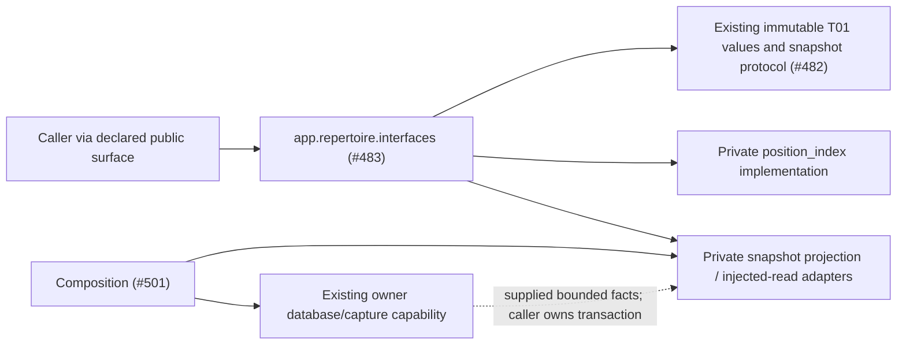

# Repertoire public interface

Owner: **#483**, repertoire lookup and immutable snapshot projection. Import from
`app.repertoire.interfaces`. This first-wave surface reuses the published owner
implementation at `f8457511`; it does not activate an unmerged runtime.

| Operations / values | Supported contract |
| --- | --- |
| `position_key`, `PositionKey` | Repertoire-scoped exact position identity; clocks ignored, legal en passant preserved. |
| `build_index`, `PositionIndex`, `PositionNode`, `RouteOccurrence`, `RouteAdjacency`, `Diagnostic` | Deeply immutable bounded route lookup, conflicts, explicit mapping and reentry evidence. No content selection or mutation. |
| `project_capture`, `CapturedSnapshotAdapter` | Validate and project supplied bounded game-capture facts; game chronology stays bound to its exact source. |
| `project_repertoire`, `CurrentSnapshotAdapter` | Project supplied bounded current authored facts, including conflicts and unknown learning/chronology facts. |
| `project_published_repertoire`, `PublishedSnapshotAdapter` | Feedback view using an explicit ready graph generation; absent publication fails instead of borrowing the authored counter. |
| `RepertoireSnapshot`, `RepertoireSnapshotPort`, `DecisionPresentation`, `IntroductionGameScope`, `RouteBoundary` | Existing T01 values/protocol from `app.contracts.product_v02.repertoire`, re-exported explicitly with class identity and wire format preserved. No duplicate DTOs. |

All lookup/projection operations are typed existing functions/classes. The three
adapters implement `snapshot(repertoire_id) -> RepertoireSnapshot` using an
injected owner callable. Only composition selects these adapters and supplies the
read/capture capability. Importing this surface opens no connection, starts no
provider/worker/engine and imports no application root or storage adapter.

No operation here owns a transaction, content edit, Study effect, queue, schedule
or process lifecycle. Content acceptance remains #492's separate owner interface;
this read-only surface grants no write authority. The existing database-owned
`product_snapshot.reserve_current_snapshot` remains a concrete composition
capability, with its unchanged borrowed writer transaction/rollback contract.
It is deliberately not pulled into a domain import. Its native qualification
remains pending; this mechanical interface change adds no reservation semantics.

## Remaining migration edges

This directory is **public-surface preparation, not completed decoupling**.
The exact first-wave lease contains only this README, `__init__.py` and
`backend/tests/test_public_surface_repertoire.py`; existing callers are not
silently changed outside that allocation.

- `app.repertoire.__init__` is the old compatibility surface (owner #483).
  Its aliases remain until declared callers migrate and #482's dependency/export
  negative controls pass. Importing the new Python subpackage still initializes
  that existing parent package; the cold-import proof covers this path too.
- `database/tempo_legacy_database/adapters/authored_repertoires/product_snapshot.py`
  imports `app.repertoire.snapshot` directly in three projection operations.
  The exact mechanical replacement with this interface is supplied to #501;
  composition/root and external consumer imports remain their owners' work.
- `position_index.py` and `snapshot.py` still reference canonical T01 contracts
  under `app.contracts.product_v02.repertoire`. `snapshot.py` additionally uses
  `tempo_game_review_contracts` and `tempo_game_evidence_contracts.legacy` values
  and provenance helpers. These existing wire origins stay explicit until #482
  publishes compatible contract interfaces and the allocated caller phase lands.
- Both private files use the existing pure
  `tempo_evidence_math.opening_position_key` normalizer. This is an existing
  repertoire-to-evidence-math edge outside the manifest's target chess/wire DAG,
  not a newly declared dependency. Owners #483/#486/#494 must route that exact
  helper through the agreed chess interface or correct the manifest explicitly;
  no copied position algorithm or guessed public import is introduced here.

The new test proves explicit exports and object identity, fresh-import absence
of infrastructure startup, existing snapshot-adapter semantics and immutable
lookup through this surface. Existing focused index/snapshot suites preserve the
algorithm evidence. Whole-graph dependency/export-bypass negative controls belong
to #482 and must run after its checker and sibling surfaces are available; a
local import pass does not certify their completion or deployment isolation.
