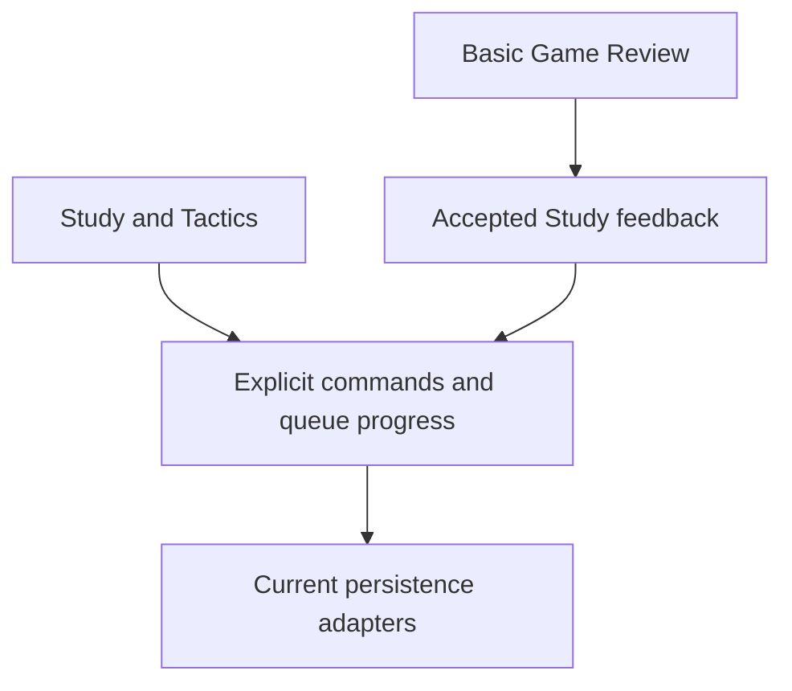

# Retained backend composition

This directory contains the serving Study, Tactics, repertoire authoring and minimal
Game Review composition. The November 10 reduction removes the retired Coverage,
Explorer/Maia, Discovery, proposal/similarity analysis and Defense producer code.
Those implementations and their exclusive tests remain available in Git history.

## Retained responsibilities

| Responsibility | Current implementation |
| --- | --- |
| Study queue, issuance and review effects | `queue_application.py`, `queue_next_card.py`, `postgres_queue_refresh.py`, `learning_review_adapter.py`, `review_service.py` |
| Authored repertoire import and integrity | `analysis_paste.py`, `canonical_prefix.py`, `opening_graph.py`, `repertoire_integrity.py`, `repertoire_move_verification.py` |
| Tactics capture and practice | `tactic_capture.py`, `tactical_catalog.py`, `puzzles.py` |
| Current accepted Game Review feedback | `real_game_feedback_adapter.py`, `legacy_study_remediation.py`, explicit `product_composition` bindings |
| Durable commands and bounded queue progress | `durable_tasks.py`, `background_wakes.py`, `queue_refresh_wakeup.py` |

`analysis_paste.py` is user-supplied SAN/PGN authoring, not an engine or a proposal
producer. Its retained name does not imply a live analysis subsystem.

## Remaining reduction boundaries

Physical placement does not establish independent ownership. Shared queue, source,
receipt and transaction code still lives in the legacy database package. Remove
out-of-scope producer callbacks at the caller before extracting a smaller retained
persistence owner; a package rename alone does not remove those dependencies.

The user has accepted downtime and temporary Study regressions during this broad
source reduction. That does not reset authored repertoire content, learning
progress or existing receipts. This source description makes no claim that the
candidate has been installed or that a live database was changed.

## Retired advisory prefix workflows

Prefix evaluation/comparison/transition, diagnostics, canonical-prefix preview
and save, advisory segmentation production, and the operator-only opening graph
recovery tree are removed. Saved canonical scope reads and line validation remain
for existing authored repertoires. Normal graph rebuild and integrity completion
request the current Study queue directly. Generic command receipts no longer have
a prefix-transition lifecycle.

Deployment requires PostgreSQL migration 063. It removes the obsolete structural
scope-check triggers while preserving application/fence history and the shared
queue/permanent-deletion serialization guards. No current content or review rows
are deleted by that migration.
