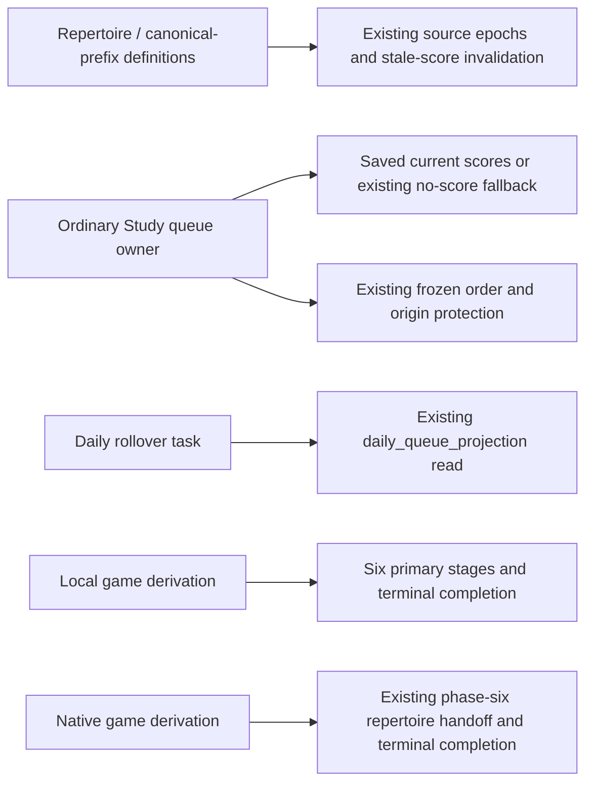

# Remaining legacy backend services

**MAIN source; organization unfinished; deployment unverified.** This flat namespace still contains application policies, concrete workflow composition and background orchestration that need logical owner placement and mixed-function splits. The [202-module checklist](../../ORGANIZATION.md) records actual progress and remaining work. A whole mixed hub moved to a new folder would not close its responsibilities or dependencies.

| Existing cluster | Current examples / canonical extracted leaves |
| --- | --- |
| Games orchestration | `game_sync.py`, `game_sync_coordinator.py`, `game_findings.py`; extracted [Games ingestion/providers](../games/README.md). |
| Authoring / repertoire | `repertoire_coverage.py`, `repertoire_integrity.py`; extracted [Discovery acceptance](../authoring/discovery/README.md). |
| Study queue/review | `queue_application.py`, `review_service.py`, `postgres_queue_refresh.py`; extracted [Study opening/feedback policy](../study/README.md). |
| Analysis / Tactics / Defense | `analysis.py`, `tactical_catalog.py`, `tactical_opportunities.py`, `threat_pipeline.py`; extracted neutral [chess calculations](../chess/README.md). |
| Durable/background operations | `durable_tasks.py`, `background_runtime.py`, `activity_gate.py`; current coordinator/resource ownership must be separated without changing timing or authority. |
| Authored Studies | `study_portable.py` and existing command/route composition; extracted [PGN preview/conflict policy](../studies/README.md). |

Database queries, drivers, DDL, native harnesses and database tooling belong in the single [root database tree](../../../database/README.md). Some legacy composition still imports concrete adapters or other application workflows; it remains explicitly pending and is not an accepted domain boundary. Study must acquire no Games dependency. New domain policy uses only its own internals, explicit contracts and neutral pure libraries; outer composition wires capabilities and lifecycle.

No consolidation is performed during this organization phase. Observed duplication/simplification questions stay in the one [running proposal list](../../../database/SIMPLIFICATION.md). Existing function behavior, SQL, transaction/lock order and resource authority remain the constraints on every split.

## Callable surfaces and remaining coupling

This directory is still legacy composition, not a plugin registry or a versioned
plugin API. [HTTP composition](../main.py), [worker composition](../tasks.py) and
[command registration/receipts](../command_gateway.py) wire retained functions.
Command names are explicit; an unregistered command is rejected before receipt
storage, not dynamically discovered.

| Current capability | Entry point and authority |
| --- | --- |
| Ordinary queue admission | [queue_admission.py](queue_admission.py) exposes `QueueAdmissionStore`, `plan_opening_admissions` and `admit_prioritized_opening_cards`; [queue_application.py](queue_application.py) composes the existing [QueueAdmissionAdapter](queue_admission_adapter.py). It borrows the caller transaction, reads saved candidates/scores, annotates frozen order and uses the existing queue writer and saved-opportunity resolution. |
| Foreground queue operations | [queue_commands.py](../queue_commands.py) registers `queue.issue_head`, `queue.prepare_next`, `queue.attempt_failed`, `queue.bury`, `queue.ensure_current`; the gateway owns receipts/transaction. The explicit prepare command reads/prepares outside its writer, then applies one selected owner unit after the operation/token fence in that borrowed writer; head/review transactions never call provider/projection preparation. |
| Per-game feature calculation | [statistics.py](statistics.py) retains `refresh_game_features`; [feature storage](../../../database/tempo_legacy_database/adapters/statistics/README.md) supplies inputs and the single canonical feature writer. It no longer materializes daily statistics. |
| Native game completion | [postgres_game_priorities.py](postgres_game_priorities.py) retains `execute_game_priority_handoff_slice`, registered by `tasks.py` as `game_derivation_priorities`. It advances the bounded repertoire cursor and completes the existing derivation; the legacy name does not mean an adaptive-priority producer survives. |
| Authored Discovery acceptance | [discovery_commands.py](../discovery_commands.py) retains `prepare_discovery_acceptance`, `accept_discovery` and `discovery.accept`. Recommendation/admission is separate from the retired opportunity feed/state/train producer. |
| Canonical source and coverage | [canonical_prefix_api.py](../canonical_prefix_api.py) retains preview/save commands and source validation/invalidation; [coverage_maia_commands.py](../coverage_maia_commands.py) retains `coverage.maia.claim`, `heartbeat`, `release`, `failure` and `submit` under the same `coverage.maia.` prefix, candidate publication and progress. Neither recreates retired refresh producers. |

**Coupling is reduced, not eliminated.** Removed producers no longer contribute
their import/callback/worker/recovery paths, but saved-score/opportunity readers,
shared graph/source facts, feedback callbacks, concrete database adapters and
legacy coordinator/activity-gate resources remain. New optional integrations
must be wired by outer composition through explicit owner capabilities; ordinary
Study must not import or wait for them, and queue/receipt/transaction ownership
must stay singular. Arbitrary plugin, resource and shutdown independence is not
proven by these removals.

## Retired optional capabilities

The unsupported Games guided-review server, command module, transport DTO and
exclusive adapter are absent after [#458](https://github.com/aaweaver-actuary/tempo/pull/458).
Ordinary Study guided attempts/review semantics are a different owner and remain.
Daily snapshot/insight materialization, `/api/statistics/daily/{day}/refresh`,
`statistics.daily.refresh` and associated workers/activity controls are absent
after [#461](https://github.com/aaweaver-actuary/tempo/pull/461);
`statistics.py` now provides per-game feature calculation.
[Guided server history and retained storage](../../../database/tempo_legacy_database/adapters/games/README.md)
and [current feature ownership](../../../database/tempo_legacy_database/adapters/statistics/README.md)
record these boundaries. The [fixed portable snapshot reader](../../../database/tempo_legacy_database/adapters/http_composition/snapshots.py)
still includes saved guided-review and daily-statistics history. Source retirement
does not drop tables, clear history, change graph/source ownership or establish
live deployment isolation. Opportunity and adaptive-priority removals are
documented in the canonical flows below.

## Immediate adaptive-priority callback cessation

**Implemented source; deployment unverified.** Seven immediate
adaptive-priority requests are removed from the six source paths below. This is
the remaining callback slice from #427 after #431 retired the legacy review
hook. The full producer retirement below subsequently removes its remaining
workers, admission and recovery paths.

```mermaid
flowchart LR
  prefix["Canonical prefix save"] --> definitions["Prefix values, source epoch and stale-score invalidation"]
  prefix --> graph["Existing repertoire game-refresh task"]
  prefix --> seed["Existing coverage seed request"]
  seed --> coverage["Explorer and Maia coverage publication"]
  coverage --> facts["Candidates, completion and progress"]
  coverage --> cursor["Existing native task cursor"]
  game["Native game derivation handoff"] --> completion["Existing per-repertoire cursor and derivation completion"]
```

Concrete owners are [`save_prefix`](../canonical_prefix_api.py),
[`submit_maia_node`](../coverage_maia_commands.py),
[`_publish_node`](postgres_coverage_explorer.py),
[`execute_coverage_node` and `submit_maia_coverage`](repertoire_coverage.py),
[`execute_game_priority_handoff_slice`](postgres_game_priorities.py).
The [coverage storage view](../../../database/tempo_legacy_database/adapters/coverage/README.md)
records the unchanged database owners and transaction boundaries.

Prefix/source certification, graph and repertoire definitions, source-epoch
triggers, coverage mathematics and stored candidates remain unchanged. The subsequent opportunity cut below removes that optional producer and its
callbacks; the earlier #454 receipt is not a claim that those callbacks remain.
Ordinary Study queue/review, frozen ordering and no-score fallback retain their
existing owners; no Study dependency on these optional producers is added.
Existing legacy cross-workflow imports and shared resources remain disclosed
above; this bounded removal does not establish full plugin/resource isolation.

The named regressions in [the regular inventory](../../../tests/REGRESSIONS.md#immediate-adaptive-priority-callback-cessation)
exercise primary prefix/coverage/game effects with adaptive enqueue functions
unavailable. SQLite and semantic fakes are source evidence; native PostgreSQL
locking, installed artifacts and deployment remain unverified.


## Opportunity production and optional API retirement

**Implemented source; deployment unverified.** The optional opportunity producer,
its exclusive storage and foreground state/train command module are removed.
The old code scored gameplay misses, coverage gaps and post-gap findings, refreshed
an auditable feed, and queued optional recommendations. Its eight feed/state/train/
refresh routes and all refresh callbacks/worker registrations are retired with it.
[Last-good source](https://github.com/aaweaver-actuary/tempo/tree/66d98610924971ea4cce3603c76cd4c330b50ae1/backend/app/services/repertoire_opportunities.py)
retains the algorithms and history; no archive or compatibility handler replaces it.

```mermaid
flowchart LR
  study["Ordinary Study queue owner"] --> queue["Existing queue-refresh adapters"]
  queue --> saved["current_repertoire_opportunities: saved weak-decision facts"]
  queue --> graph["Saved graph, card, membership and line facts"]
  builder["Opening graph build/publication owner"] --> graph
  segmentation["Segmentation projection"] --> source["Existing repertoire presence read"]
  local["Local game derivation: six primary stages"] --> features["Persisted game features"]
  features --> terminal["Existing completion write and Finished 6/6"]
```

The retained serving boundary is the existing
[opening eligibility projection](../../../database/tempo_legacy_database/adapters/queue_refresh/openings.py),
[admission/resolution writer](../../../database/tempo_legacy_database/adapters/queue_refresh/application/admission.py)
and [capacity projection](../../../database/tempo_legacy_database/adapters/queue_refresh/capacity.py).
Their SQL, stored tables/views and transaction/queue ownership are unchanged.
Normal unranked introduction works without a producer; an already saved active,
non-analysis weak decision remains eligible through the ordinary queue owner.
The exact repertoire presence read formerly shared with opportunity commands now
lives in its actual [segmentation adapter](../../../database/tempo_legacy_database/adapters/authored_repertoires/opening_advisory/segmentation.py),
using the same borrowed connection, SQL, parameters and result.

Graph/repertoire definitions, canonical source epochs/triggers and primary
coverage/game/Study effects remain. The separately owned Discovery acceptance and
recommendation path remains outside this cut. Existing legacy shared-storage and
cross-workflow coupling is still disclosed above; no new ownership or runtime
service dependency is introduced. Source retirement does not delete stored rows,
reset history, remove a graph recovery copy, or perform cutover.

Local game derivation completes after its six primary stages; its retired refresh
phase is removed from execution and progress accounting. Native game derivation's
existing seven-stage, bounded repertoire handoff protocol remains unchanged.

[Named retirement checks](../../../tests/REGRESSIONS.md#opportunity-producer-retirement)
cover physical module absence, normal missing-route/unknown-command rejection,
ordinary queue operation and saved-row eligibility. Five actual admission/cache
cases remain; three Maia/coverage cases move to their regular coverage suite.
Only tests/assertions exclusive to the removed producer/API are retired.
The owning Game Sync regression also runs all six real local stages and checks
persisted features, terminal state and progress without the optional producer.


## Adaptive-priority producer retirement

**Implemented source; deployment unverified.** The optional adaptive introduction
ranking producer is removed: coverage/personal/real-game evidence scoring,
coalesced refresh admission, preparation/jobs/generation publication, interrupted
job recovery and generation retention. The unused `introduction_priority`
repertoire response field and matching client schema field are removed. No
retained frontend consumer reads that field. The algorithms remain in
[Git history at the last producer source](https://github.com/aaweaver-actuary/tempo/tree/66d98610924971ea4cce3603c76cd4c330b50ae1/backend/app/services/introduction_priorities.py).



The saved-score/frozen-order readers in the queue adapters, canonical-prefix
invalidation, repertoire graph/source writes and physical epoch/trigger
structures are unchanged. Those surviving readers and invalidators still use
priority relations; producer removal does not authorize dropping their tables.
The native game handoff retains its cursor and terminal seven-phase protocol
although its legacy module name contains `priority`. The lifecycle adapter keeps
only its existing `daily_queue_projection` read for the essential rollover task.
No replacement producer, compatibility handler or cross-domain import is added.

[Named owning checks](../../../tests/REGRESSIONS.md#adaptive-priority-producer-retirement)
cover actual source absence, retained API/schema, saved scores, fallback/frozen
ordering, source invalidation, real game effects and local terminal completion.
The old producer-only cases and native benchmarks retire with their capability;
modified native fixture readers are source preparation, not native acceptance.
No migration, database/file cleanup, snapshot, service operation or deployment
is performed. Shared legacy resource coupling above remains unqualified.
