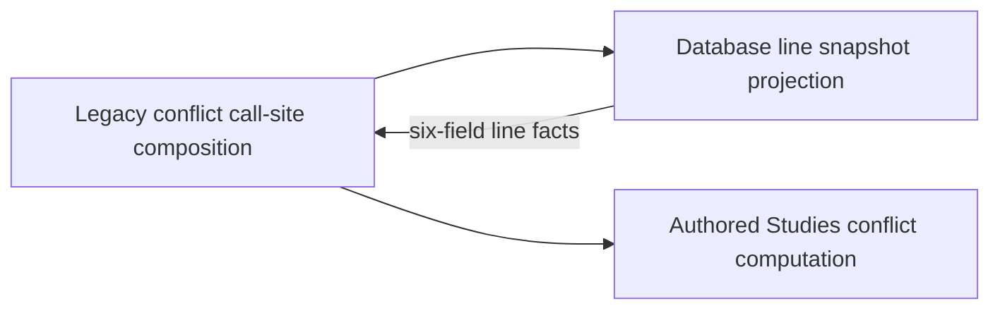
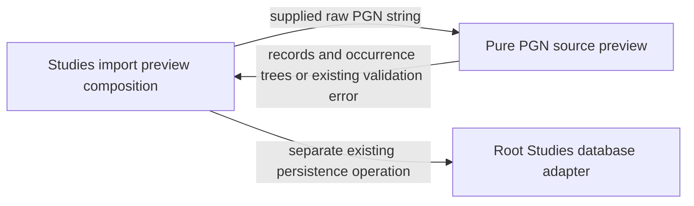

# Authored Studies policies

**Current unmerged source; deployment unverified.** Studies means authored/imported PGN chapters and exercises; saved repertoire authoring is not assumed to have the same meaning. Daily Study practice has its own [policy folder](../study/frozen_order/README.md); these owners are distinct.

[Repertoire conflict computation](repertoire_conflicts.py) takes supplied immutable line snapshots and returns the existing trained-move index/conflict records. Each snapshot row retains the original six positional fields: line id, repertoire id, name, trained color, starting FEN and moves JSON. Chess parsing, transposition/en-passant distinctions, invalid-line handling, ordering and the four-entry snapshot cache are unchanged. The public functions import only standard-library utilities and the external chess library.

[Legacy composition](../services/repertoire_conflicts.py) retains existing caller signatures and supplies the [database projection](../../../database/tempo_legacy_database/adapters/repertoire_lines.py) on the caller's connection/transaction. The new policy imports no database, HTTP framework, practice Study or sibling-domain implementation. Existing legacy consumers still use their old composition module; broader backend domain moves remain pending.

`backend/tests/test_repertoire_conflicts.py` retains the original cache, conflict and en-passant assertions and adds a fresh-interpreter import boundary guard. Database source tables/keys/fields remain in the [legacy schema dictionary](../../../database/tempo_legacy_database/schema/README.md); this split changes no schema or stored data.

## PGN preview

[PGN preview](pgn.py) is the intact former `app.services.study_pgn` module. It
returns source records and occurrence trees for authored/imported Studies without
creating cards, queues or database records. It preserves raw PGN slices, headers,
comments/starting comments, NAGs, arrow/square annotations, legal variation order,
invalid-record diagnostics and the exact SHA-256 source digest.

The existing bounds remain: 2 MB UTF-8 input, 300 records, 20,000 visited nodes,
80 plies of depth and 16 variation branch-depth levels. These are unchanged source
rules, not new qualification requirements. The module imports only standard-library
helpers and the external `chess`/`chess.pgn` library; `StringIO` is in-memory parsing.
It has no database, HTTP, provider, daily Study or sibling-domain implementation
import. The package initializer remains free of eager imports or lifecycle work.

Only the parser module moved in this slice. Study routes, persistence, exercise
practice composition and all global consumers remain owned by outer integration.
The earlier repertoire-conflict policy above is preserved unchanged; its existing
placement does not declare all saved repertoire authoring equivalent to Studies.

The existing pure parser regression is
`test_study_pgn_preview_keeps_variations_annotations_and_invalid_record_diagnostics`
in [test_studies.py](../../tests/test_studies.py). That test module also imports
`app.main`; selecting its test name alone would still initialize that unrelated
composition. Reuse the exact pure test body with a supplied `preview_pgn` or an
existing isolated owner selection instead of starting the full application merely
to validate this mechanical move.
