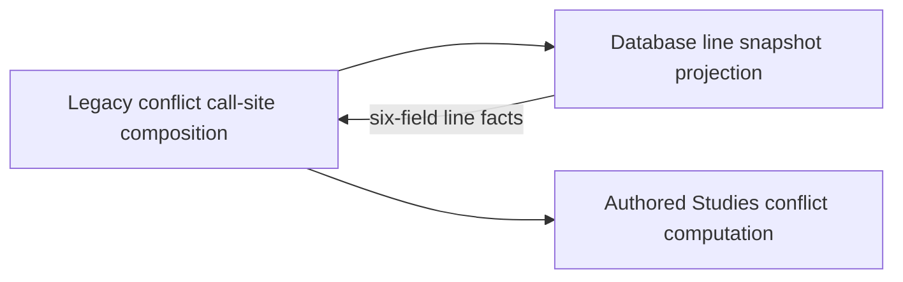

# Authored Studies policies

**Current source; deployment unverified.** Studies means authored/imported PGN chapters and exercises; saved repertoire authoring is not assumed to have the same meaning. Daily Study practice has its own [policy folder](../study/frozen_order/README.md); these owners are distinct.

[Repertoire conflict computation](repertoire_conflicts.py) takes supplied immutable line snapshots and returns the existing trained-move index/conflict records. Each snapshot row retains the original six positional fields: line id, repertoire id, name, trained color, starting FEN and moves JSON. Chess parsing, transposition/en-passant distinctions, invalid-line handling, ordering and the four-entry snapshot cache are unchanged. The public functions import only standard-library utilities and the external chess library.

[Legacy composition](../services/repertoire_conflicts.py) retains existing caller signatures and supplies the [database projection](../../../database/tempo_storage/repertoire_lines.py) on the caller's connection/transaction. The new policy imports no database, HTTP framework, practice Study or sibling-domain implementation. Existing legacy consumers still use their old composition module; broader backend domain moves remain pending.

`backend/tests/test_repertoire_conflicts.py` retains the original cache, conflict and en-passant assertions and adds a fresh-interpreter import boundary guard. Database source tables/keys/fields remain in the [ordered source DDL](../../../database/tempo_storage/ddl/README.md); this split changes no schema or stored data.

## Retired PGN preview

The former `studies/pgn.py` preview owner is absent. Its historical parser limits
and relocation test receipt do not describe a callable current Studies endpoint.
Current repertoire PGN import is owned by
[repertoire import storage](../../../database/tempo_storage/authored_repertoires/pgn_import)
and [pure chess PGN helpers](../chess/pgn.py), not a replacement claim for the
removed authored-exercise preview contract.
