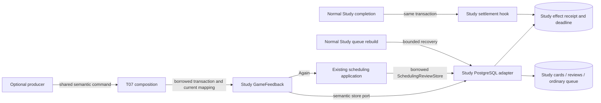

# Daily Study practice policy

Study means daily practice. Authored/imported [Studies](../studies/README.md) is a separate owner.

| Directory | Existing responsibility |
| --- | --- |
| [openings](openings/README.md) | Pure opening preparedness/reach, admission frontier and frozen-order mathematics. |
| [review](review/README.md) | Semantic feedback facts/port and UTC normalization. |
| [frozen_order](frozen_order/README.md) | Frozen-order application policy; database work stays at its root owner. |

These policies depend on their own modules, explicit contracts and neutral chess
support. Existing legacy workflows retain the separate
[organization checklist](../../ORGANIZATION.md). The `organized-study` local
import-linter contract covers the moved openings/review namespaces; existing
frozen-order guards retain their scope. This source organization does not certify
deployment/resource isolation or activate the proposed
[database simplification](../../../database/SIMPLIFICATION.md).

## Study game feedback — T06 / #487

Source implementation, not deployed. Contract dependency: #482 checkpoint
`50dd8220` (including key/revision/reason-only controls);
[shared types](../contracts/product_v02/learning.py). Ordinary Study
retains the existing scheduler, review transaction, queue and attempt authority.
There is no independent Learning service requirement.

## Public interface and composition handoff

[`GameFeedback`](game_feedback.py) implements `LearningFeedbackPort`:
`accept_lapse(GameLapse)`, `control_effect(GameEffectControl)`, and
`effect_status(GameEffectKey) -> LearningReceipt | None`. Existing v2
`EvidenceWithdrawal` is carried by `GameEffectControl`; v3 withdrawal-only
transport remains with the producer/composition owner. Receipt identity is a
stable hash of workspace/provider/game/decision/one-based occurrence ply.

Construct it with a borrowed `PostgresGameFeedbackStore(database)`, an injected
`CurrentDecisionPort.current(lapse) -> tuple[DecisionPresentation, ...]`, and an
aware processing clock. The current mapping must be read/fenced by its owner
inside the caller's transaction. Zero/multiple mappings grant no effect. Supply
the actual current source/repertoire/card revision, exact position, selected
response and introduction evidence; never resolve a card by position alone.
T07 owns command dispatch, authority capture/fencing and outer composition.

The concrete retained-owner factory is now
`tempo_legacy_database.adapters.study.game_feedback_authority.current_owner_game_feedback(database, retained_owner_capture=..., snapshot=..., clock=...)`.
Pass the existing backend-owned `legacy_game_capture` export and its #483 public
snapshot projection, inside the same writer transaction used for delivery.
This factory supplies `CurrentOwnerDecisions`; a producer snapshot by itself is
insufficient. It rereads and locks the current source/scope/card/graph/membership
and existing completed integrity facts. Graph/source locks are nonblocking after
the receiver's card/day locks. `CurrentDecisionUnavailable.reason` identifies
busy, missing or changed authority; abort/roll back and report that reason.
It creates no certificate, captures no new catalogue, and never calls Games.
T07 authenticates and fences the canonical imported game in its own boundary;
the factory requires that canonical game ID, not a provider-ID alias.

The concrete adapter supports original physical revision 1 with exact stored UTC
introduction, or #516's explicit `introduced_before_game=True` proof scoped to
the exact canonical provider/game ID/source revision/source digest. For a
date-only value, the current locked card must still match the retained capture,
its stored day must precede the game day, and the owner capture must independently
report pre-game introduction. The mapping timestamp remains `None`; the stored
date is preserved. Another source's boolean, missing proof, or changed-content
revision without owner evidence grants no effect. No historical timestamp is
invented and source/current-content fences remain unchanged.

The caller starts/commits/rolls back the transaction. `accept_lapse` acquires
existing card-edit/card-row/day locks before the effect lock. The schedule,
honestly labelled `reviews.source_kind='game_lapse'` Again record, queue and
effect receipt commit together. No Study attempt, introduction, or success is
fabricated. Exceptions require rollback; acknowledge success only after commit.
Read-only status does not acquire an effect or issue a review.

`maintain(after='', limit=1) -> next_cursor | None` advances one effect per
borrowed transaction using the same injected current mapping. Persist the cursor
with the owning job; commit each unit, resume from its cursor, and restart a new
sweep at `''`. This preserves card-before-day lock order and short transactions.
No Games/provider call belongs inside that transaction. T07 wires this bounded
Study-owned maintenance into its existing job execution; it must run independently
of the producer and on resume. Missing external authority must leave work pending
until owner revalidation; it is never permission to guess a card.

## Behavior and chronology

First detection fixes `available_by <= detected_at + 48h`; duplicate delivery or
equivalent recomparison never reapplies Again or moves the original deadline.
Semantic identity excludes delivery, comparison and presentation revisions.
Changed source content/moves/occurrence facts quarantine the original effect.
Hold/withdraw is durable even before delivery and cannot reactivate on a delayed
original. A hold after application retains its original historical effect.
No automatic correction release or historical reversal is implemented (D08).

Active affected attempts defer mutation; unrelated attempts retain their issued
slot. Burial, invalidity and conflicts remain visible. Required introduced-card
work consumes no discretionary introduction allowance. Pending work advances at
a safe boundary through maintenance. A genuine subsequent clean Study review
settles the exact mapped revision once. Guided/Again/invalidated/game records do
not settle. D10 processing policy: never backdate FSRS; a retained, revision-proved
clean Study review after the game already satisfies late evidence. Otherwise
apply Again to current state at processing time. A future review clock defers
application. Legacy date-only introduction is conservatively bounded by the end
of that day, so same-day ordering is not invented.

## Narrow hook manifest

- `services/learning_review_adapter.py::settle_remediation` calls
  `settle_saved_review` after the real saved review in the same transaction.
- `services/legacy_study_remediation.py::invalidate_review` reopens debt only
  after its actual settling review is invalidated, preserving the historical
  application receipt so Again cannot repeat.
- `services/queue_application.py::seed_queue` invokes
  `resume_available_feedback` for already-applied obligations after ordinary due
  seeding. This recovery needs no producer or index. It uses nonblocking card
  reservations when the caller already holds a day lock.
- `queue_application.py::presentation_rows` removes obsolete priority, and
  `queue_ordering.py::_priority_projection` uses the unchanged existing priority
  algorithm for `product_game_lapse` and `product_game_encounter`. Protected issued
  attempts remain protected; the stored encounter reason stays distinct.
- `queue_admission_adapter.py::has_outstanding_miss` preserves the legacy
  reconciliation interface while also reading Study's material encounter
  introduction fact. This is retention of an already-introduced current revision,
  never a miss classification or authority for a fresh introduction.
- The database eligibility owner's `_reset_stale_opening_introductions` excludes
  the same material admissions, so a later Study day does not erase/reintroduce
  them. Other unseen introductions retain ordinary reconciliation controls.

The adapter lives in [the database owner](../../../database/tempo_legacy_database/adapters/study/README.md).
Migration 051 is allocated and registered by readiness version 51; it is source
only and must be applied by the existing migration owner at integration.
Pre-migration/recovery paths retain their current
behavior. No route, main.py, independent runtime or live data changes.



```mermaid
sequenceDiagram
    participant P as Producer via public EncounterFeedbackPort
    participant I as Study intake
    participant D as Study-owned effect ledger
    participant W as Independent Study sweep
    participant Q as Existing queue and introduction owner
    P->>I: accept_encounter(shared immutable facts)
    I->>D: exact card/source fence; persist once
    I-->>P: pending owner receipt; no queue promise
    Note over I,Q: Intake never enumerates, prepares or promotes a queue
    W->>D: claim existing pending obligation
    W->>Q: prepare outside writer; recheck target and issuance
    Q->>Q: canonical introduction if needed; protected position batch
    W->>D: commit available status with queue effect
    Note over P,W: Producer failure or removal does not stop Study pickup
```

Shared host/database resource isolation and actual product activation remain T07
integration evidence. Component proofs do not certify deployment isolation.

## Focused checks

`make python-file FILE=backend/tests/test_product_game_lapse.py`

`make python-file FILE=backend/tests/test_product_game_lapse_postgres.py`

The first uses immutable shared fixtures, frozen time, explicit FSRS and semantic
fake capabilities; the second requires the documented task-owned native fixture.
Unavailable native infrastructure is unverified, never a mock pass. Existing
scheduler policy is unchanged; its unchanged regressions are reused.

`test_native_day_only_introduction_requires_exact_current_game_proof` reproduces
#488's retained date-only capture through the owning port, proves actual Again
application without an invented timestamp, and rejects each mismatched canonical
source field. Run just that case with
`PYTEST_ADDOPTS='--tb=short -k day_only_introduction_requires_exact_current_game_proof'`
on the native command above; unrelated native cases retain their evidence.

## Encounter intake and independent Study refresh

The public `EncounterFeedbackPort` consumes shared immutable `GameEncounter`
facts and returns the existing `EncounterReceipt`. Its `accept_encounter` and
`encounter_status` share the original effect key, controls, source/detection and
schema051 ledger. No new DDL, delivery queue, scheduler or producer dependency.

Intake validates only the exact current source, executable mapping, card identity,
revision, availability and complete equivalent-route provenance. It uses card and
effect locks; it cannot enumerate, prepare, lock a queue date, introduce or promote.
Valid priority requests commit `pending` / `study_priority_pending`, without an
availability promise. Introduced correct play settles as frequency evidence.
Historical misses retain importance without fabricating Again or rewinding FSRS.
Duplicates preserve the original command, receipt and disposition.

The composition root binds the public producer port to the internal factory
`current_owner_encounter_intake(database, retained_owner_capture=..., snapshot=...,
clock=...)`. This factory accepts no queue capability or introduction policy.
`receive_admitted_encounter` still requires actual whole-operation/foreground
admission and the normal background database safety gate. Unknown control state
fails closed; zero allowance and Study-only do not imply full pause.

Study independently discovers the persisted obligation through its existing
`claim_feedback_sweep` / `execute_feedback_sweep`. It captures current authority
and prepares finite presentation/ordering pages outside its short writer. The
consumer calls `EncounterFeedback.refresh_encounter(key)` for that exact observed
identity; source/target/current-task/lease checks, protected issuance fence, changed
position batch and the available receipt commit together. A refresh failure rolls
back only refresh and its task cursor; accepted intake stays pending. There is no
eager-intake toggle or fallback, and Games removal cannot prevent Study pickup.

The internal refresh factory `current_owner_encounter_feedback` alone receives
`introductions`, `introduction_policy` and optional immutable `prepared_priority`.
The independent sweep additionally uses the [prepared introduction path](introductions/README.md#prepared-independent-study-sweep--558-repair),
with source validation before its writer and commit-time current-row fences.
The existing #495 canonical capability uses `allowance="encounter_exception"`,
`paused=actual_whole_operation_pause` and the exact current `target` mapping.
This targeted first-introduction exception bypasses ordinary new-card cap and
Study-only without changing either global setting. Full pause, foreground,
maintenance, active attempts, burial, legality, source and conflict guards remain.
Schema051 has no distinct global full-Study-pause column: existing admitted-task
and background connection controls supply that decision, never an invented flag.
A racing ordinary introduction preserves actual progress and introduces once.

Preparation is an ordering hint, not a source certificate or eligibility grant.
The refresh writer rechecks queue membership/row versions, card row versions,
current issued/protected attempts, teaching/evidence protection, settings and
frozen activation before applying guarded changed positions. Other cards' derived
eligibility is evaluated outside the writer and remains independently enforced
when serving. Changed ownership invalidates the plan and rolls back refresh.
Intake never depends on this queue-sized work.

Component interface directories, public exports/import guards and their short
READMEs are owned by the designated interface lane; this implementation does not
expose database or queue types in shared producer contracts.

Focused runtime guard:
`backend/tests/test_study_encounter_intake_boundary.py` contains
`test_intake_never_calls_queue_and_commits_once_when_refresh_fails` and
`test_study_refresh_without_games_consumes_accepted_priority`. The synthetic
mixed731-row fixture retains4197reviews, the target's nine reviews/receipts and25
protected attempts. It proves forbidden queue calls during intake, once/replay,
refresh failure/stale rollback and pickup with Games disabled. Existing encounter
policy/native cases call acceptance and refresh explicitly; they do not restore a
production inline path. Installed first-release lapse handling is unchanged.

## Feedback sweep connection recovery (#589)

Recovery-only extraction from #580 onto current main; candidate untested and
deployment unverified. No #558 provider/API dependency is introduced. The registered
`maintain_game_feedback` wake now uses the existing token-fenced coalescer.
Post-claim connection failure is reconciled only after the failed writer closes.

```mermaid
sequenceDiagram
    participant M as Study maintenance
    participant W as Borrowed effect transaction
    participant D as Durable task writer
    participant B as Existing wake broker
    M->>W: Execute one fenced effect and checkpoint
    W-->>M: Connection failure; close failed transaction
    M->>D: Fresh writer, defer matching ID/generation/lease
    alt Original claim still owns checkpoint
        D-->>M: Commit retrying, release lease, preserve checkpoint
        M->>B: Coalesced wake after persisted eligibility
    else Committed progress or successor owns task
        D-->>M: No change
    else Recovery database unavailable
        D-->>M: Fail; retain normal lease recovery
    end
```

Owner: [maintenance entry point](../tasks.py),
[durable deferral](../services/durable_tasks.py) and
[task storage](../../../database/tempo_legacy_database/adapters/durable_tasks/storage.py).
Typed deadlines retain the existing durable exponential backoff; connection
failures use a one-second delay and a fixed sanitized error category. Broker
publication is advisory and occurs after commit; periodic recovery remains.
Specific lock/deadlock/serialization handlers retain precedence over generic
connection failures. Preparation, queue refresh/serving and diagnostics remain
with #580/#581's separate owner. Existing regression sources were retained;
no new tests, builds or runtime checks were run for this extracted candidate.
