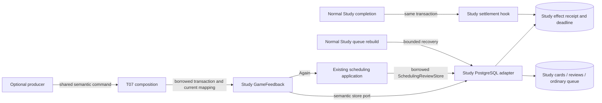
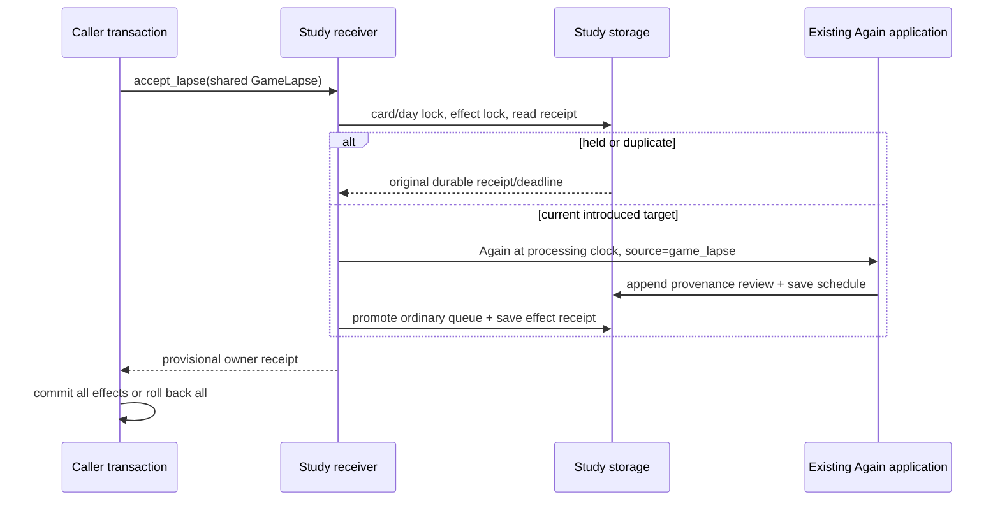
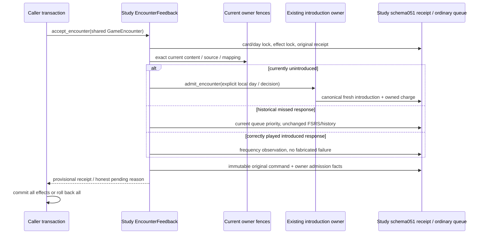

# Daily Study practice policy

Study means daily practice. Authored/imported [Studies](../studies/README.md) is a separate owner.

| Directory | Existing responsibility |
| --- | --- |
| [openings](openings/README.md) | Pure opening preparedness/reach, admission frontier and frozen-order mathematics. |
| [review](review/README.md) | Semantic feedback facts/port and UTC normalization. |
| [frozen_order](frozen_order/README.md) | Frozen-order application policy; database work stays at its root owner. |

These policies depend on their own modules, explicit contracts and neutral chess
support. Existing legacy workflows retain the separate
[organization checklist](../../ORGANIZATION.md). The `organized-study` local
import-linter contract covers the moved openings/review namespaces; existing
frozen-order guards retain their scope. This source organization does not certify
deployment/resource isolation or activate the proposed
[database simplification](../../../database/SIMPLIFICATION.md).

## Study game feedback — T06 / #487

Source implementation, not deployed. Contract dependency: #482 checkpoint
`50dd8220` (including key/revision/reason-only controls);
[shared types](../contracts/product_v02/learning.py). Ordinary Study
retains the existing scheduler, review transaction, queue and attempt authority.
There is no independent Learning service requirement.

## Public interface and composition handoff

[`GameFeedback`](game_feedback.py) implements `LearningFeedbackPort`:
`accept_lapse(GameLapse)`, `control_effect(GameEffectControl)`, and
`effect_status(GameEffectKey) -> LearningReceipt | None`. Existing v2
`EvidenceWithdrawal` is carried by `GameEffectControl`; v3 withdrawal-only
transport remains with the producer/composition owner. Receipt identity is a
stable hash of workspace/provider/game/decision/one-based occurrence ply.

Construct it with a borrowed `PostgresGameFeedbackStore(database)`, an injected
`CurrentDecisionPort.current(lapse) -> tuple[DecisionPresentation, ...]`, and an
aware processing clock. The current mapping must be read/fenced by its owner
inside the caller's transaction. Zero/multiple mappings grant no effect. Supply
the actual current source/repertoire/card revision, exact position, selected
response and introduction evidence; never resolve a card by position alone.
T07 owns command dispatch, authority capture/fencing and outer composition.

The concrete retained-owner factory is now
`tempo_legacy_database.adapters.study.game_feedback_authority.current_owner_game_feedback(database, retained_owner_capture=..., snapshot=..., clock=...)`.
Pass the existing backend-owned `legacy_game_capture` export and its #483 public
snapshot projection, inside the same writer transaction used for delivery.
This factory supplies `CurrentOwnerDecisions`; a producer snapshot by itself is
insufficient. It rereads and locks the current source/scope/card/graph/membership
and existing completed integrity facts. Graph/source locks are nonblocking after
the receiver's card/day locks. `CurrentDecisionUnavailable.reason` identifies
busy, missing or changed authority; abort/roll back and report that reason.
It creates no certificate, captures no new catalogue, and never calls Games.
T07 authenticates and fences the canonical imported game in its own boundary;
the factory requires that canonical game ID, not a provider-ID alias.

The concrete adapter supports original physical revision 1 with exact stored UTC
introduction, or #516's explicit `introduced_before_game=True` proof scoped to
the exact canonical provider/game ID/source revision/source digest. For a
date-only value, the current locked card must still match the retained capture,
its stored day must precede the game day, and the owner capture must independently
report pre-game introduction. The mapping timestamp remains `None`; the stored
date is preserved. Another source's boolean, missing proof, or changed-content
revision without owner evidence grants no effect. No historical timestamp is
invented and source/current-content fences remain unchanged.

The caller starts/commits/rolls back the transaction. `accept_lapse` acquires
existing card-edit/card-row/day locks before the effect lock. The schedule,
honestly labelled `reviews.source_kind='game_lapse'` Again record, queue and
effect receipt commit together. No Study attempt, introduction, or success is
fabricated. Exceptions require rollback; acknowledge success only after commit.
Read-only status does not acquire an effect or issue a review.

`maintain(after='', limit=1) -> next_cursor | None` advances one effect per
borrowed transaction using the same injected current mapping. Persist the cursor
with the owning job; commit each unit, resume from its cursor, and restart a new
sweep at `''`. This preserves card-before-day lock order and short transactions.
No Games/provider call belongs inside that transaction. T07 wires this bounded
Study-owned maintenance into its existing job execution; it must run independently
of the producer and on resume. Missing external authority must leave work pending
until owner revalidation; it is never permission to guess a card.

## Behavior and chronology

First detection fixes `available_by <= detected_at + 48h`; duplicate delivery or
equivalent recomparison never reapplies Again or moves the original deadline.
Semantic identity excludes delivery, comparison and presentation revisions.
Changed source content/moves/occurrence facts quarantine the original effect.
Hold/withdraw is durable even before delivery and cannot reactivate on a delayed
original. A hold after application retains its original historical effect.
No automatic correction release or historical reversal is implemented (D08).

Active affected attempts defer mutation; unrelated attempts retain their issued
slot. Burial, invalidity and conflicts remain visible. Required introduced-card
work consumes no discretionary introduction allowance. Pending work advances at
a safe boundary through maintenance. A genuine subsequent clean Study review
settles the exact mapped revision once. Guided/Again/invalidated/game records do
not settle. D10 processing policy: never backdate FSRS; a retained, revision-proved
clean Study review after the game already satisfies late evidence. Otherwise
apply Again to current state at processing time. A future review clock defers
application. Legacy date-only introduction is conservatively bounded by the end
of that day, so same-day ordering is not invented.

## Narrow hook manifest

- `services/learning_review_adapter.py::settle_remediation` calls
  `settle_saved_review` after the real saved review in the same transaction.
- `services/legacy_study_remediation.py::invalidate_review` reopens debt only
  after its actual settling review is invalidated, preserving the historical
  application receipt so Again cannot repeat.
- `services/queue_application.py::seed_queue` invokes
  `resume_available_feedback` for already-applied obligations after ordinary due
  seeding. This recovery needs no producer or index. It uses nonblocking card
  reservations when the caller already holds a day lock.
- `queue_application.py::presentation_rows` removes obsolete priority, and
  `queue_ordering.py::_priority_projection` uses the unchanged existing priority
  algorithm for `product_game_lapse`. Protected issued attempts remain protected.

The adapter lives in [the database owner](../../../database/tempo_legacy_database/adapters/study/README.md).
Migration 051 is allocated and registered by readiness version 51; it is source
only and must be applied by the existing migration owner at integration.
Pre-migration/recovery paths retain their current
behavior. No route, main.py, independent runtime or live data changes.

Shared host/database resource isolation and actual product activation remain T07
integration evidence. Component proofs do not certify deployment isolation.

## Focused checks

`make python-file FILE=backend/tests/test_product_game_lapse.py`

`make python-file FILE=backend/tests/test_product_game_lapse_postgres.py`

The first uses immutable shared fixtures, frozen time, explicit FSRS and semantic
fake capabilities; the second requires the documented task-owned native fixture.
Unavailable native infrastructure is unverified, never a mock pass. Existing
scheduler policy is unchanged; its unchanged regressions are reused.

`test_native_day_only_introduction_requires_exact_current_game_proof` reproduces
#488's retained date-only capture through the owning port, proves actual Again
application without an invented timestamp, and rejects each mismatched canonical
source field. Run just that case with
`PYTEST_ADDOPTS='--tb=short -k day_only_introduction_requires_exact_current_game_proof'`
on the native command above; unrelated native cases retain their evidence.

## Next release: encounter importance and first introduction

[`EncounterFeedback`](encounter_feedback.py) consumes #533's published additive
`GameEncounter`/`EncounterReceipt` at `46f07e9a`. Its explicit constructor takes
the same borrowed store/current owner/clock plus `introductions` and
`introduction_policy`. `accept_encounter` and `encounter_status` share the
existing stable effect key, pre-delivery hold, immutable source/detection and
receipt ledger with `accept_lapse`; no second delivery queue or scheduler exists.
The qualified first-release factory remains separately selectable.

The concrete additive factory is
`current_owner_encounter_feedback(database, retained_owner_capture=..., snapshot=...,
clock=..., introductions=..., introduction_policy=...)` in the same database
adapter. Compose #495's published `current_owner_introductions` / `admit_encounter`
capability on that exact borrowed writer. Only the actual current introduction
field may differ from the retained capture during priority validation; definition,
revision, legal executable, route, source generations and membership remain fenced.
Neither a producer's snapshot nor a FEN match authorizes mutation.

An unintroduced current card requests genuine canonical introduction for either
matched or missed play. A current introduced miss receives queue priority without
calling Again or changing its schedule/history, including evidence predating
introduction or later learning. Correct introduced play records frequency only.
These are per-observation factual receipts; the pure importance calculation stays
with #494. Study imports no Analysis implementation or copied score formula.
Original command and disposition survive replay, reload, ordinary introduction
races and recomparison; a later `GameLapse` for the same semantic event receives
the original receipt instead of converting it to Again. Genuine later Study
completion can settle queue debt without deleting the retained observation.

`EncounterIntroductionPolicy` requires an explicit `ordinary` or `limited_reserve`
input. No live default is chosen. The published capability currently implements
ordinary allowance; an absent policy or unsupported reserve remains pending.
Disabled/pause/Study-only/zero controls remain with #495. Pending admission never
claims an availability deadline; original detection stays in the receipt/storage.
#495 currently returns a generic `deferred` result, so its actual disabled-control
subreason remains generic unless that owner supplies a typed reason. No override
or unconditional 48-hour promise is implied.

The receiver adds **no DDL**: schema051 `payload_json` carries the immutable shared
encounter command and a small mutable owner admission section. #495's broader
`5f87902f` capability needs unregistered charge/period/rotation/ranking tables;
this branch does not consume that full feature. A narrow admission capability
using existing canonical state and this effect transaction is being supplied by
that owner. Actual first-introduction/native composition remains pending its
published checkpoint. No migration is allocated here. Larger-than-bound current
sources still defer; small fixtures do not establish support for an arbitrary
installed repertoire.

`product_game_encounter` is a distinct queue priority label, with a clean attempt
state. The shared `queue_ordering._priority_projection` needs to recognize it
before product adoption; its exact shared-file reservation/publication remains
pending. Current source does not claim the later normal-Study priority proof or
live activation. Integration retains admission/serving composition ownership.

Changed owner checks remain in the two existing test files above; use `-k encounter`
for the next-release cases. No first-release deployment or broad suite rerun is
part of this extension.
