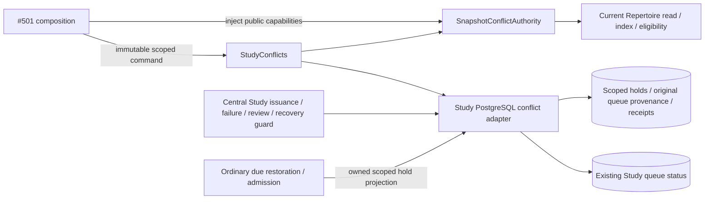
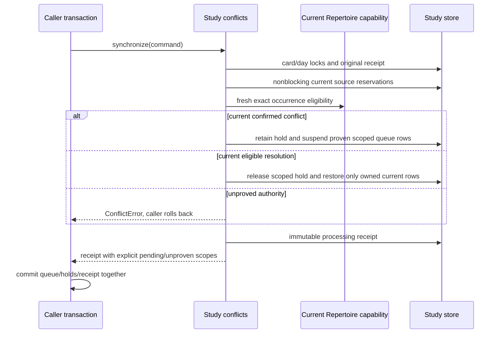

# Scoped Study conflict controls — #487 follow-on for #501 C

Proposed source on `feat/487-study-conflict-controls`, separate from qualified
#515 at `c59b93a8`. This is not a #488 dependency and changes no game-feedback
policy, review/admission hook, root composition, live data or service.

## Public command

`StudyConflicts.synchronize(ConflictCommand) -> ConflictReceipt` accepts one
bounded, immutable command over at most 16 exact targets. Each `Occurrence`
contains repertoire ID, authored route ID, zero-based route ply, actual current
presentation/card ID and current presentation revision. `SourceFence` retains
the public snapshot's source revision, revision and digest. A command ID is
immutable: exact retry returns its original receipt; changed payload under that
ID is rejected. Use a new command ID for a new audit/resolution source.

`SnapshotConflictAuthority(current_snapshot=..., build_index=...,
study_eligibility=...)` is the mechanical adapter to #483/#492's public APIs.
It rereads current source in the borrowed transaction, verifies exact physical
bindings in the public route index, then delegates every conflict/eligibility
decision to Repertoire's existing policy. Study does not import that domain's
implementation. Unknown/incomplete/stale source cannot newly block or restore.
No source policy or SQL belongs in #501.

Outer composition supplies those three existing public capabilities. Its shape
is:

```python
authority = SnapshotConflictAuthority(
    current_snapshot=lambda repertoire_id: current_snapshot(database, repertoire_id),
    build_index=build_index,
    study_eligibility=study_eligibility,
)
owner = current_study_conflicts(database, authority=authority, clock=processing_clock)
receipt = owner.synchronize(ConflictCommand(
    command_id, repertoire_id, SourceFence(source_revision, revision, digest),
    (Occurrence(repertoire_id, route_id, ply, presentation_id, presentation_revision),),
))
# The caller commits once, or rolls back on any error.
```

`current_study_conflicts` and `PostgresConflictStore` live in the
[database adapter](../../../../database/tempo_legacy_database/adapters/study/conflicts.py).
The source reader must be the actual current Repertoire owner on this same
connection. A producer snapshot or an affirmative caller boolean is insufficient.
The concrete store acquires sorted card locks before day locks, then nonblocking
current source/global-scope/publication reservations. The fresh public read
compares the opaque source fence before the first mutation. Busy source raises
`ConflictError('current_repertoire_source_busy_or_missing')`; caller rolls back.

## Effects and safe restoration

A current `own_response_conflict` creates a durable scoped hold and suspends
only queued rows whose repertoire is explicitly recorded, or whose card has one
unambiguous repertoire owner. It writes `daily_queue.status='blocked'`, keeping
attempt failure/guidance flags, issuance, position, original manifest, schedule,
introduction and review history. There is no Again, review, clean completion or
history rewrite. Other repertoires and unrelated cards retain their attempts.

If a shared card's queue row has no provable repertoire, the receipt is
`pending` with `unproven_queue_ids`; the row is left untouched. The read callback
must show pending/unknown, not pretend the affected occurrence was suspended.
Caller must retain a current owning scope before proceeding. No position/FEN or
arbitrary repertoire selection establishes that scope.

After explicit manual source resolution, submit current valid target scopes
under the new source fence. Only a fresh eligible Repertoire result can release
their holds. Study restores only rows it previously suspended, still carrying
that exact physical revision, with no other active owner hold or integrity block.
Later burial/completion/replacement and another owner's preexisting block are
preserved. Removed/unmapped/stale targets grant no restore; retain their original
provenance and submit the actual current mapped targets, never retrofit an old
attempt to new content. Current route rebinding remains its own owner operation.

The original command receipt is historical. Use current read capabilities for UI:

- `store.block_state(repertoire_id, route_ids)` returns `blocked`, `pending`, or
  `None` (unproved); it examines current holds and queue scope/status.
- `store.active_occurrences(repertoire_id, after='', limit=16)` supplies bounded
  retained targets for a new explicit current-source validation.
- `store.blocked(repertoire_id, card_id, revision)` is the scoped admission read
  for #495 under its existing target transaction/locks.
- `store.guard_attempt(queue_entry_id, card_id, revision)` rejects a suspended
  original attempt, including after queue deletion, using retained origin scope.
  A shared unscoped attempt with an active hold is rejected as unproved; unrelated
  explicit repertoire attempts remain valid. Caller translates `ConflictError`
  at the existing transport boundary.
- `store.reconcile_queue(after='', limit=1)` reapplies one durable hold after
  rebuild/restart/day rollover. Commit each unit and persist its returned cursor;
  start a later sweep at `''`. Busy resources yield without waiting backwards
  from an existing day lock. A replacement physical revision is never suspended
  by an old hold. No producer is called.

## Exact integration hooks awaiting coordination

No shared hook was edited. The #481 reservation/update was denied by automatic
approval review; its publication is pending, so existing owners keep their files.
The required minimal adoption points are:

1. #503/current queue owner: call the scoped serving/attempt guard before head
   issuance and before pending review/recovery/failure marking; ordinary blocked
   origins must not be recovered as a fresh queued attempt. Existing candidate
   paths are `queue_commands.issue_queue_head`, `queue_attempt_origins` recovery
   and failure validation, and the review adapter's current-attempt lookup.
2. #503/current rebuild owner: invoke the bounded `reconcile_queue` seam with the
   existing refresh transaction/cursor. It owns `queue_application.seed_queue`.
3. #495: use `blocked(...)` in its already-reserved current introduction
   eligibility/definition fence. Do not charge or admit a held introduction.
4. #501: compose the owner command/current Repertoire capabilities and the
   read-only `block_state` callback; handle pending/unproved scopes honestly.

Only after these hooks are composed can C's normal Study/browser proof establish
continuous serving enforcement. This component's passing private tests are not
that product acceptance. No fake fallback should be mounted.

## Storage and focused proof

[Private source DDL](../../../../database/tempo_legacy_database/ddl/study_conflicts.sql)
is deliberately unregistered. Global numeric allocation/readiness and source
diagram index links await the #491/#503 migration and #501 integration owners.
There is no live DDL apply, root edit, schema-version bump or release-candidate change.
Native tests apply it only to a fresh task-owned PostgreSQL database after its
existing registered schema053. [Stored fields and relationships](../../../../database/tempo_legacy_database/adapters/study/CONFLICTS.md)
are canonical for this proposal.

Owning commands:

```sh
make python-file FILE=backend/tests/test_product_study_conflicts.py
make python-file FILE=backend/tests/test_product_study_conflicts_postgres.py
```

The first proves policy/replay/current-source rejection/ambiguous scope and
delegation without optional producers. The second reuses the existing capped,
labelled disposable fixture and proves actual scoped writes, history retention,
source-lock fencing, rollback, concurrent retry, original-attempt guard,
rebuild/readback and owned restoration. Repertoire policy capabilities are fake
in this private native contract; actual public-owner composition is C's boundary.





## Current-main C1 Study hook adoption

The retained owner above is reused without changing its synchronization or
suspension authority. `services/study_attempt_guard.py` now calls
`PostgresConflictStore.guard_attempt` after the existing R11 availability check.
Issuance, failure marking, review and original-attempt recovery retain that one
central guard and their caller-owned card/queue locks. A conflict is the existing
machine-readable HTTP409 (`study_occurrence_conflict_suspended`, or
`current_attempt_scope_unproved` when scope cannot be established); R11's
`current_presentation_unavailable` remains first. Explicit unaffected repertoire
attempts sharing a card remain operable.

Ordinary due-row restoration excludes active current-revision holds through the
Study adapter's `held_queue_sql` projection. It respects the same explicit valid,
single inferred, or unproved repertoire scope as the attempt guard. Ordinary new
due admission has no repertoire context, so `held_unscoped_card_sql` defers a
current held card rather than guessing scope. It changes neither introduction
state, scheduling nor existing attempts. Resolution by the canonical conflict
owner releases the hold; an old-revision hold never binds replacement content.
There is no whole-hold reconciliation loop inside queue refresh.

Both projections return false when this optional owner schema is absent; SQLite
and main's registered schema053 retain their existing path. The additive C DDL is
still **unregistered**. #501 owns its version/readiness allocation and assembled
C1 adoption, coordinated separately from C2. No DDL is applied on import, and this
source patch makes no installation or complete C1 browser-acceptance claim.

The regular native suite retains #501's exact
`test_c1_durable_hold_survives_current_main_due_row_restoration`, plus the affected
scope, original-recovery, due-admission and resolution/current-revision checks.
`backend/tests/test_study_attempt_guard.py` preserves R11 precedence and the
absent-schema path. Existing donor transaction/replay tests remain available;
unchanged broad R11 and Games suites are not prerequisites for this repair.

C1 integration registers this exact owner DDL in
[migration054](../../../../database/tempo_legacy_database/ddl/migrations/054_product_repertoire_review.sql)
after R11/schema053. The source readiness bump and normal HTTP/browser composition
belong to #501; this is not an installed-schema claim.
