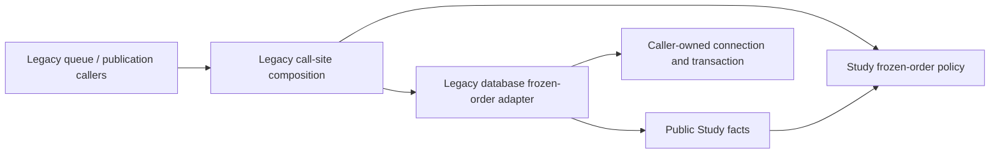

# Frozen opening preference

**Implemented source in this unmerged extraction; deployment unverified.** Study means daily practice. This folder owns the existing preference, definition-validity and slot-ordering decisions, moved from `services/frozen_opening_order.py`. It imports only its own public fact/capability definitions and Python's standard library.

The [public interface](interfaces.py) supplies activation tokens, captured/current card definitions, memberships, legacy-exposure facts and blocked routes. [Policy functions](policy.py) receive those facts, a content-fingerprint function, and semantic card predicates. They never receive a connection or SQL execution capability. The existing fingerprint implementation is supplied by composition; this move does not change fingerprint format or reader version.

[Legacy composition](../../services/frozen_opening_order.py) retains existing caller signatures and lazy feedback lookup. It binds the [database adapter](../../../../database/tempo_legacy_database/adapters/frozen_order.py) to the caller's transaction. The adapter retains bounded reads, existing row/advisory-lock usage, staging, activation guards and conditional rollback. It does not open or commit a transaction. [SQLite DDL and relationships](../../../../database/tempo_legacy_database/ddl/frozen-opening/README.md) have a separate database home; PostgreSQL migrations are unchanged.

This is one bounded split, not a claim that the legacy backend meets strict domain isolation. Existing queue/admission/publication callers still use the legacy composition module, and other mixed modules remain on the [extraction checklist](../../../../database/INVENTORY.md). Outer composition must eventually own those bindings; domain implementations must not import sibling implementation through this compatibility surface. Study gains no Games dependency here.

The owning focused proofs are `backend/tests/test_frozen_order_policy.py`, `test_frozen_opening_order.py` and `test_frozen_opening_schema.py`: pure imports/facts/capabilities, existing SQLite selection/rollback behavior, and DDL replay/transactional invalidation. Existing PostgreSQL proofs remain in `database/tests/test-frozen-postgres.py`; they were not run against live or disposable services for this extraction.
