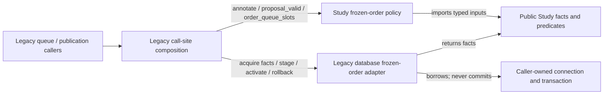

# Frozen opening preference

**MAIN implemented source; deployment unverified.** Study means daily practice. This folder owns the existing preference, definition-validity and slot-ordering decisions, moved from `services/frozen_opening_order.py`. It imports only its own public fact/capability definitions and Python's standard library.

The package [public exports](__init__.py) are `annotate`, `proposal_valid`, `order_queue_slots`, `FrozenAnnotationFacts`, `FrozenRankFacts`, `CardPredicate` and `ContentFingerprint`. These are supplied-fact policy operations, not queue commands, a database API or plugin lifecycle hooks. The [public interface](interfaces.py) supplies activation tokens, captured rank/fingerprint and current card definitions, memberships, legacy-exposure facts and blocked routes. [Policy functions](policy.py) receive those facts, a content-fingerprint function, and semantic card predicates. They never receive a connection or SQL execution capability. The existing fingerprint implementation is supplied by composition; this move does not change fingerprint format or reader version.

[Legacy composition](../../services/frozen_opening_order.py) retains existing caller signatures. It binds the [database adapter](../../../../database/tempo_storage/frozen_order.py) to the caller's transaction. The adapter retains bounded reads, existing row/advisory-lock usage, staging, activation guards and conditional rollback. It does not open or commit a transaction. [Ordered PostgreSQL DDL](../../../../database/tempo_storage/ddl/README.md) owns the retained schema history.

This is one bounded split, not a claim that the legacy backend meets strict domain isolation. Existing queue/admission/publication callers still use the legacy composition module. That facade binds `tempo_storage.frozen_order` and the explicit `study.openings.frozen_math` fingerprint/reader version. Other mixed modules remain on the [extraction checklist](../../../../database/INVENTORY.md). Outer composition must eventually own those bindings; domain implementations must not import sibling implementation through this compatibility surface. Study gains no Games dependency here.

Use current [test selection](../../../../docs/testing.md) and inspect the selected
fixture before execution. Historical SQLite/DDL relocation results are not native
PostgreSQL or installed acceptance.
