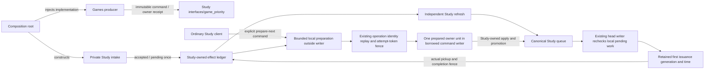

# Study game-priority interface

Study owns acceptance, control tombstones, effect receipts and later learning/
queue changes. Consumers import only [`game_priority.py`](game_priority.py).
Its explicit exports are `LearningFeedbackPort`, `EncounterFeedbackPort`,
`GameLapse`, `GameEncounter`, `GameEffectKey`, `GameEffectControl`,
`LearningReceipt` and `EncounterReceipt`. These are semantic commands and frozen
facts; database handles, queue/preparation types and constructors are private.

| Operation | Input | Output / authority |
| --- | --- | --- |
| `accept_lapse` | Proven `GameLapse` | Existing `LearningReceipt`; unchanged qualified lapse policy. |
| `accept_encounter` | Original immutable `GameEncounter` | `EncounterReceipt`; persist relevance once, without queue processing. |
| `effect_status` / `encounter_status` | Stable `GameEffectKey` | Owner receipt or `None`; callers must preserve its actual state. |
| `control_effect` | Key, source revision, hold/withdraw reason | Durable fence, including before admission; no historical reversal. |

**Accepted** means durable owner evidence, **pending** means Study has work to
consume, and **available** requires the owner's explicit available receipt.
Intake never waits for queue refresh, broad eligibility, promotion or providers.
Only Study refresh consumes accepted work and updates its canonical queue.
Study selection/save/refresh works with Games absent. An optional producer or
refresh failure cannot erase accepted evidence; delivery retries the original
key/source/detection/payload, and owner replay produces one logical effect.
Retain active attempts and later learning. Do not manufacture an Again, infer
availability from acceptance, poll until available inside intake, invoke a private
factory, write owned tables or refresh the queue from Games.

Composition alone binds the private implementation and current authority.
The existing pure `app.contracts.product_v02.learning` definitions are temporarily
re-exported unchanged, preserving existing wire/type consumers; they import no
Study or Games runtime. #482 owns these definitions and this surface; #501 owns
their eventual component-path migration. There is no reverse forwarding edge,
private type export or duplicate DTO. This compatibility location is removed
when #501 migrates the pure definitions and consumers together.

This depicts the source boundary; shared host/database resource isolation and
installed behavior require the release owner's separate proof.

Required affected command (after combining the named published producer/runtime
checkpoints): `python backend/app/study/qualify_priority.py`. It selects the real
#487 failure/absent-producer/replay/protected-state regressions and #488 actual
history intake/claim/refresh/pause/compatibility cases, with no optional skip or
fallback. The separate #491 public-provider injection/replay selection remains
with that unadopted continuous-sync component; it is not a prerequisite here. Cheap source check:
`PYTHONPATH=backend:database python -m pytest -q backend/tests/test_study_priority_interface.py backend/tests/test_product_contracts.py::test_new_product_boundaries_do_not_import_composition_or_private_siblings`.
The generic negative controls are collected by `npm run test:components`.
Static imports/calls cannot prove arbitrary injected callback behavior; the two
native #487 tripwire cases remain required in `qualify_priority.py`.

The historical-evidence ownership regression also uses the existing disposable
PostgreSQL fixture and a cached qualified worker image, with no pull/build.
`TEMPO_PRIORITY_WORKER_IMAGE` may select that test artifact; the default is the
retained `ea0b9746` image. It retains the 250ms transaction limit under constrained
worker/database CPU, and tests pickup/replay against stale queue statistics.

## Explicit next-card preparation

[`NextCardPreparation`](next_card.py) reports one bounded local command unit.
The composition root injects optional new Games handoff only with verified mode
intent. Accepted Study obligations use their own owner independently of that
producer. Construction performs no reads, opens no connection and starts no work.
`queue.prepare_next` only reads/prepares outside its command writer. Its selected
owner unit applies in the same borrowed writer **after** the operation identity,
replay and attempt-token fence. Completed/conflicting operations and stale
attempts cannot advance another obligation. A failed owner unit rolls back with
the handler savepoint. New Games intake uses the same pure-preparation/borrowed
apply seam; the mutating optional-worker advance function is never a gateway
preparer. Genuine head issuance only rechecks pending/ready facts and stamps
actual attempt authority.

A new ordinary prepared successor is declined while actionable local work needs
preparation. The user's real review commits and replays normally. The next queue
acquisition receives the explicit `study_feedback_preparation_pending` response,
performs `POST /api/queue/prepare-next` through the existing foreground worker,
then rereads before installing a new card. Ordinary queue GETs never prepare an
effect. An already-issued board remains valid, including over rollover; upcoming
unissued data can reconcile without changing its moves, generation or result.
The bounded local request remains foreground work during continuous practice;
optional provider HTTP and full projection retain their background gates.

The gate compares the ready candidate against earlier same-class local work;
pending historical preparation cannot block an already-ready live target. Only
a movable eligible urgent target relaxes ordinary repeat-position protections.
Burying a retained prior-day board retires its real row and keeps a current-day
exclusion marker, while its history/origin remains intact. The ordinary review
adapter captures its current time, settings timezone and Study day once at the
card/day boundary, preserving that day if the wall clock crosses midnight.

Schema55 records actual origins once. See the [canonical data dictionary](../../../../database/tempo_legacy_database/schema/study-queue-review-1/README.md#publicqueue_attempt_origins).
Read-only status may hydrate a missed optional receipt projection from that same
ledger; no read invents issuance or mutates the receipt. The final provider/mode
assembly and installed proof remain #624 responsibilities.
