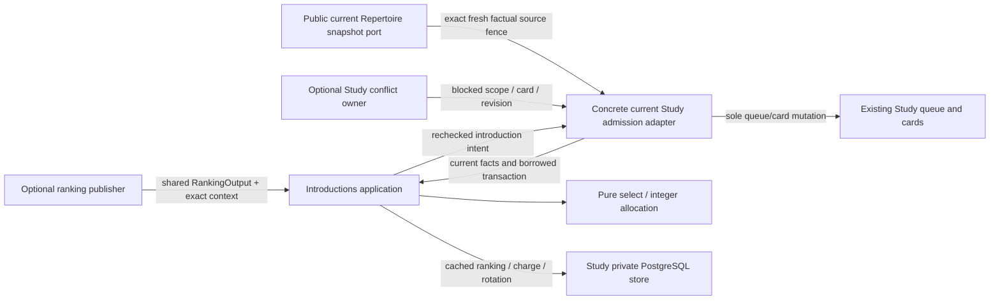
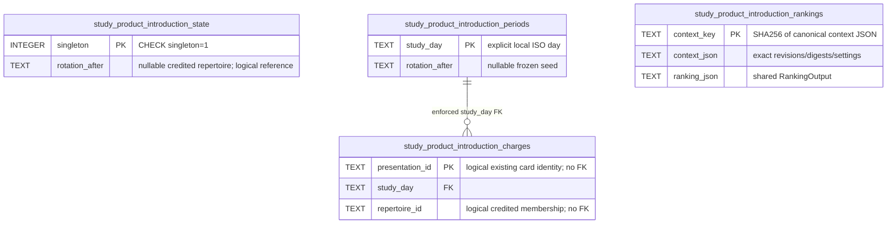

# Study introduction allocation (#495)

Implemented source, **explicit opt-in and inactive by default**. No setting, provider request,
schema migration, runtime activation or live operation is performed here.

`policy.select` replaces only introduction selection when explicitly adopted by
the current Study admission owner. The concrete bridge in
[`queue_admission_adapter.py`](../../services/queue_admission_adapter.py) now
implements `IntroductionOwner`; existing due reviews, game obligations, review
completion, attempt issuance and FSRS retain their current owners. #501 supplies
existing factual values and wires this factory on the borrowed writer transaction.

## Usable interface

```python
service = Introductions(PostgresIntroductionStore(borrowed_database), owner)
service.accept_ranking(local_day, exact_context, shared_ranking_output)
plan = service.preview(local_day)            # no writes, even to fairness
if plan.introductions:
    result = service.commit(local_day, plan.introductions[0], exact_context)
# caller commits/rolls back the whole owner transaction
```

Concrete current-owner composition (no SQL or eligibility callback in #501):

```python
from app.services.queue_admission_adapter import current_owner_introductions
from app.study.introductions.ports import IntroductionSettings, IntroductionSource
from tempo_game_evidence_contracts.legacy import LegacyAuthorityToken

source = IntroductionSource(public_snapshot, LegacyAuthorityToken.model_validate(capture["authority"]))
receiver = current_owner_introductions(
    borrowed_database, sources=(source,),
    settings=IntroductionSettings(settings_revision, global_budget, explicit_weights,
                                  enabled=explicitly_enabled, paused=explicitly_paused),
)
context = receiver.context(local_day)
receiver.accept_ranking(local_day, context, shared_ranking_output)
# At ordinary Study seeding; omitted keyword retains the legacy path:
seed_queue(borrowed_database, local_day, introductions=receiver)
```

`capture` is the existing retained-owner read supplied to #483, not a producer
callback during Study. `IntroductionSource` checks shared snapshot/authority
bindings and detaches input values; the concrete receiver rereads actual current
rows. The configured weight set must exactly match the supplied repertoire set.
Source bounds are 32 repertoires, 64 routes/128 mapped physical cards/256 graph
occurrences and decision mappings per repertoire, 40 moves per presentation and
1000 per route. Legal route replay is cached within each facts read.

The receiver itself checks current source/catalogue/prefix/graph revisions,
published ready graph rows, exact source route and executable, physical revision,
membership, conflict/deletion/validation/archive/supersession blocks and legal
learner history. Explicit route-local bindings are respected when supplied by the
newer compatible contract. It does not infer physical identity from a position.
Its content binding uses the existing authority fingerprint, which excludes
schedules/reviews and game-specific capture metadata; receiving a new capture of
unchanged content does not discard a compatible saved ranking.
Stale source scopes lose ranking compatibility and cannot introduce; source
busy/missing/oversized states return `deferred` with `receiver.owner.diagnostics`.
The saved installation `study_only_mode` is reread independently of caller
settings, and participates in the context fingerprint. Existing zero global or
per-repertoire introduction limits remain explicit pauses; positive legacy
per-repertoire allowances do not multiply or replace the new global budget.
New settings require actual Boolean enable/pause values; truthy strings cannot
activate this path.

`commit` obtains the existing card-edit reservation and day-position lock before
the allocation row. Card/source fences are nonblocking where waiting backwards
could interfere with foreground reviews. Busy admission returns `deferred`, with
no charge or fairness advance; retries remain safe. Source/definition/settings
rows are held in the same transaction through the sole existing
`QueueAdmissionAdapter.introduce_opening` writer. Due cards are appended by their
existing canonical writer before the introduction, and current issued rows are
never moved, removed or relabeled.

The optional `seed_queue(..., introductions=receiver)` hook bypasses only legacy
opening reset/per-repertoire reconciliation/admission for this explicitly
selected path. Already committed product introductions are not refunded or reset
by a later budget/pause change. The ordinary due/obligation, Tactics and authored
Study phases retain their owners. `receiver.admit(day, maximum_new=16)` admits a
bounded batch (hard maximum 64); another ordinary refresh may continue a larger
explicit allowance. No existing caller supplies the keyword automatically.

Public definitions: [application.py](application.py), [policy.py](policy.py),
[ports.py](ports.py). `RankingOutput` is the unchanged
[#482 shared contract](../../contracts/product_v02/analysis.py), also consumed by
#494's `rank_candidates(RankingInput)`. Study never imports that analysis
implementation. `RankingContext` is Study's acceptance envelope: exact sorted
repertoire IDs/revisions/digests plus an explicit settings revision. It is not a
second ranking DTO. The publisher must bind its output to that context; Study
checks the current owner context and the output's revision set. D04 population
selection is not invented here. A context may change for population controls,
weights, pause controls or source edits; integration must advance its revision
when any relevant setting changes.

An unavailable or incompatible publication is rejected without deleting a saved
compatible ranking. The store caches rankings by complete binding, so serving
uses the matching saved value or the owner-supplied existing safe fallback order.
It never calls or waits for Games, Explorer, Maia or Stockfish. Accepting ranking
facts never reorders, replaces or completes an issued attempt.

## Exact finite allocation policy

One **global** opening budget applies across all memberships. Relative weights
must be unique finite nonnegative numbers; zero explicitly pauses a repertoire.
`enabled=False` is the default; pause and `study_only` suppress discretionary
introductions. Required due/obligation work is retained in the supplied owner
order before introductions even with a zero budget.

Allocate the day's whole budget proportionally using integer floors, then give
largest fractional remainders to repertoires with ties ordered cyclically after
the persisted cursor. Subtract that day's actual allocation credits, then choose
the best-ranked eligible presentation among repertoires still owed slots. The
ranking takes precedence over fallback ordinals; stable rotation/identity breaks
ties. Spill unused slots by the same proportional rule over nonempty positive
weight repertoires. This is an allocation rule, not an encounter model or an
optimizer.

The period's tie cursor freezes only on its first committed introduction. Every
uniquely committed introduction atomically updates the global cursor to its
credited repertoire; the next local period starts after that value. Equal
nonempty repertoires with a one-slot budget therefore alternate across days.
Preview, rebuild and receipt replay never create a period, charge a slot or
advance the cursor. The whole-day quota seed stays fixed during the day, avoiding
quota drift as individual introductions commit.

Deduplication uses the **explicit presentation/physical-card identity** from the
owner, never a FEN. Multiple routes/decisions or memberships referring to that
identity receive one slot and one charge; allocation credit belongs to the
selected membership. Existing actual introduction facts and ledger receipts are
unioned by that identity, retaining charges if a queue row disappears. Required
work and already-introduced/joined material consume no new slot. Combined
presentations are introduced by #503's owner; this module does not create joins.

Candidates require affirmative approved/legal/mapped/playable-context facts and
no conflict, plus an exact current definition revision. Unknown facts fail
closed. There is no ancestor stability or 14-day maturity input. The current
owner must still verify the entire playable route/context at the effect boundary.

## Authority and transaction boundary



The current owner retains card/day locks, current definition/control fences and
the sole canonical card/queue writer. Acquire those existing locks **before**
the allocation singleton; use the same borrowed transaction for both sides.
`owner.introduce` revalidates current membership, exact definition, eligibility,
controls and route; it reports `introduced`, `already_introduced` or `stale` and
does not commit. It appends safe work without changing issued attempts. On an
exception the caller rolls back everything. Receipt replay across days is free.
The singleton serializes the small global allocation mutation, not providers or
long-lived background work. Read snapshots need no locks; commit checks the
current next allocation again under the writer transaction.

## Proposed private storage (not installed)

[product_introductions.py](../../../../database/tempo_legacy_database/adapters/study/product_introductions.py)
contains the bounded `SCHEMA_SQL` contract for **integration-owned migration
allocation**, and a `PostgresIntroductionStore` borrowing `PostgresConnection`.
Only ranking/rotation/receipt facts absent from existing storage are new; cards,
queues, scheduling, attempts and review history are not duplicated. No adapter
method installs tables, opens a connection or commits. Native tests install this
schema only in their labelled disposable fixture.



Logical card/repertoire references deliberately have no cascading foreign key:
removing a membership must not refund an actual introduction or erase fairness.
One charged presentation ID may appear once across all days. New composite
generations must use the presentation identities owned by #503; reused IDs do not
resurrect old commands. The local-day charge index supports the bounded period
read. Deployment/resource isolation and production schema availability are
unverified.

## Checks and next adoption work

`make python-file FILE=backend/tests/test_product_introductions.py` covers the
named policy cases plus revision fencing, quota stability, invalid weights and
the shared import guard. `test_product_introductions_postgres.py` owns disposable
real-transaction/reload/concurrency/rollback proof. Pure checks use synthetic
facts; native checks use a small task-owned SQL owner to exercise the application
transaction, not a claim that normal Study has been wired.

#495 owns the concrete current-owner eligibility/fence/canonical
writer adapter, now implemented in the concrete factory above. The three narrow
reserved hooks are `queue_admission_adapter.py`, `queue_application.py::seed_queue`
and the existing admission SQL owner. #501/T20 owns outer normal-product wiring,
explicit settings selection, migration allocation, central suite registration and
visible ranking acceptance; no eligibility callbacks or queue SQL belong in that
composition. The original 31 policy/6 private PostgreSQL results remain valid;
the follow-on adds only changed concrete-owner/native and opt-in seeding proof.
#503 can proceed independently; neither R11 nor existing Study depends on the new
tables until the feature is explicitly wired with its schema installed. The
retained bounded authority may conservatively defer after unrelated catalogue
generation changes; refresh it through its existing source owner. No migration
or graph rebuild is started by this module.

## Optional conflict admission and repertoire-only sources

The concrete factory accepts `conflicts=PostgresConflictStore(borrowed_database)`.
It delegates to the existing Study owner's `blocked(repertoire_id, card_id,
revision)` capability during candidate reads and again inside the commit-time
facts check. It copies no conflict SQL or policy. A hold can neither introduce
nor charge the card. An explicit False is the only release; unknown is closed.
Absence preserves the prior behavior and requires no conflict table/read.
Serving, recovery and rebuild guards remain with their assigned owners.

A complete repertoire-only source needs no game or retained capture:

```python
source = RepertoireIntroductionSource(current_snapshots.snapshot(repertoire_id))
receiver = current_owner_introductions(
    borrowed_database, sources=(source,), settings=explicit_settings,
    current_snapshots=current_snapshots,  # existing public #483 reader on this writer
    conflicts=study_conflict_store,      # optional existing Study owner
)
```

`current_snapshots` implements the existing `RepertoireSnapshotPort.snapshot`
operation; outer composition binds the published `current_snapshot` database
adapter to the same borrowed writer. It supplies facts, never an eligibility
callback. The receiver compares the exact source_revision/revision/digest fence
from a fresh public snapshot under its current source/card locks. The actual
reader's revision is `scope_source_revision + 1`; it is not a graph generation
and is never converted into a game authority token. Exact current membership,
physical revision/executable, playable route and saved controls remain required.

The content-only introduction binding is only a ranking-cache identity. It never
waives the exact raw source fence on admission. After this transaction's own
canonical introduction, the receiver rereads its already-validated sources,
checks unchanged content and refreshes their raw introduction facts. This permits
a bounded batch without accepting an independently stale caller snapshot. A
rollback discards the transaction-bound receiver. Source, route or membership
changes still close admission. Explicitly over-bound sources defer without
silently using a prefix of the supplied snapshot.

## Encounter-first introduction without optional ranking

```python
result = receiver.admit_encounter(
    local_day, repertoire_id=repertoire_id, decision_id=known_unintroduced_decision,
)
```

This small canonical capability prioritizes an actual current approved decision
within the existing weighted allocation. It requires no Explorer, model, game
capture or accepted ranking, and never writes a review/lapse/Again. Due work
retains precedence. The global allowance, positive weight, period quota, saved
zero limits, study-only/paused/disabled controls and scoped conflicts still
apply. It does not silently take another repertoire's owed slot. Successful
admission records one ordinary introduction, budget charge and fairness advance;
a retry or another decision on the same physical presentation reuses its receipt.

`deferred` means the feedback/command owner retains its existing durable retry
intent; this module creates no second command queue or priority producer. An
unmapped/ambiguous decision returns `unavailable`; already introduced material is
free. The receiver only appends eligible work and leaves an active attempt intact.
This API is source-only and inactive until the later product wiring is selected.

Changed native source qualification assembles the unchanged published generic
reader/shared mapping values and conflict owner/DDL with this component. It uses
the actual current schema, reader, canonical writer and hold read, not installed
artifact qualification or an optional runtime. Exact dependency hashes and commands
belong in the handoff evidence. #501 retains migration/registration and visible
product proof; the first feedback release is not changed by this feature.
