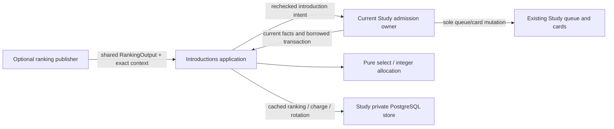
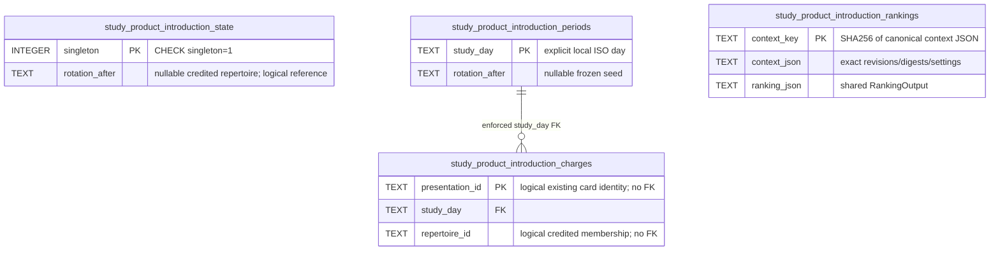

# Study introduction allocation (#495)

Implemented source, **unwired and inactive**. No setting, provider request,
schema migration, runtime activation or live operation is performed here.

`policy.select` replaces only introduction selection when explicitly adopted by
the current Study admission owner. Existing `queue_admission.py` remains the
queue authority; existing due reviews, game obligations, review completion,
attempt issuance and FSRS remain with their current owners. The integration
owner supplies the typed `IntroductionOwner` on the existing writer transaction.

## Usable interface

```python
service = Introductions(PostgresIntroductionStore(borrowed_database), owner)
service.accept_ranking(local_day, exact_context, shared_ranking_output)
plan = service.preview(local_day)            # no writes, even to fairness
if plan.introductions:
    result = service.commit(local_day, plan.introductions[0], exact_context)
# caller commits/rolls back the whole owner transaction
```

Public definitions: [application.py](application.py), [policy.py](policy.py),
[ports.py](ports.py). `RankingOutput` is the unchanged
[#482 shared contract](../../contracts/product_v02/analysis.py), also consumed by
#494's `rank_candidates(RankingInput)`. Study never imports that analysis
implementation. `RankingContext` is Study's acceptance envelope: exact sorted
repertoire IDs/revisions/digests plus an explicit settings revision. It is not a
second ranking DTO. The publisher must bind its output to that context; Study
checks the current owner context and the output's revision set. D04 population
selection is not invented here. A context may change for population controls,
weights, pause controls or source edits; integration must advance its revision
when any relevant setting changes.

An unavailable or incompatible publication is rejected without deleting a saved
compatible ranking. The store caches rankings by complete binding, so serving
uses the matching saved value or the owner-supplied existing safe fallback order.
It never calls or waits for Games, Explorer, Maia or Stockfish. Accepting ranking
facts never reorders, replaces or completes an issued attempt.

## Exact finite allocation policy

One **global** opening budget applies across all memberships. Relative weights
must be unique finite nonnegative numbers; zero explicitly pauses a repertoire.
`enabled=False` is the default; pause and `study_only` suppress discretionary
introductions. Required due/obligation work is retained in the supplied owner
order before introductions even with a zero budget.

Allocate the day's whole budget proportionally using integer floors, then give
largest fractional remainders to repertoires with ties ordered cyclically after
the persisted cursor. Subtract that day's actual allocation credits, then choose
the best-ranked eligible presentation among repertoires still owed slots. The
ranking takes precedence over fallback ordinals; stable rotation/identity breaks
ties. Spill unused slots by the same proportional rule over nonempty positive
weight repertoires. This is an allocation rule, not an encounter model or an
optimizer.

The period's tie cursor freezes only on its first committed introduction. Every
uniquely committed introduction atomically updates the global cursor to its
credited repertoire; the next local period starts after that value. Equal
nonempty repertoires with a one-slot budget therefore alternate across days.
Preview, rebuild and receipt replay never create a period, charge a slot or
advance the cursor. The whole-day quota seed stays fixed during the day, avoiding
quota drift as individual introductions commit.

Deduplication uses the **explicit presentation/physical-card identity** from the
owner, never a FEN. Multiple routes/decisions or memberships referring to that
identity receive one slot and one charge; allocation credit belongs to the
selected membership. Existing actual introduction facts and ledger receipts are
unioned by that identity, retaining charges if a queue row disappears. Required
work and already-introduced/joined material consume no new slot. Combined
presentations are introduced by #503's owner; this module does not create joins.

Candidates require affirmative approved/legal/mapped/playable-context facts and
no conflict, plus an exact current definition revision. Unknown facts fail
closed. There is no ancestor stability or 14-day maturity input. The current
owner must still verify the entire playable route/context at the effect boundary.

## Authority and transaction boundary



The current owner retains card/day locks, current definition/control fences and
the sole canonical card/queue writer. Acquire those existing locks **before**
the allocation singleton; use the same borrowed transaction for both sides.
`owner.introduce` revalidates current membership, exact definition, eligibility,
controls and route; it reports `introduced`, `already_introduced` or `stale` and
does not commit. It appends safe work without changing issued attempts. On an
exception the caller rolls back everything. Receipt replay across days is free.
The singleton serializes the small global allocation mutation, not providers or
long-lived background work. Read snapshots need no locks; commit checks the
current next allocation again under the writer transaction.

## Proposed private storage (not installed)

[product_introductions.py](../../../../database/tempo_legacy_database/adapters/study/product_introductions.py)
contains the bounded `SCHEMA_SQL` contract for **integration-owned migration
allocation**, and a `PostgresIntroductionStore` borrowing `PostgresConnection`.
Only ranking/rotation/receipt facts absent from existing storage are new; cards,
queues, scheduling, attempts and review history are not duplicated. No adapter
method installs tables, opens a connection or commits. Native tests install this
schema only in their labelled disposable fixture.



Logical card/repertoire references deliberately have no cascading foreign key:
removing a membership must not refund an actual introduction or erase fairness.
One charged presentation ID may appear once across all days. New composite
generations must use the presentation identities owned by #503; reused IDs do not
resurrect old commands. The local-day charge index supports the bounded period
read. Deployment/resource isolation and production schema availability are
unverified.

## Checks and next adoption work

`make python-file FILE=backend/tests/test_product_introductions.py` covers the
named policy cases plus revision fencing, quota stability, invalid weights and
the shared import guard. `test_product_introductions_postgres.py` owns disposable
real-transaction/reload/concurrency/rollback proof. Pure checks use synthetic
facts; native checks use a small task-owned SQL owner to exercise the application
transaction, not a claim that normal Study has been wired.

#495 still owns the later concrete current-owner eligibility/fence/canonical
writer adapter and any exactly reserved admission/reconciliation hook changes;
this private checkpoint does not claim those are implemented. #501/T20 owns
outer normal-product wiring, explicit settings selection, migration allocation,
central suite registration and visible ranking acceptance. It can consume this
accept/read capability with typed fake owner facts now. The existing fallback/
planner evidence remains unchanged. No current admission hook was edited. #503
can proceed without this feature; neither R11 nor existing Study depends on the
new tables.
