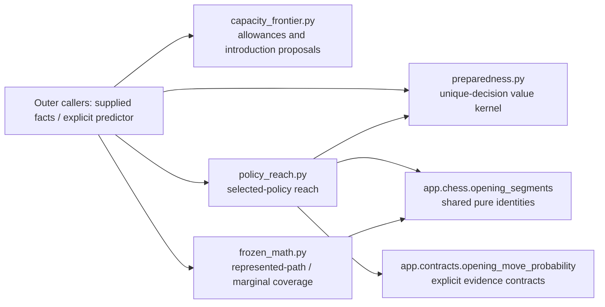

# Study opening policies

These are the existing supplied-input policies moved intact from `app.services`.
Each file retains its own model, validation, ordering, defaults and result types.
They acquire no database, network, clock, environment or scheduler. Concrete
input acquisition, publication, admission writes and provider lifecycle remain
outside these kernels. Moving them does not qualify the rest of Study's existing
legacy serving or resource dependencies.

Import explicit names from the owning module; `__init__.py` has no runtime
re-exports or composition. Same-Study policy imports are allowed. The other
repository dependencies here are shared pure chess functions and the explicit
move-probability contract, never sibling-domain implementations.

| Module | Supplied inputs and results | Existing responsibilities retained |
| --- | --- | --- |
| [preparedness.py](preparedness.py) | Policy-scoped `ProbabilityEvidence`, opponent distributions, `RouteReach`, `DecisionReadiness`, and `CardLearningEffect`; preparedness, marginal-value and ranking results | Expected correctly recalled **unique decisions**, exact/bounded/unknown evidence, disjoint event accounting and non-regressive hypothetical effects. Readiness is supplied evidence; this is not a scheduler or recall-state reader. |
| [capacity_frontier.py](capacity_frontier.py) | Existing candidate rows, allowances, day and miss-reason fact; `CapacityRoute`, `CapacityCandidate`, `CapacitySnapshot`, `CapacityProposal` | Normal introduction priority and a bounded one-decision capacity proposal. Admission is never treated as exposure. Supplied miss labels do not create a Games runtime dependency. No queue writes occur here. |
| [policy_reach.py](policy_reach.py) | Explicit `LearnerPolicy`, routes, scenario context and selected opponent evidence; path/unique reach and diagnostics | Deterministic learner actions retain opponent probabilities and unassigned mass. It neither chooses/fuses policies nor retrieves evidence. Missing learner actions prevent downstream kernel export. |
| [frozen_math.py](frozen_math.py) | Existing scenarios/represented lines, supplied `predict` callable, decision sets and ranks | Represented-path estimates, first-hit decision accounting, greedy marginal coverage and content fingerprinting. The caller owns the supplied predictor; this module creates no provider client. Its model remains distinct from preparedness and selected-policy reach. |

## Current source dependency view

Arrows between modules show actual imports after relocation. The diagram makes
no claim that every caller has completed its own boundary migration. The
[existing frozen-preference policy](../frozen_order/README.md) remains separately
owned; it is not consolidated with frozen coverage mathematics.

Model/event assumptions remain in
[the preparedness contract](../../../../docs/opening-preparedness-contract.md).
No schema or stored data changed. Algorithms, class identities within the moved
modules, dataclass options, default values, signatures, callback order and
exception decisions are preserved by source/AST comparison.

## Focused existing proof

- `backend/tests/test_opening_preparedness.py`: hand calculations, policy identity,
  bounded/unknown mass, transpositions, input immutability and import isolation.
- `backend/tests/test_opening_capacity_frontier.py`: residual allowances,
  one-step prerequisites, shared introductions, permutations and pure imports.
- `backend/tests/test_opening_policy_reach.py`: opponent deviations, incomplete
  actions, explicit selected context, metadata detachment and deterministic reach.
- `backend/tests/test_frozen_maia_math.py`: conditioning anchors, first-hit
  identities, duplicate routes, transpositions and unknown inference evidence.

Consumer/test imports are updated by the integration owner. These focused cases
and the move proof do not establish live/native, provider, whole-system or
optional-feature failure isolation.
