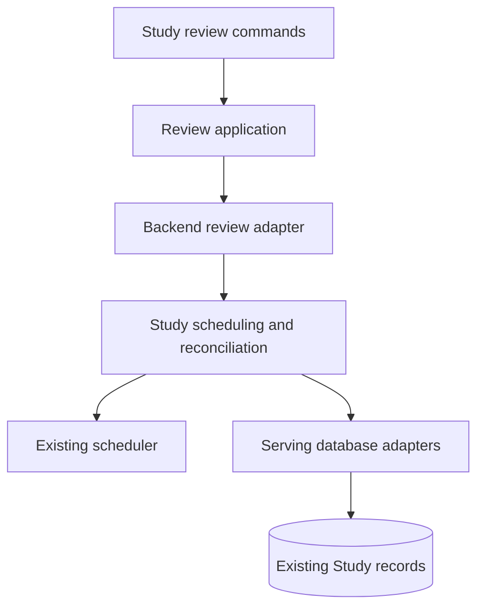

# Retained Study policy

The serving backend owns these helpers. The independent Learning runtime, its
HTTP/CLI assembly, separate database, publication lifecycle and position-effect
prototype have been removed. Importing queue ordering no longer imports those
owners or the old real-game feedback/database initialization chain.

| Module | Responsibility |
| --- | --- |
| `queue_ordering` | Deterministic presentation of work already admitted to the queue. |
| `scheduling_review_application` / `scheduling_review_contracts` | Review scheduling over explicit borrowed-store capabilities. |
| `review_reconciliation` | Rebuild schedule credit from retained independent review history. |
| `study_grading` | Validate and grade the existing authored exercise answer shapes. |
| `opening_decision_evidence` | Build opening decision manifests and interpret ordered observations. |
| `clock` | Preserve the existing explicit review-day override and workspace calendar. |

Authored exercise models belong to
[`contracts/study_exercises.py`](../../contracts/study_exercises.py).
Scheduling mathematics reuse [`services/scheduler.py`](../../services/scheduler.py);
opening identity helpers reuse [`chess/opening_segments.py`](../../chess/opening_segments.py).
The retained backend facades preserve their current caller interfaces.

The review application and remediation packages remain active libraries. They
borrow the caller's transaction and do not create an independent server or
separate Learning database. The two extracted SQL implementations belong to the
serving database adapters: `scheduling_review_store.py` and
`review_reconciliation.py`. This relocation changes no schema, SQL statement,
review meaning, persisted identity or data. It does not certify an installed
release or replace the native PostgreSQL/browser acceptance proof.
