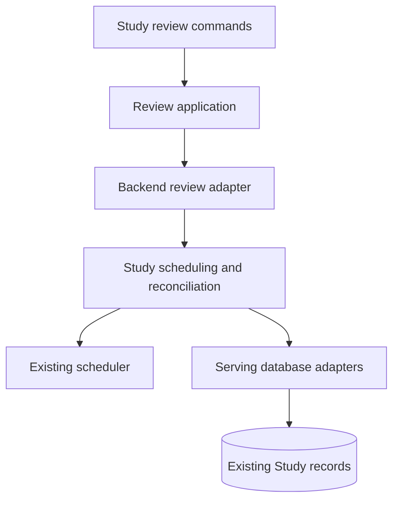

# Retained Study policy

The serving backend owns these helpers. The independent Learning runtime, its
HTTP/CLI assembly, separate database, publication lifecycle and position-effect
prototype have been removed. Importing queue ordering no longer imports those
owners or the old real-game feedback/database initialization chain.

| Module | Responsibility |
| --- | --- |
| `queue_ordering` | Deterministic presentation of work already admitted to the queue. |
| `scheduling_review_application` / `scheduling_review_contracts` | Review scheduling over explicit borrowed-store capabilities. |
| `review_reconciliation` | Rebuild schedule credit from retained independent review history. |
| `study_grading` | Validate and grade the existing authored exercise answer shapes. |
| `opening_decision_evidence` | Build opening decision manifests and interpret ordered observations. |
| `clock` | Preserve the existing explicit review-day override and workspace calendar. |

Authored exercise models belong to
[`contracts/study_exercises.py`](../../contracts/study_exercises.py).
Scheduling mathematics reuse [`services/scheduler.py`](../../services/scheduler.py);
opening identity helpers reuse [`chess/opening_segments.py`](../../chess/opening_segments.py).
The retained backend facades preserve their current caller interfaces.

The review application and remediation packages remain active libraries. They
borrow the caller's transaction and do not create an independent server or
separate Learning database. The two extracted SQL implementations belong to the
serving database adapters: `scheduling_review_store.py` and
`review_reconciliation.py`. This relocation changes no schema, SQL statement,
review meaning, persisted identity or data. It does not certify an installed
release or replace the native PostgreSQL/browser acceptance proof.

## Grader v1 compatibility decision

For retained and historical v1 exercises, the existing Python
`contracts/study_exercises.py` parser and `study_grading.py` validation and
evaluation are authoritative. This is the proposed default for browser
conformance, not a claim that the previous browser implementation was already
identical. Preserve schema/grader version 1, original attempts and receipts,
and the existing request serialization and answer hash. In particular, do not
add even a default-null provenance field to `StudyAttemptRequest`.

The v1 parser forbids extra fields but retains Pydantic's existing scalar
coercion. Its text, list and numeric bounds and defaults are the models in
`contracts/study_exercises.py`: for example, move answers have 1–40 moves,
choice answers 1–12 IDs and up to 12 displayed IDs, and knight paths up to
four squares. Model parsing, exercise validation, and answer evaluation are
separate stages: parser rejection is not an `invalid_submission`, and an
unrecognized legal open-judgment move is not an incorrect or invalid answer.

V1 accepts UCI moves, not SAN. Square selections and selected choice IDs with
duplicates are invalid submissions. A nonempty choice `displayed_order` is
checked by set equality against the authored IDs: duplicate entries are not
independently rejected if the set matches and the parser's length bound holds.
Knight routes use the current bounded static occupancy rules, including exact
versus at-most hop semantics; explanation answers require readiness and then
require self-assessment. The grader's existing checks and defaults are the
complete authority, rather than a stricter interpretation of this summary.

A deliberate change to Python acceptance or grading, such as rejecting a
currently accepted duplicate displayed order or imposing globally strict scalar
types, requires a genuinely separate schema/grader v2 path before deployment.
It must not relabel persisted v1 work or silently change v1 behavior.
