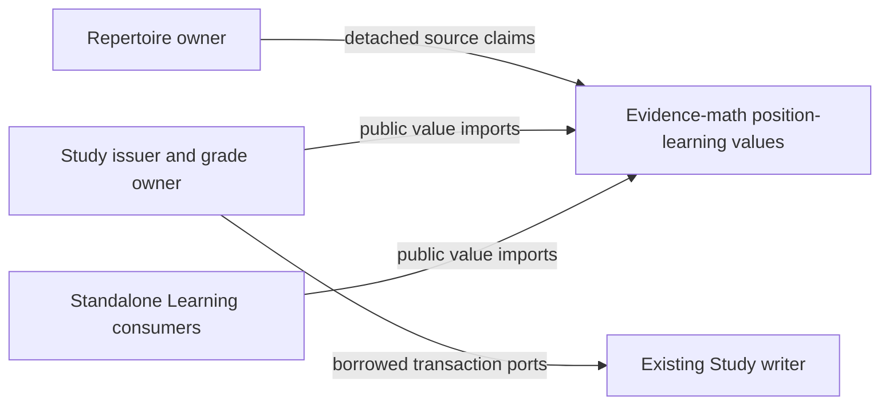
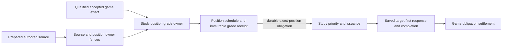

# Position-owned opening Study contract

`tempo_evidence_math.position_learning` owns detached immutable values;
`contracts.py` re-exports the identical classes and contains Study transaction
ports. The contract
performs no issuance, grade, graph lookup, persistence, or scheduling. Existing
Study remains authoritative for these operations and the legacy card scheduler
and its first-clean reinforcement remain unchanged. The pure values do not
activate a cohort or attest that an operation occurred.

`PositionKey(repertoire_id, position, variant)` is the stable schedule identity.
`position` must already be the canonical legal four-field FEN from
`tempo_evidence_math.opening_position_key`, including legal en passant, without
clocks. The definition separately fences the selected UCI and policy version.
A response/policy change holds an old attempt's positive effect until the owner
revalidates its exact original definition; it never moves history to another key.
Existing card ID plus occurrence ply, evidence-math decision ID, and Games event
IDs remain original provenance, not aliases or rewritten keys. A mapping requires
source owner proof of the exact repertoire, occurrence, board and answer; a FEN
or physical card alone cannot establish it.

`SourceCertificate` and `RouteOption` carry claims from the Repertoire owner;
constructing them or setting their booleans does not certify their provenance,
completeness, legality or currentness. The existing snapshot/index owner must
establish those facts and the Study issuer must fence them in its transaction.
Authored-route completeness is separate from physical-card binding ambiguity.
The original queue/card/attempt identity, frozen plan, definition, source proof,
owner epoch and a due witness for every physically shown learner position must
be persisted together. A proposed plan is not an issued receipt. A matching
retry returns the original issuance; changed bytes under the same identity hold.
When the first unavailable state is after the target, queue preparation may end
at the preceding learner response. The issuer rechecks the exact certified route
slice and the first omitted state before accepting that boundary. A completed
root-prefix attempt proves only its played moves and saved responses.

The writer uses the captured due witness as necessary, never sufficient, positive
entitlement. Under the existing borrowed transaction it locks position states in
stable key order, rechecks definition, original issuance proof and owner epoch, event identity,
current revision and the accepted positive ledger, and commits schedule, receipt
and original attempt/queue settlement atomically. Stale Good is observation;
never backdate or reorder an accepted FSRS transition. A newly due state after
issuance cannot turn a nondue witness into Good. A mismatch in the original proof or owner epoch holds; a later unrelated source
digest revision holds new issuance but does not by itself invalidate the saved
original attempt. Changed approved definitions are separately fenced;
there is no silent fallback to legacy scheduling for an opted-in position. Study reads its
configured local timezone and captures the Study day once at issuance. At each
particular grade acceptance transaction, the Study owner captures the current
local day using its existing clock/settings day policy and supplies it as the
required `AcceptedEvidence.accepted_study_day`. For Good, that is the day of
the completed saved review, not an earlier partial-response checkpoint. Persist
this day in the accepted grade receipt for exact replay. Never derive it from a
client timestamp or the offset on `issued_at`. To bound late arrivals, a Good is
eligible only when that owner-supplied acceptance day is the same as the issued day; after midnight preserve the response as observation,
including on replay, and never credit the prior day retroactively. The writer
checks at most one Good per position and local day across all attempts, policies
and epochs. Negative evidence is accepted on the current owner day at actual
processing time, including after midnight, without backdating. Timezone changes
must be fenced by the owner; a mismatched or unavailable day context holds.

| Evidence and current ledger | Owner outcome |
| --- | --- |
| Saved completed attempt, unaided correct first response, due at issuance, unchanged definition/epoch and revision, no Good that day | Good once |
| Correct but nondue, assisted, stale state, previous Good, or accepted after issued day | Observe only |
| Correct but no completed saved attempt | Pending; no Good |
| New durable authoritative wrong first response or explicit manual failure, due or nondue, even after Good or abandoned completion | Again once at acceptance |
| Guided retry or duplicate same first-response event | No new transition; replay original receipt |
| Alternate or unverified response, missing durable evidence, changed definition or epoch | Hold, no fabricated failure |
| Two tabs issued due at same revision | First qualifying Good advances state; second Good observes after ledger/revision recheck; a distinct later wrong still gets Again |

A partially correct line cannot certify prefix skipping. That requires a saved,
whole clean presentation with matching ordered authored prefix, root, day, source
and epoch. A correct response in a subsequently failed line may still be graded
individually when its saved complete attempt meets the positive conditions.

Example detached values (the owner must still validate and persist them):

```python
key = PositionKey("rep-1", "rnbqkbnr/pppppppp/8/8/8/8/PPPPPPPP/RNBQKBNR w KQkq -")
definition = PositionDefinition(key, "e2e4", "policy-1")
# DueAtIssuance(definition, True, local_day, epoch, revision, issued_at)
# Each FirstResponse is tied to the original attempt and one durable event ID.
```

The interfaces deliberately have no Repertoire implementation, DB connection,
provider or scheduler import. Concrete issuance and grade receipts are supplied
by the actual Study owner; ports borrow its transaction and cannot commit it.



This is the source contract and intended dependency boundary, not a claim that
Learning, issuance or persistence is wired or deployed. Composition and owner
adapters supply source authority and implement the transaction ports.

Qualified game misses use Study's `PositionGameIntake` capability. The source is
prepared on a closed read and fenced with the active owner before the existing
card/effect locks. For an introduced position, the accepted original Games effect
and the position Again receipt commit in the same borrowed transaction. The
receipt retains the original game key and evidence; it does not create a human
review. Its position grade ID is distinct from a legacy scheduling review ID.
For an unseen target, the existing encounter-exception admission and its fresh
position state commit together after source and owner fences. Accepted effects
promote the current physical carrier through the existing Study queue. The queue
issuer reads the exact durable position obligation and retains its natural due
witness; a nondue urgent presentation does not become positive evidence.
When the original Games carrier is unintroduced but its position already has
state, Study can select a currently introduced authored alias. It rechecks the
prepared source, physical binding, grade and owner epoch before promoting that
carrier. The original game and decision identity stay unchanged. Settlement
requires the issued position plan and the exact accepted post-reset response;
the alias does not acquire the original physical decision lineage.


