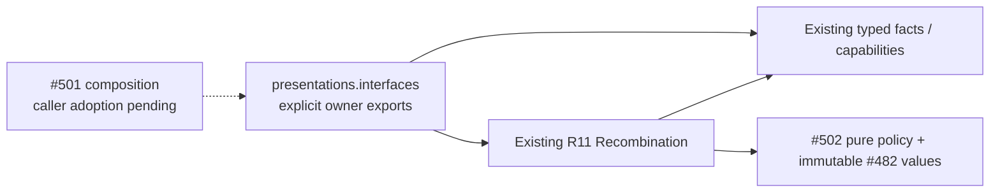

# Study presentation interface — #503

`app.study.presentations.interfaces` is the allocated public surface for the
existing [R11 recombination owner](../../recombination/README.md). It explicitly
exports the original class, protocols and immutable facts; no DTO or policy is
copied. Its backing implementation remains in `app.study.recombination` at the
qualified, published #503 checkpoint. This first-wave surface does not move that
implementation or activate a caller.

`Recombination` supports `record_review`, `propose`, `apply_join` and the manual
`accept_split`. `StudyBoundary` and `RecombinationStore` are its typed semantic
capabilities. `CurrentRoute`, route/evidence values, `PresentationChange` and
`Obligation` carry existing owner facts. Canonical `Presentation`, `JoinPlan` and
`PresentationChangeReceipt` remain #482 values in
[`app.contracts.product_v02.presentation`](../../../contracts/product_v02/presentation.py);
this surface references their existing identities through the original types
and does not re-export another component's operations.

Composition supplies the concrete capabilities, clock, local-day boundary and
identity source. The application borrows the caller's writer transaction;
scheduling, queue changes and private receipts commit or roll back together.
An applied receipt is provisional until commit. Busy or missing current authority
holds the change; exceptions require rollback. Original attempt/history and
obligation identities/deadlines retain their existing owners. The interface opens
no connection, registers no command and starts no worker, provider or engine.
Its imports use only the existing pure policy, chess/evidence libraries and
immutable wire values.

Remaining private edges are explicit: the owning database adapter
[`adapters/study/recombination.py`](../../../../../database/tempo_legacy_database/adapters/study/recombination.py)
still imports `app.study.recombination` modules; the retained review, queue and
split hooks still use their existing concrete adapter paths. Legacy
[`prefix_split_commands.py`](../../../prefix_split_commands.py) also registers
foreground commands, and [`services/prefix_split.py`](../../../services/prefix_split.py)
retains cross-owner publication/queue helpers. Neither is re-exported here.
Existing private test imports remain unchanged. These are migration work, not
completed decoupling or new mutation authority.

The allocation leases only this README, `__init__.py` and the focused surface
test. #501 owns cross-owner/root adoption and packaging; #487's active intake and
refresh files remain untouched. After those caller leases are released, migrate
the named private edges to this surface and retire compatibility paths only when
all callers and #482's DAG/private-import/export-bypass negative controls pass.
The guard must map this allocated surface to its existing #503 recombination
implementation; this directory alone cannot establish that graph proof.

Focused proof: `make python-file FILE=backend/tests/test_public_surface_presentations.py`
checks export identity, canonical annotations and a cold import with forbidden
runtime modules/effects. The unchanged application suite is
`backend/tests/test_product_recombination_application.py`. Existing native and
A08 evidence belongs to the preserved R11 branch; this import-only change makes
no new database, browser, deployment or host-isolation claim.
