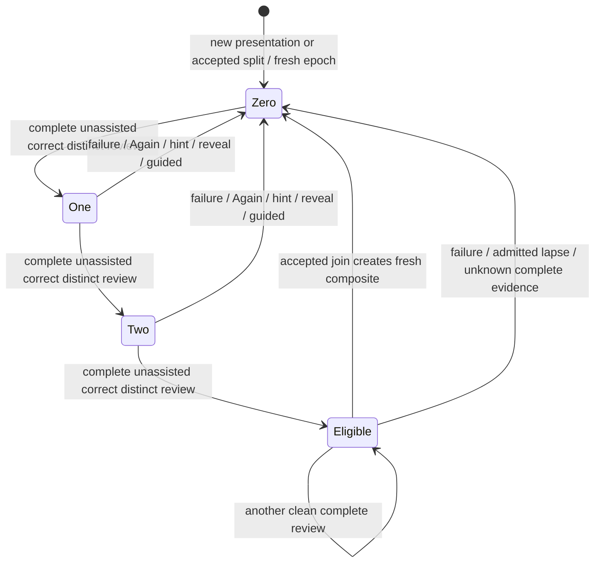

# Pure recombination policy — #502

This is Study-owned pure source for SPEC C01–C04. It is not wired to product
reviews or queues. #503 owns persistence, ordering, active-attempt rechecks,
conservative schedule initialization, obligations and accepted splits.

`models.py` owns `CleanStreak`, `ReviewEvent`, `JoinMember`, `RouteUse`,
`ParentConnection`, `RouteContext`, `JoinPlan`, `JoinHold` and `JoinDecision`.
The two read protocols describe supplied factual capabilities. They are not
shared wire DTOs: #482 owns those values and #483 owns route/index acquisition.
No concrete sibling-domain implementation is imported.

`reduce_clean_streak(state,event) -> CleanStreak` is usable now. Pass aware,
owner-ordered events, explicit immutable presentation/revision/epoch identities,
distinct attempt and review identities, completion and known assistance facts.
A retry cannot count by changing only its event ID; a teaching correction in an
already failed attempt cannot become clean. Real games never increment. Only an
explicit `source="admitted_lapse", outcome="failure"` invalidates from game
evidence; Study owns its admission and chronology. Out-of-order current-epoch
events raise `ValueError`, allowing the owner to replay in its chosen order.
Unknown assistance on a completed review resets eligibility conservatively;
incomplete work leaves the count alone unless it includes failure/assistance.

Partial clean work, raw game success and duplicate completions do not increment.
Same-day distinct completed reviews count. The existing scheduler's
`hard_correct_streak` remains a separate recovery counter. The existing
three-Again-among-last-five split offer remains unchanged.

The frozen plan shape is `JoinDecision(plan: JoinPlan | None, holds)`.
`plan_join(presentations: tuple[JoinMember,...], route_context: RouteContext)`
will produce at most one plan for this route/pass. Exact components include
presentation ID, revision, fresh-evidence epoch and route occurrence/range.
The plan retains authored route/start/history, ordered resulting moves,
intervening opponent cues and other uses of both members. It starts at 0/3,
already introduced, costing zero introduction slots. It contains no new
presentation ID, scheduling/FSRS state or database statement. Application owns
idempotency/new identity and must atomically recheck current facts.

No output composite is fed back into the same pass. AB must earn three fresh
complete Study reviews before it can combine with C. Accepted splits initialize
each fragment with a new `evidence_epoch` and count zero, even if component IDs
are reused; old-generation events cannot resurrect eligibility.
