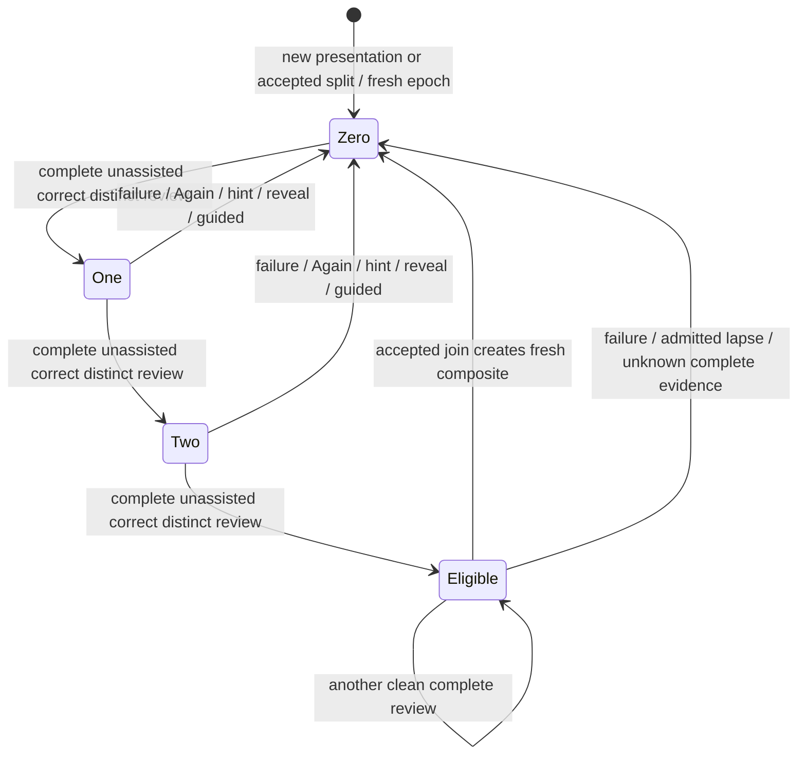

# Pure recombination policy — #502

This is Study-owned pure source for SPEC C01–C04. It is not wired to product
reviews or queues. #503 owns persistence, ordering, active-attempt rechecks,
conservative schedule initialization, obligations and accepted splits.

`models.py` owns `CleanStreak`, `ReviewEvent`, `JoinMember`, `RouteUse`,
`ParentConnection`, `RouteContext`, `JoinEvidence`, `JoinHold` and `JoinDecision`.
It consumes the exact shared `Presentation` and `JoinPlan` from #482's
[`presentation.py`](../../contracts/product_v02/presentation.py) at
`2db98217f249a81ba8e5c3b3709169a80c0a82b9` (PR #513).
`RouteJoinPlan(JoinPlan)` adds only a frozen local `evidence` proof; it does not
redefine the shared payload. The single `AuthoredRouteFacts` read protocol is a
projection of route fields plus snapshot source revision. #483 owns acquiring
those facts; outer composition supplies the projection. No concrete sibling
implementation is imported. No shared files are changed.

`reduce_clean_streak(state,event) -> CleanStreak` is usable now. Pass aware,
owner-ordered events, explicit immutable presentation/revision/epoch identities,
distinct attempt and review identities, completion and known assistance facts.
A retry cannot count by changing only its event ID; attempts and review IDs are
terminal before chronology checks, so even an old failed-review retry cannot
reset later clean evidence. A teaching correction in an already failed attempt
cannot become clean. Real games never increment. Only an
explicit `source="admitted_lapse", outcome="failure"` invalidates from game
evidence; Study owns its admission and chronology. Out-of-order current-epoch
events raise `ValueError`, allowing the owner to replay in its chosen order.
Corrected historical facts require the owner's ordered replay rather than a new
submission against a completed attempt. Unknown assistance on a completed review resets eligibility conservatively;
incomplete work leaves the count alone unless it includes failure/assistance.



Partial clean work, raw game success and duplicate completions do not increment.
Same-day distinct completed reviews count. The existing scheduler's
`hard_correct_streak` remains a separate recovery counter. The existing
three-Again-among-last-five split offer remains unchanged.

The final shape is `JoinDecision(plan: RouteJoinPlan | None, holds)`.
`plan_join(presentations: tuple[JoinMember,...], route_context: RouteContext)`
produces at most one plan for this route/pass. `JoinMember.presentation` is the
shared value, accompanied by proven streak state, owner-current revision,
availability, active/pending-attempt facts, immutable executable start/moves/end
and every retained route use. Shared aggregate clean counts alone never suffice.

`RouteContext` supplies the current immutable authored route, repertoire and
Study revisions, complete/available conflict scope, optional exact recorded
parent references, other authored routes, opaque unresolved obligation IDs, and
owner-allocated `plan_id`/`result_presentation_id`. These IDs are inputs: the
policy generates no clock, random ID, schedule or command receipt. Its pure
legality work is bounded to at most 1,000 moves per supplied route.

Plans preserve the actual shared left/right values, decision components,
lineage, all opponent cues and unresolved obligation IDs. The result has
`result.clean_streak == resulting_clean_streak == 0`, is introduced and costs
zero introduction slots. `evidence.components` names exact presentation
IDs/revisions, evidence epochs and route occurrence/ranges;
`evidence.route_starting_fen/route_moves` preserve authored history;
`evidence.starting_fen/moves/ending_fen` give the executable joined sequence;
`evidence.retained_uses` lists every other supplied use of both members. The plan
contains no database statement or guessed FSRS state. Application must preserve
obligation deadlines and atomically recheck current revisions, membership,
conflicts, fresh streaks and active/pending attempts.

The shared presentation anchors decisions and internal opponent cues. Executable
spans may include a leading opponent cue (as in a retained split continuation).
The policy takes connecting cues directly from the authored moves between the
last left and first right decisions and includes each once. Position keys use
the public `tempo_evidence_math.opening_position_key`: repertoire/variant scope
is explicit; clocks do not establish position identity, and authored full FEN and
route history remain in the proof. Unscoped matching FENs never establish a join.

An explicitly recorded parent takes precedence; stale, missing or competing
parent references do not silently fall back to another neighbour. Otherwise
verified nonoverlapping authored neighbours qualify. Ties choose recorded-parent
pairs first, then earliest route ply and stable IDs. Only one pair is returned;
there is no graph-wide optimization. Alternative opponent route uses stay
separate; conflicting moves within a supplied occurrence, overlapping ranges,
unsupported source, own-response conflicts, unintroduced/unavailable material,
and active/stale members receive explicit holds. Unrelated eligible pairs can
still be planned. This is a proposal, not a transaction reservation.

No output composite is fed back into the same pass. AB must earn three fresh
complete Study reviews before it can combine with C. Accepted splits initialize
each fragment with a new `evidence_epoch` and count zero, even if component IDs
are reused; old-generation events cannot resurrect eligibility.

## Reuse and focused evidence

The existing `prefix_split.py` legal split/lineage concepts, scheduling recovery
counter/recent-five threshold and practice-card split offer were inspected and
remain unchanged. Reusing their state would conflate recovery with general clean
review eligibility; the capability gap is the pure C01 reducer and C02 join plan.
The public evidence-math identity helper and #482 shared presentation/plan values
are reused. #483's immutable route/adjacency API was read; no index implementation
or database capture is pulled into Study policy.

The exact shared [A/B/AB fixture](../../../../contracts/product-v02/fixtures/join-a-b-to-ab.json)
is consumed by `test_exact_shared_fixture_and_obligation_ids_are_preserved`.
The policy output, after excluding local `evidence`, equals the original shared
plan, including `existing-game-obligation`. Other synthetic legal fixtures expose
reducer transitions and parent/fork/overlap/cue/fresh-generation behavior plainly.
The focused suite reuses #482's boundary/cycle guard for only these two modules.

Run from the repository root with existing Python dependencies and the three
source libraries on PYTHONPATH (no installation):

```sh
PYTHONPATH="$PWD/packages/evidence-math/src:$PWD/packages/game-review-contracts/src:$PWD/packages/chess-core/src:$PWD/contracts/game-evidence/src" \
  TEMPO_PYTHON=<existing-source-path-wrapper> \
  make python-file FILE=backend/tests/test_product_recombination_policy.py
```

The Make target replaces PYTHONPATH with `backend:database`, so the external
interpreter wrapper must prepend the four library paths above, plus the task
`backend`/`database` paths, then exec the existing interpreter. No package is
installed or refreshed. Acquire the existing advisory lock nontruncating before
the command and release it promptly; never unlink it. No server, database,
provider, engine or browser is used.

Central regression inventory entry for #503's integration reservation:
`backend/tests/test_product_recombination_policy.py` — C01–C04/R11 pure review
identity, failure/assistance reset, parent-first exact route/cues and AB 0/3 proof.
The local suite is executable/discoverable now; central registration and normal
Study A08 proof remain the integration owner's work. The application-owned
directory `README.md` is reserved to #503; this assigned POLICY.md owns the pure
state-transition diagram until that owner links it from the canonical README.

This source has no I/O, persistence, lifecycle, transaction, provider or deployment
boundary. Native persistence/races, scheduling initialization, actual #483 capture
projection and normal Study/browser adoption are deliberately unverified here.
