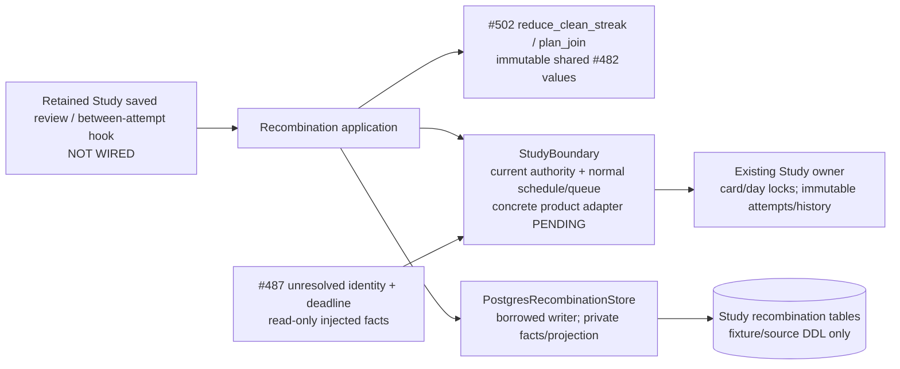
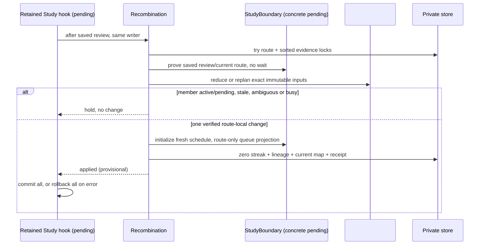
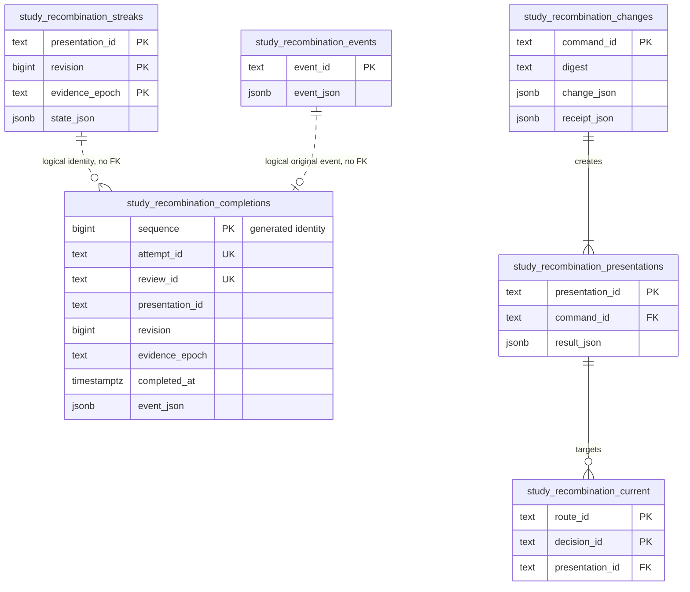

# Study recombination application — #503

Private implementation checkpoint for SPEC v0.2 C01–C04 / A08. It consumes
[#502's pure policy](POLICY.md) at `86debb32` and #482's immutable
[`Presentation` / `JoinPlan`](../../contracts/product_v02/presentation.py).
It does not install a migration or connect the normal Study path. Retained
review/admission hooks, concrete current-owner capture, scheduler initialization,
#487 obligation routing/settlement and browser acceptance remain integration work.
There is no additional service, scheduler, producer call or content mutation.

## Public application and transaction contract

`Recombination(store, study, clock=..., next_local_study_day=..., new_id=...)`
borrows one existing Study writer transaction. The caller commits/rolls back all
current-owner, queue, schedule and private-store writes together. A returned
`applied` receipt is provisional until commit. Any exception requires rollback.
Do not catch an initialization/storage error and commit an earlier partial write.

- `record_review(route_id, ReviewEvent) -> CleanStreak`: accepts an exact saved
  owner fact only after `StudyBoundary.saved_review` proves its immutable
  presentation/revision/epoch, attempt/review, completion, assistance and failure
  facts. Unknown historical assistance never qualifies. The exact #502 reducer
  handles chronology and deduplication. An old pending completion remains tied
  to its original presentation; the new composite receives no inherited event.
- `propose(route_id) -> JoinDecision | None`: reloads current facts, overlays only
  this owner's persisted streaks and calls #502 `plan_join`. `None` means current
  authority/bounded locks were unavailable; an ineligible decision retains the
  policy's explicit holds. No recursive same-pass merging.
- `apply_join(RouteJoinPlan) -> PresentationChangeReceipt`: exact shared wire
  plan plus #502's immutable local route proof. Replans from current facts under
  nonblocking route/evidence/current-owner locks. Rechecks source and Study
  revision, conflict scope, memberships, current content, active/pending attempts,
  earned eligibility and unused result identity. Changed command payload under a
  reused command ID raises `command_identity_conflict`. Exact replay returns its
  original receipt even after subsequent split/rejoin generations.
- `accept_split(route_id, presentation_id, expected_revision, command_id,
  confirmed=True)`: the learner must confirm; three Again outcomes among the
  latest five **distinct completed Study attempts** are required. Isolates the
  final learner decision, preserving the legal opponent cue in continuation
  moves. Both fragments have fresh identities/epochs, introduced=true and 0/3.
  No targeted interior split is claimed. Preview, decline and UI remain with the
  existing command/TrainingView owners until their reserved integration window.

`ports.py` is the narrow composition contract. `StudyBoundary.try_current`
must reread/fence actual retained source/publication/conflict/membership rows,
current revisions, issued and pending attempts, due state and unresolved
obligations in the **same** writer transaction. Its `CurrentRoute` is a capability
result, not authorization from a producer snapshot. Unproved/ambiguous routes
return unavailable. `saved_review` must read actual owning immutable receipts and
hold their existing locks. `identity_available` checks all retained physical and
historical presentation IDs, including old generations.

`StudyBoundary.apply(PresentationChange)` is an explicit missing integration
capability. It must initialize fresh scheduling through the existing Study
owner, replace only the specified route occurrences in its queue, preserve all
other memberships/active attempts, and retain source moves and original review
identities. The private adapter alone cannot make a product join happen. The
native fixture supplies a deliberately named fake boundary over real PostgreSQL;
its initialization row does not establish a real FSRS/queue integration pass.

The application takes a nonblocking route lock and sorted evidence identity
locks. Current-owner capture must use nonblocking locks when it cannot follow
the existing card-before-day order after a completed review. Busy work defers;
it must never wait for another card while holding the current review/day locks.
Evidence locks also serialize one shared presentation used by different routes.
Release all locks promptly by ending the caller transaction; perform one change
per pass. No long-running database transaction or optional worker is introduced.

## Finite initial schedule and obligations

The exact default is:

`due = min(next local study-day boundary, each participating current due,
           each unresolved participating decision's original available_by)`.

`next_local_study_day(now)` is supplied by the existing owner with the user's
timezone/day boundary; it must be an aware instant strictly after now and within
26 hours (including DST changes). Every supplied deadline must be aware. Missing
component due state declines the join. An overdue deadline stays in the past and
is immediately eligible. This is a complete verification request by the next
local day, not a copied/averaged FSRS stability or a fabricated combined review.
Initialization owns no past review count and charges zero introduction slots.

`Obligation(logical_id, decision_id, available_by)` carries #487's original
unresolved effect identity/deadline unchanged. Only obligations whose existing
decision occurs in the combined sequence are included. The adapter updates a
route/decision → current-presentation projection; the immutable obligation row,
its lapse receipt, occurrence/detection time and settlement history stay with
#487. Its owner must consume the projection for current queue targeting and
settlement. This checkpoint deliberately neither writes nor settles
`study_game_feedback`. Original game effects must never be resubmitted merely
to change their queue target. #487 `994499f3` remains the authority/maintenance
reference, with its current exact-UTC-introduction limitations unchanged.

The existing split donor reassigns `reviews.card_id`, rekeys old queue entries,
deletes memberships and archives the source globally. Those mutations are not
reused. R11 retains original immutable attempt/review identities and route-local
lineage; fresh split/rejoin identities cannot resurrect old schedules, receipts
or introductions. No source repertoire edit is made.

## Implemented source boundary (deployment unverified)





## Private storage shape

[`recombination.py`](../../../../../database/tempo_legacy_database/adapters/study/recombination.py)
contains source DDL `SCHEMA` for task fixtures. It runs no DDL, opens no connection
and commits nothing. Integration must allocate an additive migration number,
readiness/registry entry and relevant database owner README before merge/activation;
none is silently selected here. Columns are the source proposal, not live schema.



All stored facts belong to Study. There are no FKs to source cards, original
attempts, reviews or #487 effects: those are explicit logical provenance
references in immutable JSON, not ownership transfers or inferred mappings.
`changes.change_json` retains exact retired route occurrences, result moves,
lineage, fresh evidence epochs, conservative initialization and obligation refs.
Unique attempt/review IDs prevent retries becoming extra split failures; the
indexed completion query reads at most five distinct completed facts. The
current projection is keyed by route and decision, so another branch/repertoire
is untouched. Original events and historical changes/presentations are append-only.

## Focused verification and remaining integration

Run the assigned commands with an existing Python runtime/source paths:

```
make python-file FILE=backend/tests/test_product_recombination_application.py
make python-file FILE=backend/tests/test_product_recombination_postgres.py
```

The native file requires an explicitly task-owned database named
`tempo_task503_*` via `TEMPO_RECOMBINATION_TEST_DSN`; unavailable infrastructure is
a failed required check, never a skip/pass. It creates/drops only unique private
fixture schemas. The external task runner bounds the existing disposable image,
uses a loopback ephemeral port, verifies exact container ownership, removes its
container/anonymous volumes and releases the nontruncating advisory validation
lock. It installs nothing. Native current/scheduler boundaries remain fake;
transactions, constraints, locks, rollback, reconnect/readback and persistence
are real PostgreSQL. Unchanged #502 policy evidence is reused.

Remaining #503 acceptance: reserve exact completion/admission/split/queue adapter
hooks after #487/#495's current window; add the concrete retained source/schedule
and obligation projection adapter; allocate private DDL through integration;
register these exact tests centrally; prove normal Study A08 in
`make ui-file FILE=product-recombination.spec.ts`. That browser spec is not yet
created because there is no installed normal-Study route to exercise. Separate
private-file work is ready without occupying a shared hook. An unsupported or
ambiguous route safely continues its separate presentations; no join is guessed.
