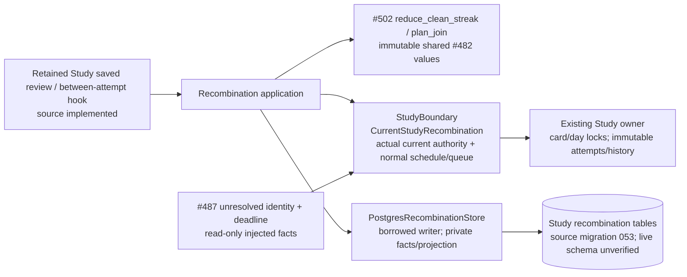
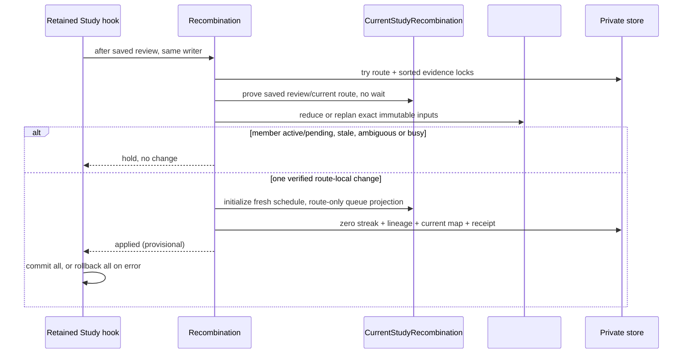
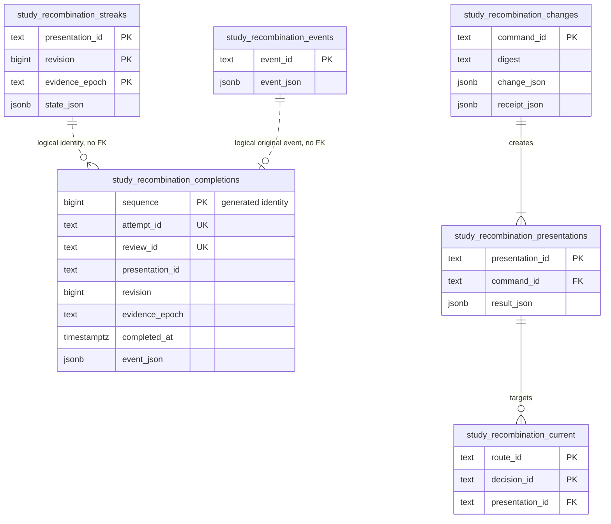

# Study recombination owner — #503

Study-owned implementation for SPEC v0.2 C01–C04 / A08. It consumes
[#502's pure policy](POLICY.md) at `86debb32` and #482's immutable
[`Presentation` / `JoinPlan`](../../contracts/product_v02/presentation.py).
The retained normal-Study save, queue recovery and confirmed-split paths now
consume `CurrentStudyRecombination` in the owning database adapter. New rows require
additive source migration 053; this is not a claim of live schema or deployment.
Migration/readiness coordination and browser acceptance are recorded below. There
is no additional service, scheduler, producer call or source content mutation.

## Public application and transaction contract

`Recombination(store, study, clock=..., next_local_study_day=..., new_id=...)`
borrows one existing Study writer transaction. The caller commits/rolls back all
current-owner, queue, schedule and private-store writes together. A returned
`applied` receipt is provisional until commit. Any exception requires rollback.
Do not catch an initialization/storage error and commit an earlier partial write.

- `record_review(route_id, ReviewEvent) -> CleanStreak`: accepts an exact saved
  owner fact only after `StudyBoundary.saved_review` proves its immutable
  presentation/revision/epoch, attempt/review, completion, assistance and failure
  facts. Unknown historical assistance never qualifies. The exact #502 reducer
  handles chronology and deduplication. An old pending completion remains tied
  to its original presentation; the new composite receives no inherited event.
- `propose(route_id) -> JoinDecision | None`: reloads current facts, overlays only
  this owner's persisted streaks and calls #502 `plan_join`. `None` means current
  authority/bounded locks were unavailable; an ineligible decision retains the
  policy's explicit holds. No recursive same-pass merging.
- `apply_join(RouteJoinPlan) -> PresentationChangeReceipt`: exact shared wire
  plan plus #502's immutable local route proof. Replans from current facts under
  nonblocking route/evidence/current-owner locks. Rechecks source and Study
  revision, conflict scope, memberships, current content, active/pending attempts,
  earned eligibility and unused result identity. Changed command payload under a
  reused command ID raises `command_identity_conflict`. Exact replay returns its
  original receipt even after subsequent split/rejoin generations.
- `accept_split(route_id, presentation_id, expected_revision, command_id,
  confirmed=True)`: the learner must confirm; three Again outcomes among the
  latest five **distinct completed Study attempts** are required. Isolates the
  final learner decision, preserving the legal opponent cue in continuation
  moves. Both fragments have fresh identities/epochs, introduced=true and 0/3.
  No targeted interior split is claimed. Preview, decline and UI remain with the
  existing command/TrainingView owners until their reserved integration window.

`ports.py` is the narrow composition contract. `StudyBoundary.try_current`
must reread/fence actual retained source/publication/conflict/membership rows,
current revisions, issued and pending attempts, due state and unresolved
obligations in the **same** writer transaction. Its `CurrentRoute` is a capability
result, not authorization from a producer snapshot. Unproved/ambiguous routes
return unavailable. `saved_review` must read actual owning immutable receipts and
hold their existing locks. `identity_available` checks all retained physical and
historical presentation IDs, including old generations.

`CurrentStudyRecombination.apply(PresentationChange)` initializes an actual fresh
`cards` row: learning, zero repetitions/stability/interval, no FSRS state or first
correct/review history, explicit already-introduced timestamp, generated source
provenance (`canonical_route_source=0`). It uses the existing
`ensure_card_queued_after` writer with review admission. Source cards and their
memberships are retained. Only verified unissued duplicate queue occurrences are
blocked; no original queue identity or saved review is reassigned. The normal
`scheduling_review_application` remains the sole review transition authority.

The saved-review wrapper runs after immutable evidence completion and prepared
continuation issuance. A member that is issued/pending is held. It persists its
actual review-derived streak, then attempts one join inside a savepoint of the
same writer: an initialization failure rolls back the entire join while keeping
the genuine saved review and evidence. The response reports the hold/error; it
does not call a partial join applied. Direct application callers retain their
existing all-or-nothing outer transaction contract.

The application takes a nonblocking route lock and sorted evidence identity
locks. Current-owner capture must use nonblocking locks when it cannot follow
the existing card-before-day order after a completed review. Busy work defers;
it must never wait for another card while holding the current review/day locks.
Evidence locks also serialize one shared presentation used by different routes.
Release all locks promptly by ending the caller transaction; perform one change
per pass. No long-running database transaction or optional worker is introduced.

## Finite initial schedule and obligations

The exact default is:

`due = min(next local study-day boundary, each participating current due,
           each unresolved participating decision's original available_by)`.

`next_local_study_day(now)` is supplied by the existing owner with the user's
timezone/day boundary; it must be an aware instant strictly after now and within
26 hours (including DST changes). Every supplied deadline must be aware. Missing
component due state declines the join. An overdue deadline stays in the past and
is immediately eligible. This is a complete verification request by the next
local day, not a copied/averaged FSRS stability or a fabricated combined review.
Initialization owns no past review count and charges zero introduction slots.

`Obligation(logical_id, decision_id, available_by)` carries #487's original
unresolved effect identity/deadline unchanged. Only obligations whose existing
decision occurs in the combined sequence are included. The adapter updates a
route/decision → current-presentation projection; the immutable obligation row,
its lapse receipt, occurrence/detection time and settlement history stay with
#487. The existing #487 store now explicitly supplies `GameFeedbackTargets` for
current queue targeting and genuine settlement. It resolves the exact original
decision ID/repertoire to one current presentation; zero/ambiguous mappings retain
the original target. Effect `card_id`, original lapse review/provenance and
`available_by` never change. A genuine combined review settles matching effects
through #487, and invalidating that settlement reopens the same owed effect.
Combining itself neither settles nor creates a lapse. A newly admitted lapse
invalidates current joining eligibility once under its stable effect identity.
Applied-obligation recovery promotes the current target through the same Study
queue writer without a producer. Original effects are never resubmitted just to
change their queue target. #487 `994499f3` remains the authority/maintenance
reference, with its exact-UTC-introduction limitations unchanged.

The existing split donor reassigns `reviews.card_id`, rekeys old queue entries,
deletes memberships and archives the source globally. Those mutations are not
reused. R11 retains original immutable attempt/review identities and route-local
lineage; fresh split/rejoin identities cannot resurrect old schedules, receipts
or introductions. No source repertoire edit is made.

## Implemented source boundary (deployment unverified)





## Private storage shape

[`recombination.py`](../../../../database/tempo_legacy_database/adapters/study/recombination.py)
contains source DDL `SCHEMA`, also frozen in
[`053_study_recombination.sql`](../../../../database/tempo_legacy_database/ddl/migrations/053_study_recombination.sql).
The store/adapter runs no DDL, opens no connection and commits nothing. 053 follows
#491's published `f137d970` migration 052; source readiness is 53. Complete ordered
DDL through 053 is exercised in the native fixture. Central registration remains
with the serialized integration owner. Columns are source, not a live-schema claim.



All stored facts belong to Study. There are no FKs to source cards, original
attempts, reviews or #487 effects: those are explicit logical provenance
references in immutable JSON, not ownership transfers or inferred mappings.
`changes.change_json` retains exact retired route occurrences, result moves,
lineage, fresh evidence epochs, conservative initialization and obligation refs.
Unique attempt/review IDs prevent retries becoming extra split failures; the
indexed completion query reads at most five distinct completed facts. The
current projection is keyed by route and decision, so another branch/repertoire
is untouched. Original events and historical changes/presentations are append-only.

## Focused verification and remaining integration

Run the assigned commands with an existing Python runtime/source paths:

```
make python-file FILE=backend/tests/test_product_recombination_application.py
make python-file FILE=backend/tests/test_product_recombination_postgres.py
```

The native file requires an explicitly task-owned database named
`tempo_task503_*` via `TEMPO_RECOMBINATION_TEST_DSN`; unavailable infrastructure is
a failed required check, never a skip/pass. The six original private-store cases
use explicit fake current/scheduling capabilities over real PostgreSQL. They are
retained evidence, not ordinary Study proof. The new `-k current_owner` cases use
the actual retained source, source/publication/integrity fences, actual queue
issuance, immutable manifest/evidence completion, normal review controller,
existing FSRS scheduler, saved review/attempt receipts, current queue writer,
#487 target/settlement adapter and confirmed split command. Only the task database
connection/policy read is injected. The synthetic source fixture includes retained
unknown-assistance history; every qualifying success is performed through the
normal controller. There is no Games/provider implementation in the Study path.

The concrete adapter materializes at most 64 authored routes, 256 graph steps,
128 physical/current generated members and 128 obligations. It refuses larger,
unproved, changed-content, unsupported and ambiguous scopes with diagnostics.
Current client evidence supports at most 40 moves / 20 learner decisions; larger
proposed results are held without interrupting the saved review. Each clean event
requires complete persisted evidence, all actual expected first responses and no
assistance/reveal/correction/manual-failure signal anywhere in that attempt.
Counted original review/receipt/origin rows are rechecked against invalidation and
held nonblockingly. Legacy aggregate correct ratings with unknown assistance do
not become clean evidence. Explicit retained split parent/lineage is projected;
new fragments always use fresh identities/epochs.

The old queue cannot represent all shared route occurrences independently.
Concrete shared/ambiguous members stay unjoined (`shared_occurrence_queue_unavailable`)
and retain their separate original memberships and normal Study. Private policy
and application ports still preserve retained uses for a future richer queue;
there is no global archive/delete fallback. Foreground Study priority is retained:
all added source/evidence/member lock acquisition is nonblocking, and join errors
are isolated by the savepoint after the actual review has saved.

Serving an existing generated presentation locks its own definition under the
same current route fence; a busy join neighbour only defers the later proposal.
The optional published #487 conflict store is checked before issuance, recovery,
failure marking and review lookup. When its DDL is absent these controls add no
hold. Queue seeding reconciles one currently queued, provably scoped durable hold
per transaction; already suspended rows are durable progress, so a rebuilt queue
cannot repeatedly visit only an old first hold. Scope and restoration policy stay
in #487; #495 owns admission and #501 owns current Repertoire composition and its
separate migration. A generated occurrence supplies exact identity proof from its
immutable definition/current mapping without becoming conflict authority.

The external task runner bounds the existing disposable image, uses a loopback
ephemeral port, verifies exact container ownership, removes its container/anonymous
volumes, and releases the nontruncating validation lock. It installs nothing.
Deployment/resource isolation on the live host remains unverified.

The A08 browser file uses the real Study board and HTTP endpoints, then accepts
the retained split control. A guarded disposable source/readback fixture stages
explicit extra same-day practice through the existing queue writer; it never
seeds qualifying reviews, clean streaks or settlements. Another actually issued
unrelated attempt and all original card/history identities are checked throughout.
No Study API is intercepted. Exact browser/migration results are in the PR; a
prepared but unrun browser spec is not a pass.

Pending coordinated surfaces: central test/diagram registration, then
`make ui-file FILE=product-recombination.spec.ts` against the normal source stack.
No live join/review, history reset, graph migration resumption, deployment or merge
is performed by this task.
