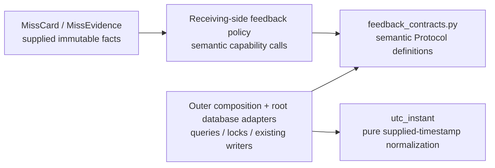

# Receiving Study feedback contracts

[feedback_contracts.py](feedback_contracts.py) is the single existing definition
of the feedback facts, semantic borrowed-transaction capabilities and UTC
normalizer, moved intact from `app.services.real_game_feedback_ports`. It imports
only the Python standard library. `game_id` is a supplied fact identifier, not a
Games client, call, readiness check or lifecycle dependency.

| Definition | Existing data or capability |
| --- | --- |
| `MissCard` | Frozen facts: `card_id: str`, `state: str`, `introduced_at: str | None`. |
| `MissEvidence` | Frozen facts: `event_id: str`, `card_id: str`, `game_id: str`, `played_at: str`. |
| `RealGameFeedbackStore` | Existing card/day locks, outstanding/buried facts, introduction/review requests, miss ordering, event-card lookup and accepted/replacement priority operations. |
| `FeedbackProjectionStore` | Existing bounded typed card projections and event/evidence batch iterators. No SQL string crosses the port. |
| `utc_instant(timestamp)` | Parse the supplied ISO timestamp, accept `Z`, treat an absent timezone as UTC and normalize aware instants to UTC. It never reads the clock. |

The complete field/method signatures live in the module; no copied DTO model or
wildcard public barrel is added. `__init__.py` is documentation only. Other owners
may import these explicit facts/contracts without importing Study implementation.
Concrete persistence and effect orchestration remain in their existing owners.

The adapter arrows describe contract use, not permission for a producer to write
Study tables. Implementations borrow the command caller's transaction, retain
existing lock/order/receipt authority and do not commit or roll back on their own.
Optional producers must cross the receiving queue owner's semantic command
interface. Ordinary Study must not import or wait on Games, including through a
public Games API. Moving this contract does not by itself repair legacy callers'
current synchronous producer-authority dependencies.

No schema or data changed; this module defines no tables or foreign keys. Logical
card/event/game identifiers are validated and persisted by their existing owners.
The pure normalization callback used by root projections remains this one
implementation, rather than a second database-local copy.

Existing focused pointers include `test_real_game_feedback_policy.py`,
`test_feedback_store_separation.py`, and `test_feedback_boundary_integration.py`
in `backend/tests`. Integration updates their imports. Source/AST equality covers
both protocols, frozen DTO declarations and UTC parsing/evaluation; fake contract
checks do not qualify live database/resource isolation.
