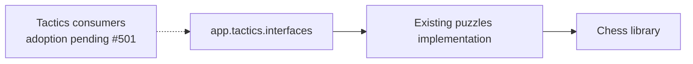

# Tactics interface — #503 allocation

`app.tactics.interfaces` exposes the existing typed `LichessPuzzle`,
`parse_lichess_puzzle_row`, `validate_puzzle_record` and `load_packaged_decks`
operations from the Tactics-owned [puzzle module](../../services/puzzles.py).
Object identity, signatures, validation and failure behavior remain unchanged.
Parsing/validation use supplied values and the chess library. Loading a packaged
deck explicitly reads its supplied path; merely importing this surface reads no
catalog or puzzle data and starts no connection, command, worker or engine.

This is the supported first surface for puzzle values/operations. Capture,
catalog admission, activation and attempt mutations are not exposed through a
hidden re-export: the existing
[`tactic_capture.py`](../../services/tactic_capture.py),
[`tactical_catalog.py`](../../services/tactical_catalog.py) and
[`tactic_commands.py`](../../tactic_commands.py) retain private database, queue
and command-registration edges. Learning-owned defensive grading remains behind
its existing owner, outside this Tactics surface. Canonical request/response
values stay in #482's wire contracts; none are copied here.

The allocation permits only these new interface/test files. #501 must wire
concrete mutation capabilities and migrate cross-owner/root callers in a released
window; #487's active intake/refresh files are untouched. Keep original capture,
attempt and receipt/transaction authority until that migration is qualified.
Remove the exact private compatibility edges only after callers adopt owner
interfaces and #482's DAG/private-import/export-bypass negative controls pass.
This directory does not claim completed Tactics decoupling or mutation adoption.

`backend/tests/test_public_surface_tactics.py` verifies export identity, legal
puzzle behavior and cold import while command/storage/producer modules and
runtime effects are blocked. Existing native mutation evidence is unchanged and
is not replaced by these import checks.
