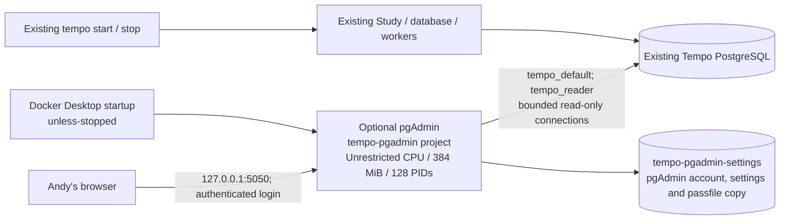

# Local pgAdmin companion

**PROPOSED / NOT ACTIVATED.** This optional configuration uses the
[official pgAdmin container](https://www.pgadmin.org/docs/pgadmin4/9.18/container_deployment.html).
It browses the existing local PostgreSQL server as `tempo_reader`. It does not
run migrations, provision roles, build Tempo images, or start product services.
Its only published port is <http://127.0.0.1:5050>.
The official 9.18 multi-platform image is pinned by registry digest; public
Docker Hub metadata confirms both ARM64 and AMD64 images. Nothing is built
from Tempo main for this companion.

## Ownership and startup



This is a separate Compose project because the current Tempo CLI validates a
fixed set of product volumes and explicitly lists the services it starts.
Adding an unrecognized pgAdmin volume to that project would break startup.
The companion shares only the already-existing `tempo_default` network and
PostgreSQL read access. Study has no pgAdmin readiness or lifecycle dependency.
The shared database/host remain resource boundaries: container limits and
5-second statement / 100-ms lock / 10-second idle-transaction deadlines bound
ordinary browsing, not arbitrary user-overridden SQL or every host failure.

After its one-time approved start, pgAdmin stays running across `tempo stop`
and `tempo start`, and `unless-stopped` restores it when Docker Desktop restarts.
The existing CLI does not start an explicitly stopped pgAdmin container. Use
the companion start command below to resume it. Closing the pgAdmin browser
does not stop it. If PostgreSQL is stopped, reconnect in pgAdmin after Tempo
returns. This deliberately avoids a product update just to install pgAdmin.

## Required approval before activation

Do not create credentials or activate this configuration until the operator
has approved all of the following at action time:

1. The pgAdmin login email and creation of one persistent pgAdmin-only login
   password, in a private host file outside the repository. Keep authentication
   enabled. This login administers pgAdmin's own settings, not PostgreSQL.
2. Mounting the existing reader passfile into this container. The official
   first-run entrypoint copies it to the pgAdmin user's storage directory as
   `.pgpass`, mode 0600. That copy persists in `tempo-pgadmin-settings`.
   Do not mount writer/admin credentials or read their contents.
3. Connecting this one new container to the existing `tempo_default` network
   and binding **only** `127.0.0.1:5050`. There is no new PostgreSQL published
   port, LAN listener, reverse proxy, tunnel or authentication bypass.

No database grant, role, password, default-privilege or server configuration
change is proposed. On October 20, 2026, bounded catalog inspection of live
Study (`86d11afe`, schema 50) found `tempo_reader` could SELECT all 178 public
relations, owned none, had no table write or schema-creation privilege, no role
memberships and no executable public security-definer functions. Its existing
default is read-only. Recheck grants if the server changes before activation.
This role can read data as well as schema; it is not a metadata-only role.

## Installation after approval

Copy **only** this directory's `compose.yml` and `servers.json` to
`~/.config/tempo/pgadmin/`. This keeps bind mounts independent of a development
checkout. Do not fast-forward the live checkout, run `tempo start`, change its
registration, or apply unrelated main-branch changes to install the companion.

Create a private `~/.config/tempo/pgadmin/pgadmin.env` containing the approved
email and these file paths (the password value itself does not go in this file):

```dotenv
TEMPO_PGADMIN_EMAIL=<approved login email>
TEMPO_PGADMIN_PASSWORD_FILE=/Users/andy/.config/tempo/pgadmin/password
TEMPO_POSTGRES_READER_PGPASS_FILE=/Users/andy/.tempo-postgres-cutover/secrets/reader_pgpass
```

The containing directory must be mode 0700 and the environment/password files
mode 0600. Never overwrite an existing password file or volume during setup.
The official entrypoint initially runs as root to read the private bind-mounted
secrets and initialize its own volume, then drops to UID/GID 5050 for the
application. It does not change the source files' ownership or permissions.
No credentials are included in the repository or echoed by these commands.

Start only pgAdmin:

```sh
docker --context desktop-linux compose \
  --env-file "$HOME/.config/tempo/pgadmin/pgadmin.env" \
  -f "$HOME/.config/tempo/pgadmin/compose.yml" \
  up -d --no-build --no-deps --wait --wait-timeout 180 pgadmin
```

The named settings volume is created only for pgAdmin. The existing network
must already exist; Compose does not create or reconfigure Tempo's network.
The first launch imports the server definition. Later launches retain settings;
they do not reset the pgAdmin password or replace the saved servers/passfile.
If the reader password is rotated, explicitly refresh only the pgAdmin passfile
copy under a separate approval; do not erase the settings volume.

Sign in at <http://127.0.0.1:5050>, connect to **Tempo (read only)**, then expand
**Databases → tempo → Schemas → public → Tables**. Database authentication uses
the approved reader passfile rather than a second new database credential.

Stop the companion without touching Study or removing settings:

```sh
docker --context desktop-linux compose \
  --env-file "$HOME/.config/tempo/pgadmin/pgadmin.env" \
  -f "$HOME/.config/tempo/pgadmin/compose.yml" stop pgadmin
```

## Activation verification still required

Before/after activation, record existing Tempo container IDs, image IDs,
StartedAt values, revision labels, schema ledger and API health. They must
remain unchanged except for normal elapsed uptime and study activity. Confirm
pgAdmin alone was created, its host port is loopback only, its effective limits
match Compose, and the application runs as UID/GID 5050. Verify authenticated
UI access and a real reader connection with schema browsing; use bounded
catalog queries to confirm the effective role/read-only setting and absence of
writable public relations. Do not test by attempting a real database write.

Prepared-source configuration validation does not certify image startup,
authentication, effective isolation or live UI/database acceptance.

Current source omits the pgAdmin CPU quota and retains its 384 MiB memory and 128 PID limits. Existing installed-container receipts above describe their captured settings; applying this source change requires separately authorized recreation and readback. Unrestricted CPU guarantees neither host capacity nor Study responsiveness.
