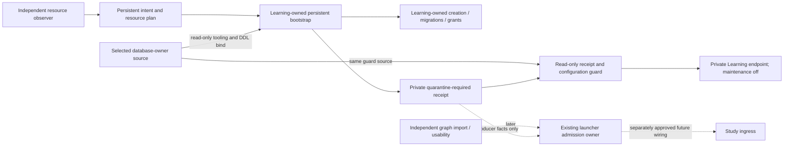

# Persistent Learning preparation

**SOURCE IMPLEMENTATION; NATIVE AND DEPLOYMENT QUALIFICATION UNVERIFIED.**

[quarantine.compose.yml](quarantine.compose.yml) owns a separately named persistent
target. It does not extend or relabel the disposable Study composition. All
volumes and the network are explicit externally created resources. An independent
persistent resource observation is required before new database/role creation.

There is no web service, host port, automatic maintenance, registration publisher
or admission producer in this file. Explicitly targeting study-web fails because
that service is absent. The provision profile creates only a new database,
roles/schema and private runtime files. The quarantine profile opens private
Learning health/operator routes only after the persistent receipt and private
configuration guard pass. Profiles are convenience controls, not authorization.

## Ownership and dependency direction

Bootstrap imports no Content, graph converter, bridge, runtime application or
optional service implementation. An outer operator may run an approved pinned
public Content/bridge CLI on the exact target network. The Learning image does
not contain those CLIs. Operator origin http://learning:8001 differs from browser
ingress; existing Study nginx does not expose /internal routes. Runner identity,
UID/token access and any separate Content provisioning remain explicit inputs.
Ordinary Study never depends on that operator runner remaining available.

Provisioning and the quarantine startup guard use an explicit read-only bind of
the selected `database/tempo_learning_database` source; they are not standalone
image-only operations. [`quarantine.compose.yml`](quarantine.compose.yml) runs
`bootstrap_persistent.py bootstrap` or `check-quarantine` from that source with
the image's interpreter/dependencies; the quarantine service then executes
installed `tempo-learning`.
Keep the source mount, image pin, migration map and receipt bound to the selected
revision. Source/fake preparation does not qualify that installed combination.

## Explicit phases

1. Select one source revision, immutable role images, new resource names and
   workspace/timezone/origin. Independently observe newly owned persistent
   volumes/network/server. Names alone are not identity or ownership proof.
2. Supply private intent.json and resources.json from the
   [persistent bootstrap contract](../../database/tempo_learning_database/tooling/README.md#persistent-target-bootstrap).
   Run the read-only plan command before any bootstrap invocation. Actual resource
   acquisition/inspection is an external owning capability.
3. Explicit bootstrap rechecks physical PostgreSQL identity and exact DB/role
   absence, creates from template0, migrates schema/workspace, grants runtime
   roles and verifies owner/schema/fresh metadata/empty content. Output and every
   containing-directory fsync must succeed; no false durable-success receipt.
4. Copy exact credential-free writer_dsn/reader_dsn from private connection.json
   into the required environment inputs. Files remain0600 and runtime UID10001.
   The startup guard rejects wrong/incomplete persistent receipts, intent,
   authority, DSNs, private paths, libpq overrides or maintenance enabled.
5. Only separately authorized operator actions may start private quarantine and
   import the graph. Health is not complete graph/default/name acceptance. Queue
   GETs may write. Any needed bounded maintenance is an explicit new-target
   operation; bootstrap never runs it.
6. Existing launcher composition must independently verify actual runtime
   fencing, graph/default/name readback, new-authority isolation and exact
   cutover confirmation before future ingress/admission. This source adds no
   admission command or registration mutation.

Every environment input in this file is required. Bootstrap and Learning use the
same selected immutable Learning image. Intent also pins Study's future image,
but this non-serving composition intentionally defines no Study web service.

## Failure and remaining qualification

Creation is not atomic across roles and database. Failure preserves new private
outputs and provisioning-state.json with exact target identities/last phase.
Reused DB/roles/output directory are refused; there is no automatic DROP, retry,
old restore or source cleanup. Partial resources require explicit inspection.

Receipt schema.identity is the public digest of exact expected/applied migration
checksums. Count is informational, never a schema-version substitute. Declared
source/image pins and independently observed PostgreSQL image are distinct facts.
Receipt proves only producer-owned effects and no admission performed by this
producer, not actual runtime or graph isolation. Disposable helper #452 remains
unchanged; its receipt cannot be promoted into persistent acceptance.

Focused qualification at executable commit
65ec53bfee1b3e94a374a9b5dfdcd8fdfff54020 passed: 25 persistent fake tests and
12 existing disposable-bootstrap regressions. Both Compose 5.6.1 profiles rendered
successfully with DOCKER_HOST pointing to a nonexistent Unix socket; no daemon
or resources were contacted. These results supersede the authoring-time executor
outage. No live resource, credential, grant, capture, service start or cutover was
executed. Native PostgreSQL, installed-container runtime and actual admission
qualification remain unverified.
