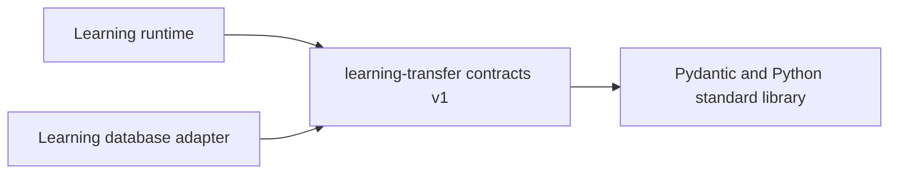

# Retained-history transfer contracts

Artifact `tempo-learning-transfer-contracts==1.0.0`; public namespace
`tempo_learning_transfer_contracts.v1`. This package owns W01's unchanged pure
retained-history DTOs and claimed-binding checks. It owns no storage, executor,
writer fence, activation or startup. Pydantic 2.12.5 is its only runtime dependency.

The [contract specification](../../docs/architecture/retained-history-cutover-20261103/contract-v1.md)
and adjacent state ledger remain authoritative for preservation requirements and
UNKNOWN/BLOCK dispositions. Representative fixtures cannot authorize activation.
Original bytes, identity, digest, receipt and recovery semantics are unchanged
from the reviewed W01 contract. Public models use the existing `version: 1` field;
this extraction does not rename it to another contract's envelope vocabulary.

## Dependency direction



Runtime and database consumers import the same independent contract; neither
contract import loads the runtime, database adapters, optional producers or
provider infrastructure. Database adoption belongs to W02A. The superseded new,
unmerged runtime module is removed rather than retained as another public path.

## Build and focused proof

```sh
python -m build --no-isolation contracts/learning-transfer
uv pip install --python /path/to/disposable/venv/bin/python contracts/learning-transfer/dist/*.whl
/path/to/disposable/venv/bin/python -I -m pytest contracts/learning-transfer/tests --import-mode=importlib -q
/path/to/disposable/venv/bin/python contracts/export_schemas.py --package learning-transfer --check
node tools/component-build/check-components.mjs --component learning-transfer-contracts
```

`PUBLIC_MODELS`, `validate_contract` and `serialize_contract` support the existing
catalog/schema tools. Models and helpers do not read schema resources on import.
Schemas are included in wheels and sdists. Tests must resolve imports from an
installed artifact; a source `PYTHONPATH` is not installed-package evidence.
Python metadata supports 3.12–3.14; this extraction is locally checked on 3.13.
Native database, browser, complete migration, packaged runtime container and
installed activation qualification remain with their respective owners.
