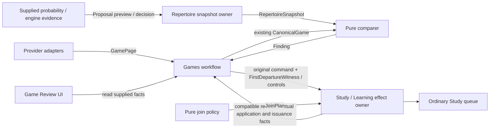

# Product v0.2 contracts — first-departure checkpoint 0.2.2

[#618](https://github.com/aaweaver-actuary/tempo/issues/618) releases the typed
first-departure qualification and application/issuance vocabulary below. It is a
source contract, not proof that #619–#624 consumers, installed feedback or actual
Study issuance have completed. [SPEC G01–G03](../../SPEC.md#3-game-feedback) is the
canonical policy and time/disposition/hold/capacity definition. Stored 0.2.0 and
0.2.1 values retain their original wire shape and historical meanings.

Issue [#482](https://github.com/aaweaver-actuary/tempo/issues/482), under
[#481](https://github.com/aaweaver-actuary/tempo/issues/481), pins SPEC v0.2 at
`6885b942`. These are proposed/unmerged source interfaces, **not live behavior**.
The initial slice is usable independently; probability, engine, proposal and
rejoining values are additive checkpoints and do not gate game feedback.
The second compatible checkpoint adds provider `filters` facts and the isolated
Game Review screen's `GameSummary`, `ProviderSyncStatus`, `RecentGames` and
original-history `GameDetail` projections. These are read models, not a new
canonical game or receiver. The UI renders receipt statuses verbatim; `applied`
does not mean `available`. Failed sync requires an error and operation identity.
`GameReviewApi` adds `recentGames`, `gameDetail`, `sync` and `retryFeedback` with
request-local AbortSignal/operation/repertoire context; no transport starts here.

## Public seams and owners

| Direction | Public value / operation | State and effect owner |
| --- | --- | --- |
| Provider → Games | `GameAcquisitionPort.fetch_page` → `GamePage` | Each provider owns transport; Games owns import/checkpoint storage. |
| Repertoire → supplied comparison | `RepertoireSnapshotPort.snapshot` → `RepertoireSnapshot` | Repertoire owns approved moves, route boundaries and mapping evidence. |
| Comparer → Games | `Finding` | Membership facts do not grant a learning effect. Games owns findings. |
| Games → Study | `LearningFeedbackPort.accept_lapse(GameLapse)` | Study alone validates/maps, applies the scheduler transition and admits obligations. |
| Games → Study | `QualifiedGameFeedbackPort.accept_qualified(original, qualification=FirstDepartureWitness)` | Same Study owner/ledger; revalidates complete current first-boundary authority, fixes disposition and owns actual Again or canonical introduction. |
| Games → Study | `control_effect(GameEffectControl)` | Study durably holds/withdraws even evidence not yet received. |
| Consumer → Study | `effect_status(GameEffectKey)` → `LearningReceipt` or null | Study owns receipt, pending/held/applied/settled status and chronology. |
| UI → owning API | `GameReviewApi` reads findings and feedback status | UI renders supplied facts; it does not mutate schedules or queues. |
| Probability provider → analysis | `ProbabilityPort.evidence` → `ProbabilityEvidence` | Provider owns transport/model lifecycle; evidence has no admission authority. |
| Engine → analysis | `EngineEvaluationPort.evaluate` → `EngineEvidence` | Evaluator owns bounded execution; supplied values start no process. |
| Analysis/UI → Repertoire | `RepertoireChangePort.preview/decide` | Repertoire revalidates one-own-response, source revisions and approved displayed edits/card additions. |
| Ranking → Study | `RankingInput/RankingOutput` | Study owns eligibility, global budget/weights and selection; rankings contain facts only. |
| Pure rejoining policy → Study | `Presentation`, `JoinPlan`, `PresentationChangePort.apply_join` | Study owns safe-boundary revalidation, schedule, lineage and obligation remapping. |

Python contracts live in [`backend/app/contracts/product_v02`](../../backend/app/contracts/product_v02).
TypeScript schemas and types live in [`contracts.ts`](../../app/features/product-api/contracts.ts).
Python ports are synchronous semantic capabilities; the TypeScript API boundary
returns promises. Wiring and any transport belong to the integration owner.

The Python `CanonicalGame` is the existing `tempo_game_review_contracts` model,
not a new canonical game. Product `RepertoireSnapshot.membership` is the existing
public membership snapshot; the wrapper adds variant/color, explicit route ends,
selected decision/current physical presentation mappings and introduction evidence.
Its `membership` uses wire-compatible immutable subclasses of the existing owner
models: routes, moves, reentries and repertoire scope are tuples, and nested
models forbid assignment. Donor behavior is unchanged. `EvidenceWithdrawal` is
likewise adapted with frozen assignment inside the new control seam. TypeScript
public parsers return recursively readonly/frozen snapshots, including arrays.
The TypeScript membership schema is that owner's wire mirror for the new screens.
No physical card identity is invented: `presentation_id` names the actual existing
card/current presentation. Position equality cannot establish it or introduction.
`DecisionPresentation.available` and `introduction_matches_current_content` are
explicit owner-supplied facts; both default false when absent. An introduction
timestamp alone cannot prove current content was introduced before a game. The
synthetic snapshot proves both facts explicitly so a valid miss can be expressed.
Position keys use the public `tempo_evidence_math.opening_position_key(fen)`
legal-en-passant four-field FEN convention, scoped by repertoire and variant.
`route_id` / zero-based `route_ply` optionally restrict a binding to the proven
authored response occurrence; they must be paired. Paired nulls mean an explicitly
global owner binding. A mapping for route A never grants authority for transposed
route B merely because its position/response matches. Snapshot validation checks
the referenced route, repertoire, ply and selected response.

When Study supplies an explicit `introduced_before_game` boolean but its stored
date is only day precision, preserve that boolean with `introduced_at: null` and
`introduction_game: {provider, game_id, source_revision, source_digest}`. Boolean
and exact game scope must be supplied together; unknown stays null/null. The
boolean applies **only** to that captured game source, never to another provider,
game or corrected revision/digest. It does not replace current-content provenance,
availability or snapshot revision checks. No date is upgraded into a timestamp.
`snapshot-route-game-introduction.json` demonstrates two legally transposed routes
with only route A mapped and an explicit game-scoped chronology assertion.

## Frozen operation semantics

- Provider windows are UTC and half-open `[start_at, end_at)`. Preserve supplied
  PGN byte-for-byte as text and retain source time precision. Unknown time stays
  null/unknown. Saturated or continuing pages cannot claim completeness. A page
  cannot contain two revisions of one stable provider game ID. Continuations are
  opaque; provider adapters own completeness and checkpoint interpretation.
  `GamePage.filters` retains exact requested key/value facts (default empty).
  Provider-specific raw metadata may live in an immutable owner envelope around
  the shared page/record; it does not justify a competing canonical game DTO.
- Finding `ply` is **one-based**. Existing membership route offsets and v3
  encounters remain **zero-based**, so adapters must convert explicitly.
  The stored 0.2.0 `confirmed_miss` parser retains its original proven-introduction
  rule for compatibility. It is not the new first-departure eligibility policy.
  New action selection uses `FirstDepartureSelection` and qualified current Study
  authority without an introduction-before-game gate. Reentry findings remain
  diagnostic and never authorize an extra first-departure effect.
- Logical effect identity is the JSON array of workspace, provider, provider game
  ID, decision ID and one-based occurrence ply (`GameEffectKey.logical_id()` /
  `logicalEffectId`). Delivery UUIDs, comparison revisions and source revisions
  are deliberately absent. Payload digest binds the semantic evidence, excluding
  transport retries/detection clocks. The producer computes it; Study validates
  its evidence before applying an effect. Do not trust the supplied hash as authority.
- Study owns idempotency and current source/target validation. Exact replay has
  one effect and preserves its original determination/accepted disposition.
  Changed payload under one key conflicts/quarantines, never creates another
  failure. [SPEC G02/G03](../../SPEC.md#g02--one-learning-owner-a-real-learning-effect)
  defines current-state application, actual next-head/five-issuance service,
  authoritative Study day and durable overdue recovery. Legacy `available_by`
  is neither reset proof nor an expiration/TTL. Producers supply facts, not a schedule.
- Changed/withdrawn evidence must reach `control_effect` even when reclassification
  is no longer a confirmed miss. A hold/withdrawal must durably fence the logical
  key and revision before a delayed original can arrive. Exact replay or a stale
  revision cannot release that fence. No automatic release is defined while D08
  remains unresolved. Applied historical learning effects are preserved; a
  withdrawal never reverses history. `settled` means no remaining actionable
  obligation, with the owner receipt/outcome explaining why.
- Pre-admission `GameEffectControl` requires only its stable `key`, changed
  `source_revision`, `action` and `reason`. Producers never guess a Study-owned
  obligation identity/revision. Study persists the tombstone by logical key;
  receipt/admission need not have happened. Optional `withdrawal` reuses public
  v2 `EvidenceWithdrawal` when the existing owner reference is already known
  (also used unchanged by v3); otherwise the Study adapter resolves it. Legacy
  explicit-withdrawal commands may omit `reason` and retain the existing reason
  inside `withdrawal`; if both are supplied they must agree.
  `withdrawal_only_delivery` validates an existing v3 envelope
  with empty observation/obligation arrays and the supplied withdrawal. The caller
  supplies fresh envelope identity/revision and actual captured authority. The
  adapter performs no database lookup and fabricates no graph authority. Study
  retains the key/source revision/reason, plus an existing obligation revision
  when available. Null `effect_status` is not
  proof that an original delivery may bypass a stored fence.

These requirements describe the receiver contract. Tests here prove wire shapes,
identity and adapter behavior; #487 owns actual persistence/race/scheduler proof.

## Stored encounter-priority compatibility: interface 0.2.1

This section records the retained 0.2.1 command/receipt contract. Its old
priority-only and correct-encounter introduction policy is superseded for new
automatic first-departure work by the 0.2.2 qualification section below. Retaining
these parsers does not authorize replay of old work without qualification.

This backend-only seam follows [#481's next-release scope](https://github.com/aaweaver-actuary/tempo/issues/481#issuecomment-6429212066)
and [#487's receiving-owner boundary](https://github.com/aaweaver-actuary/tempo/issues/487#issuecomment-6429214039).
It changes no existing `GameLapse`, `LearningReceipt`, `LearningFeedbackPort` or
qualified first-release behavior. No analysis/UI contract or second pipeline is added.

`learning.GameEncounter` reuses `GameEffectKey`, exact `IntroductionGameScope`
source facts and immutable `DecisionPresentation`, with original detected/occurred
time, expected/played moves and explicit `matched`/`missed` observation. Study must
revalidate approved current route/content/mapping and actual admission state;
neither position equality nor `known_unintroduced` alone grants authority.
`EncounterFeedbackPort` adds `accept_encounter` / `encounter_status` alongside the
unchanged lapse operations, and uses the same `control_effect` hold/withdraw fence.

Historical importance and lapse eligibility are different facts. A miss may retain
priority even when it predates introduction or later learning prevents a lapse;
introduced material can receive review priority without rewinding that progress.
Correct play is frequency evidence, never a fabricated failure. A currently
unintroduced approved decision may receive first-introduction priority for either
played response; Study alone performs genuine fresh introduction/scheduling.
That legacy lapse path required proven introduction before the game; qualified
first-departure intake supersedes this policy without rewriting stored commands.

`EncounterReceipt` extends the existing receipt fields with original detection,
source digest, original observation, whether that observation is durably recorded,
owner `disposition` (review_priority / first_introduction / existing_lapse /
frequency_only / unresolved), actual `admission_status`, and explicit deferral.
Recorded importance/frequency does not claim admission or a review. A receipt's
existing `admitted_at` is owner command acceptance, not a manufactured introduction
or Study attempt. The approved next-release policy is a **targeted exception**:
real-game encounter first introductions bypass the ordinary new-card cap,
including exhausted/zero allowance, and Study-only. The owner keeps the global
cap and Study-only settings unchanged, and ordinary unrelated introductions retain
their existing controls. A first-introduction receipt cannot claim those ordinary
controls as its deferral reason. Their reason labels remain wire-compatible for
other owner contexts; this does not alter the ordinary introduction interface.

Explicit full Study pause/disable and foreground/maintenance, active-attempt,
source/identity/legality/conflict guards still apply. Disabled/full-paused controls
remain visibly pending and cannot promise an availability deadline. This targeted
exception is implemented/qualified only by the separate next-release Study owner;
the installed/qualified first release and live settings are untouched.
The existing owner `reason` field preserves foreground/maintenance explanations;
no new transport labels or global settings changes are needed.

The owner persists one logical key and original observation/disposition through
replay, later admission and recomparison. Later introduced-state projections must
never turn an earlier unintroduced encounter into a fake Again or reintroduce an
already/concurrently introduced card. A request payload digest is an identity
claim, not authority: the owner validates source/decision/response facts and must
not hash mutable admission state or retry/detection metadata into a second effect.
Changed/withdrawn sources still use the same durable control tombstone and never
reverse historical effects. #487 owns atomic introduction/receipt, chronology,
controls and races; #489 owns durable delivery/retry. No state mutation is here.

Synthetic next-release examples live in [`fixtures/encounters`](fixtures/encounters)
and are tested in the existing Python product-contract suite. They cover matched
and missed unintroduced encounters, a historical miss, paused first introduction,
owner review priority without a lapse, and an admitted encounter introduction
under the targeted exception. Nested fixtures leave existing v0.2.0
Python/TypeScript fixture dispatch and all UI/analysis exports unchanged. Receiver,
native persistence and normal-Study acceptance remain with their owning tasks.

## First-departure qualification and truthful progress: interface 0.2.2

`games.FirstDepartureSelection` records one global result over selected relevant
same-color scope. Its statuses are `covered`, `own_actionable`, `own_unmapped`,
`opponent_gap`, `coverage_end`, `missing_own_continuation` and `unresolved`.
`null` occurrence therefore never means both covered and failed. Known boundaries
retain actor, one-based ply, pre-move position, played move and distinct expected
alternatives. Only `own_actionable` carries an exact available
`DecisionPresentation` with an explicit route occurrence. Interior decisions
retain the existing physical card/revision; equivalent route aliases are not
additional effects. A legacy global owner mapping can be specialized to an
actually proven unique route occurrence; missing authority is not guessed.
Historical `introduced_before_game` / `introduction_game` facts or introduction
timestamp precision do not distinguish otherwise equivalent current physical
route aliases. Current introduction state/availability and source/content mapping
remain owner facts and are rechecked at first authoritative Study acceptance.

`FirstDepartureScope` retains each selected relevant repertoire, actual snapshot
ID/source revision/revision/digest, color, completeness and availability. Missing
source facts remain null and unavailable, including #615 deferred scope.
`FirstDepartureRoute` retains policy, source revision, zero-based occurrence and
deliberate-end fact. Incomplete scope or an ended surviving competitor cannot
manufacture a unique action. Positive authored coverage does not require a
physical Study mapping. The selector owns proving these facts; type validation
alone cannot prove the game replay or completeness of a caller-supplied list.

`learning.FirstDepartureWitness` contains the actionable selection, actual Games
provider `configuration_revision`, original durable `determined_at` and existing
`forward` / `reconciliation` / `manual` provenance. It is separate qualification
metadata: **do not append it to or rewrite an original stored `GameEncounter`
0.2.1 or `GameLapse`**. `matches(original)` checks source/key/position/response
correspondence without choosing disposition or making the witness authority.
#621 prepares trusted complete captures outside the writer; #620's
`CurrentOwnerDecisions` rechecks the actual provider configuration, source,
publication and exact current mapping through owning bounded capabilities.
Missing actual configuration/source authority is a hold, never a fabricated
revision/timestamp or a producer `is_first_departure` permission flag.

`QualifiedGameFeedbackPort.accept_qualified` is an additive declaration on the
same existing owner/ledger, accepting the original `GameEncounter | GameLapse`
plus witness. Existing `accept_lapse`, `accept_encounter`, control and status
methods remain readable/compatible. Runtime implementations and legacy upgrade
dispatch belong to #620/#581/#621. Newly accepted introduced misses use
`introduced_again`; unseen misses preserve `first_introduction`. Full identity,
first-acceptance, manual-pause, history and burst rules are defined once in
[SPEC G02/G03](../../SPEC.md#g02--one-learning-owner-a-real-learning-effect).

`EncounterReceipt` accepts stored `interface_version: 0.2.1` without adding any
serialization fields. New `0.2.2` receipts require `progress: EncounterProgress`:

| Progress fact | Meaning and owning evidence |
| --- | --- |
| `policy_version`, `determined_at`, `stream` | Qualified first-departure policy, original determination and source class; retry cannot restart service measurement. |
| `target` | Actual current physical `card_id` / `card_revision`, distinct from original logical decision identity. |
| `scheduling_review_id`, `schedule_applied_at` | Paired actual ordinary Again receipt/time; priority `applied_at` alone supplies neither. |
| `introduction_applied_at` | Canonical first introduction/current admission completed; mutually exclusive with an Again receipt for this accepted occurrence. |
| `remediation_fence` | Current target, queue-owner `after_issuance_sequence` and truthful establishment time at/after application/admission. An old real reset may acquire a conservative current fence without replaying Again or backdating it. |
| `first_issued`, `first_issued_ordinal` | Paired actual target issuance and measured distinct new-issuance ordinal from determination; no five-card claim from a queue row. |
| `settlement` | Durable genuine clean Study `review_id` plus compatible actual post-fence issued attempt. Withdrawn/historical-preserved terminal control is distinct from settled remediation. |

`IssuedAttemptEvidence` reuses the queue owner's actual
`(queue_entry_id, card_id, card_revision)` generation, adding its once-stamped
`issuance_sequence` and `issued_at`. #622 owns additive migration055 and actual
stamping/counting; no historical issuance is fabricated. Sequence gaps after
rollback do not count as cards: count actual distinct committed issuance rows
after the original determination. Reloads, prefetch and already-issued work do
not increment service. The Study owner validates genuine clean completion;
serializable facts alone cannot grant settlement.

New `available` introduced-Again receipts need the actual scheduling receipt and
fence; new `available` first introductions need canonical introduction evidence
and fence, with no fake scheduler review. New settled remediation requires the
same compatible physical target and a genuine later issued generation plus
saved review receipt. Protected pre-reset attempts remain pending and save
truthfully. Outstanding legacy priority-only receipts stay visibly legacy until
qualified/applied once, including effects already acknowledged by Games;
settled/withdrawn history is not reopened automatically.

[`fixtures/first-departure`](fixtures/first-departure) supplies shared synthetic
covered-alternative, introduced/unseen own boundary, opponent-before-later-miss,
coverage-end, ambiguous/incomplete, protected-active and legacy-priority values.
Both regular parser suites execute the same valid documents and
`rejections.json` contradictions, plus actual stored 0.2.1 command/receipt
fixtures. They prove contract compatibility and identity, **not** scheduler,
queue, PostgreSQL, browser or installed behavior. No schema/storage implementation
or second feedback ledger is introduced by this contract change.

## Later analysis and presentation checkpoint

[`analysis.py`](../../backend/app/contracts/product_v02/analysis.py) reuses public
`tempo_evidence_math.PositionMoveUniverse`, `MoveProbabilityDistribution` and
`CountEvidence`: every legal move is retained, partial mass stays unknown, and
absent counts remain null. The small wrapper supplies provider/model, observation
date and explicit selected population/time controls. Personal account evidence
is a separate basis and never silently replaces population context. D04 is still
open: example rating/time-control settings are **synthetic fixture inputs**, not
a choice of Andy's live Settings. Unavailability is a reason, not invented zeros.

Engine scores reuse analysis-jobs CP/mate models through wire-compatible frozen
adapters. All scores in `EngineEvidence` are **learner oriented**; the evaluator
owns conversion from side-to-move. `EngineContext` retains starting/target full
FEN, ordered game history, variant/color, engine version, depth/node/time bounds,
threads and hash allocation. Every explicitly requested candidate has a result
or explicit unavailable reason, including candidates outside a preferred top five.
The engine fixture has seven candidates and a supplied 24 CP candidate loss;
no real engine/model ran in this contract task. Mate/inconclusive evidence is
distinct and cannot be treated as a CP score or acceptance proof.

`Proposal` contains the source revision/digest, explanation, exact edits and all
displayed card additions/updates, evidence and distinct supporting positions.
`max_loss_cp` defaults to **30**; any contextual change requires an explicit
displayed reason. Repertoire owns evaluating that policy and invariant checks.
`Proposal.content_digest()` / async `proposalDisplayDigest()` bind all fields
except `display_digest` via SHA-256 of UTF-8 JSON with recursively sorted object
keys, no whitespace and unescaped Unicode. Arrays keep their displayed order.
`ProposalDecision.matches_preview()` / `matchesProposalPreview()` compare that
binding plus proposal/source revisions. The owner must perform this check against
the stored preview before accepting. Hash matching alone is no permission to
publish; the Repertoire owner still rechecks current invariants and versions.
An edit returns a fresh preview; it cannot publish directly.

[`presentation.py`](../../backend/app/contracts/product_v02/presentation.py) keeps
existing decision IDs and actual presentation IDs, exact route/repertoire/variant
scope, component response positions, opponent cues, expected participant/Study
revisions and lineage. `JoinPlan` preserves component order, exact connecting
position chain and unresolved obligation IDs; its result starts at 0/3 and costs
zero introduction slots. #502 owns choosing eligible neighbours and clean-streak
policy; #503/Study owns between-attempt application, conservative schedules,
history/obligation/deadline preservation and repeated-failure splitting. These
DTOs do not implement a new scheduler, choose joins, fabricate clean successes,
or require the game-feedback/analysis lanes to run.

## Synthetic examples and verification

All [`fixtures/*.json`](fixtures) contain task-owned synthetic IDs/content:
`confirmed-introduced-miss`, `opponent-gap`, `unintroduced`, `conflict`, `reentry`,
`incomplete-page`, `snapshot`, `lapse`, `hold`, `withdraw`, and `held-receipt`.
Later fixtures add `probability-unknown-mass`, `probability-unavailable`,
`probability-personal`, `engine-explicit-candidate`, `engine-mate`, `proposal`,
`proposal-accept`, `presentation`, `join-a-b-to-ab`, `ranking-input` and
`ranking-output`; the UI checkpoint adds summary/detail/recent/sync examples.
Each `{model, payload}` document round-trips unchanged in both regular suites.
The v3 withdrawal-only test additionally reuses the existing synthetic v3 fixture.

```sh
make python-file FILE=backend/tests/test_product_contracts.py
make unit-file FILE=tests/unit/product-contracts.test.ts
```

The Python test supplies local source paths for game-review contracts, chess-core
and game-evidence contracts, plus evidence-math and analysis-jobs for the later
checkpoint. No dependency installation is required when using
the existing backend pytest/Pydantic runtime. Integration #488 must register the
existing `tempo-game-review-contracts` package in the actual runtime if absent;
this issue cannot edit dependency/build files. The new tests are discoverable in
the existing regular suites. Central `tests/REGRESSIONS.md` registration belongs
to the integration owner: register shared fixture round trips, invalid/unproved
findings, saturated pages, revision conflicts, caller isolation, withdrawal-only
compatibility and import/boundary guards.

The dependency guard covers only explicit new product roots (contracts,
`games/feedback`, `repertoire`, `study/game_feedback.py`). It rejects composition
imports and all private cross-domain implementation edges, hence cycles between
those domains. Pure shared packages and explicit contracts remain allowed.
Relative imports and explicit cycles within the bounded new-module graph are
checked as well. Extend that small root map when further modules are added; it is not a
legacy-tree architecture audit or a claim about deployed resources.

## Proposed target architecture — not live



Study has no producer import, call, readiness or lifecycle dependency. These
values start no network, database, process, app or credential access. Each future
adapter owns its resources; deployment/host resource isolation is unverified.

## Reservations / later checkpoints

#481 reserves only NEW `contracts/product-v02/README.md`, `fixtures/*.json`,
`backend/app/contracts/product_v02/{__init__,games,repertoire,learning,analysis,presentation}.py`,
`app/features/product-api/contracts.ts`, `backend/tests/test_product_contracts.py`
and `tests/unit/product-contracts.test.ts` for #482. Consumers request compatible
additions here rather than copying DTOs. No root consumer, schema, hook, lockfile
or central registration is reserved by this contract slice.
