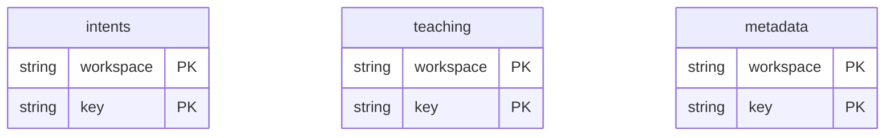

# Browser intents 0.1.0

`@tempo/browser-intents` owns the dedicated `tempo-study-intents` IndexedDB
database. It has no third-party runtime dependencies. Workspace and immutable
command keys bind original request identity, revision, payload, endpoint and time.
Reusing a key with changed content rejects the transaction.

`openIntentStore` returns asynchronous immutable insertion, indexed lookup and
enumeration, transactional mutation, expiring claims, incremental teaching facts,
migration checkpoints and subscriptions. A teaching fact and its delivery intent
can commit in one transaction. Network work never runs inside a transaction.

Claims and BroadcastChannel messages coordinate work; neither establishes a
server commit. Recovered delivery must consult the original receipt. Committed
and explicitly discarded records remain as tombstones, so repeat imports cannot
recreate pending work. Only Learning establishes authoritative review effects.

Run `npm ci --workspaces=false`, `npm test`, and `npm run build` in this package.
Tests use fake-indexeddb for adapter invariants; native browser acceptance is
separate. The legacy application installs this package through its declared npm
workspace and public exports. Package-local tests reject empty selection.

The legacy application owns cutover acknowledgement, legacy-envelope validation,
receipt semantics and user-facing storage errors. It retains legacy arrays.
Already-loaded old JavaScript cannot be forced to honor new browser locks;
close/reopen is a required cutover condition, and mixed-version operation is
unsupported. No code here migrates a running user's browser from the development
environment.

`put` accepts an optional initial pending/conflicted state used only on insertion,
and an expected checkpoint boundary checked atomically before a new insertion.
Equivalent retained records preserve their mutable state and remain recoverable
through an old boundary. `boundary` reads selected records with their checkpoint
or atomically advances it after settlement and an optional caller-owned completion
predicate. The predicate runs synchronously inside the transaction; it performs
no network or asynchronous work. `compareCheckpoint` fences advisory cursor
updates. These primitives contain no grading or application scope policy.

Subscriptions carry `IntentChange` notifications after commit, including keyed
teaching changes and connection invalidation. `teachingFact` reads one durable
fact. Broadcasts never establish persistence or server settlement.

## Object-store relationships and data dictionary

Current source storage definition, browser data unverified. Owner: browser intent package; IndexedDB database `tempo-study-intents` by default (caller may supply a name), version 1. The package is physically centralized here; its npm name, public API and `dist` exports are unchanged. Source: [src/index.ts](src/index.ts). There are **no foreign keys** or cross-store referential constraints; workspace/card/attempt identities are logical data.

| Object store | Stored fields / JavaScript types | Keys / non-unique indexes |
| --- | --- | --- |
| `intents` | `workspace: string`, `key: string`, `kind: string`, `attemptId: string`, `requestId: string`, `endpoint: string`, optional `revision: number`, `createdAt: string`, `payload: unknown`, `sequence: number`, `state: pending/conflicted/committed/discarded`, `version: number`, optional `data: unknown`, `receipt: unknown`, `claim: {owner: string, token: string, expiresAt: number}`. | Composite key path `(workspace, key)`; indexes `workspace` and `(workspace, state)`. |
| `teaching` | `workspace: string`, `key: string`, `cardId: string`, `revision: number`, optional `ply: number`, `kind: seen/first-clean`. | Composite key path `(workspace, key)`; indexes `workspace` and `(workspace, cardId)`. |
| `metadata` | `workspace: string`, `key: string`, `value: unknown`; values include sequence counters and application checkpoint/boundary facts. | Composite key path `(workspace, key)`; no secondary index. |

IndexedDB enforces keys, not SQL/TypeScript field types. `attemptId`, `cardId`, workspace and request IDs refer to application/public-protocol facts without an FK. Parent server availability is not required to retain local intents. [Database index](../README.md).
