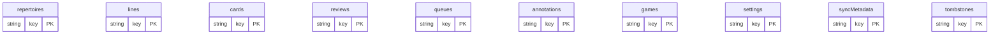
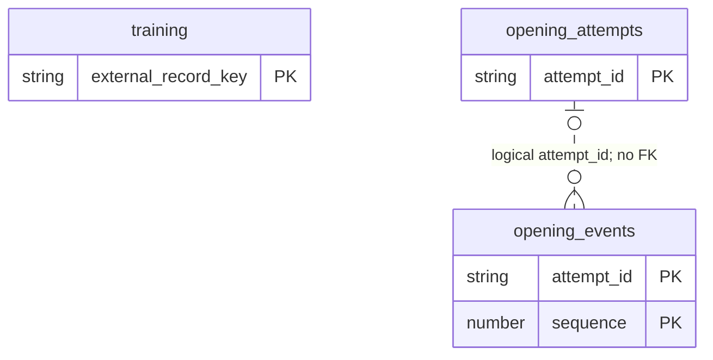
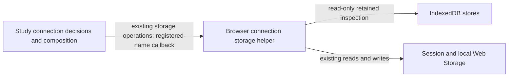
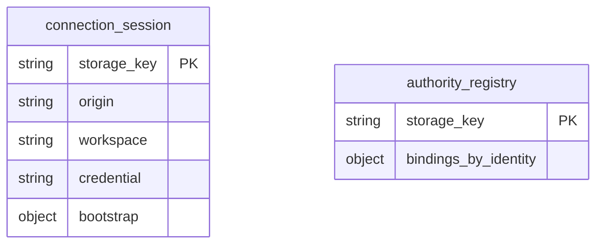
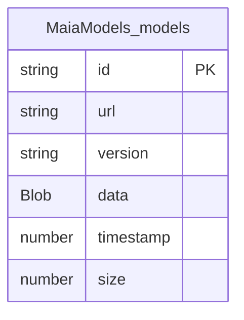

# Browser persistence

Current source definitions; existing browser data/version state was not inspected. Owners are named per entry: Study/practice, authoring, optional feature command journals, Workbench and the optional Maia model cache. These are IndexedDB object stores and serialized JavaScript records, not PostgreSQL tables. Key paths are enforced by IndexedDB; field shapes are TypeScript/runtime validation contracts. IndexedDB declares **no foreign keys**.

| File | Data / authority |
| --- | --- |
| [tempo-db.ts](tempo-db.ts) | `tempo`, version 1; portable snapshot records in ten stores below. |
| [offline-training-storage.ts](offline-training-storage.ts) | `tempo-offline-training` or the workspace-specific name from `study-connection`; version 2; prepared queue and incremental opening journal stores. |
| [prepared-training-storage.ts](prepared-training-storage.ts) | Existing complete prepared-queue read and atomic update operations; the application callback retains replay/grading decisions. |
| [opening-evidence-journal-storage.ts](opening-evidence-journal-storage.ts) | Existing twelve complete journal transactions and two retained-review/completion-signal Web Storage operations; capture, recovery, leases and transport remain outside. |
| [maia-worker-cache.js](maia-worker-cache.js) | Optional legacy classic Maia worker's `MaiaModels`, version 1; cached model Blob with URL/version identity, not Study state. |
| [study-intent-storage.ts](study-intent-storage.ts) | Browser intent package adapter and legacy localStorage cutover/checkpoints; uses the existing [intent package](../browser-intents/README.md). |
| [study-connection-storage.ts](study-connection-storage.ts) | Existing read-only retained-store inspection, tab connection session and persistent authority-registry reads/writes; connection/transport decisions stay in the Study application. |
| [sqlite-migration.ts](sqlite-migration.ts) | Existing HTTP snapshot-to-IndexedDB import; `tempo-sqlite-migration` localStorage completion marker. |
| [encrypted-backup.ts](encrypted-backup.ts) | Existing encrypted export/import of portable records. Envelope fields: `version: 1`, `algorithm: PBKDF2-AES-GCM`, `iterations: number`, `salt/iv/ciphertext: string`. |

## Portable records

All ten actual `tempo` stores have the same record shape: `key: string` (primary key path), `value: unknown` (stored source row/payload), and optional `updatedAt: string`. Store names identify stored data: `repertoires`, `lines`, `cards`, `reviews`, `queues`, `annotations`, `games`, `settings`, `syncMetadata`, `tombstones`. The importer derives record identities from each table's existing row identity; source PostgreSQL constraints do not become IndexedDB constraints.

## Prepared training and opening journal

| Store | Stored fields / types | Keys and indexes |
| --- | --- | --- |
| `training` | `localDate: string`, `preparedAt: string`, `cards: BackendQueueCard[]`, `attempts: OfflineAttempt[]`, `nextTemporaryId: number`; full nested attempt/card definitions live in the explicit [offline-training contract](../../app/domain/offline-training.ts) and its imported domain schemas. | External key `prepared-daily-queue` supplied to `put` by [prepared storage](prepared-training-storage.ts); no inline key path. |
| `opening_attempts` | `attempt_id: string`, `manifest: OpeningDecisionManifest`, `origin_queue_entry_id: number`, `queue_entry_id: number or null`, `parent_attempt_id: string or null`, `started_at: ISO string`, `study_timezone: string`, `source: live/offline/reinforcement`, `terminal: {state, final_sequence, ended_at} or null`; plus `owner_session_id: string`, `final_sequence: number`, `delivery_state: idle/pending/complete/rejected/retained`, optional `rejection`, `retention_reason`, `local_capture_gap: string`, optional `delivery: {checkpoint, operationKey}`. | PK `attempt_id`; non-unique index `delivery_state`. The manifest contains its version/policy IDs, presentation snapshot, repertoire/card/revision/color and decision records. |
| `opening_events` | `attempt_id: string`, `sequence: number`, `decision_index: number`, `decision_id: string`, `expected_uci: string`, `kind: assistance/first_response/manual_failure/reveal/correction`, `observed_at: ISO string`, `response_uci: string or null`, `assistance: enum or null`, `disposition: enum or null`. | Composite PK `(attempt_id, sequence)`; non-unique index `attempt_id`. The attempt link is logical and has no referential constraint. |

Exact nested shapes: [opening-evidence.ts](../../app/domain/opening-evidence.ts) and [journal storage facts](../../app/domain/opening-evidence-journal.ts). The [journal application](../../app/lib/opening-evidence-journal.ts) retains capture, replay, quota fallback, network, lease, notification and retry decisions. The root adapter owns complete existing transactions, including commit/error/abort callbacks and cursor traversal. Supplied blocked/eligibility, caller-flag and orphan-time callbacks run at the original callback points; no generic query or new journal framework is introduced. Logical backend queue/card/attempt IDs in these records are not cross-database foreign keys. Browser storage must continue to work without Games availability.

| Journal Web Storage key | Stored fields / logical relationship |
| --- | --- |
| `tempo-opening-evidence-completion-v1` | JSON `{attemptId: string, signalId: string, sourceSessionId: string}`; cross-tab wakeup hint only. BroadcastChannel fallback and notification choice stay in the application. No foreign key or authoritative completion is implied. |
| `tempo-pending-training-reviews-v1` | Existing pending-review array; journal reads only each optional `attemptId: string` to avoid treating retained reviews as orphaned. The review-outbox owner defines the full aggregate; no new store/schema or second writer is added. |

## Connection session and retained authority registry

These are existing Web Storage key/value records, not SQL tables. The [storage helper](study-connection-storage.ts) owns reads/writes and retained IndexedDB inspection. [Study connection composition](../../app/lib/study-connection.ts) retains origin/workspace/bootstrap validation, authority-transition decisions, request generations and transport/error handling. It supplies registered offline database names through a narrow callback; storage inspection invokes it at the original point after checking IndexedDB availability. The helper imports no application implementation.

| Storage / exact key | Stored data and logical relationships |
| --- | --- |
| `sessionStorage`, `tempo-learning-connection-v1` | JSON connection with `origin: string`, `workspace: string`, `credential: string`, optional `bootstrap: StudyBootstrap` (schema version, workspace, timezone, local date, settings). Tab-scoped restore state; the credential is not included in retained-data inspection/export. The application retains the existing runtime validation. |
| `localStorage`, `tempo-learning-authorities-v1` | JSON object keyed by encoded authority identity; each binding stores `origin: string`, `workspace: string`, `offlineDatabase: string`. The identity and database-name relationship is validated by the application; there is **no foreign-key constraint**. No credential is stored in this registry. |
| Existing legacy pending-operation keys in `localStorage` | The existing inspection reads nonempty values matching `tempo-pending-*`, `tempo-bury-operation*`, `tempo-bury-identity*`, `tempo-seen-moves*` and `tempo-first-clean-passes*`; values remain the original serialized strings. Exact matching stays in the linked helper. Inspection does not rewrite, delete, import or upgrade them. |

The read-only inspector enumerates known/discovered `tempo-offline-training:*` databases plus `tempo-study-intents` and `tempo-offline-training`, retaining the existing version/key/index checks. Application decisions about retained/foreign authority data stay outside this directory. This relocation changes no stored names, payload formats, schema versions, credential handling or live browser data.

## Durable command journals and retained practice records

These owner-specific directories contain existing fixed WebStorage operations,
not a shared runtime journal or dispatcher. The application retains payload
validation, immutable request selection, replay/receipt decisions, HTTP,
notifications and clocks. Keys and payload versions are unchanged. Each owning
README lists actual keys/formulas, payload field types and logical server
identities; WebStorage provides no foreign keys or multi-record transactions.

| Logical owner | Single persistence source / dictionary | Existing application responsibility |
| --- | --- | --- |
| Repertoire authoring and Discovery | [Sixteen journals](adapters/authoring/README.md) | Source/card/branch/coverage/Discovery mutation preparation and reconciliation. |
| Games, Tactics and Endgames | [Nine command journals](adapters/games-analysis/README.md) | Optional feature commands and receipt recovery; each journal retains its separate implementation. |
| Practice, teaching settings and authored annotations | [Eight specific stores](adapters/practice/README.md) | Review archive, burial state, tactic progress, pending settings/activity/activation/annotation requests. Active-pack preferences remain outside. |
| Authored Studies | [Pending command key ledger](adapters/authored-studies/README.md) | Session-lifetime UUID retry key; request fingerprint, UUID creation and HTTP retry/poll decisions stay in the view. It is not an offline payload outbox. |
| Independent Workbench package | [Authority-scoped pending mutation](adapters/workbench/README.md) | Immutable command/run identity, digest, conflict/replay and transport policy. The standard package artifact contains its one compiled root adapter; no checkout dependency. |

Ordinary preferences, notification display history, session/OAuth metadata and
rebuildable workspace/Explorer/asset caches remain with their existing logical
owners. A browser storage API call alone is not evidence for another database
adapter. No preference framework, generic validation wrapper or consolidation
is introduced by this organization.

## Optional legacy Maia worker model cache

The [classic worker](../../public/maia-worker.js) retains ONNX setup, download,
inference and message policy. Its existing complete cache block now lives once
in [maia-worker-cache.js](maia-worker-cache.js). The fixed
[build asset reference](../../scripts/maia-cache-asset.ts) emits those exact bytes
as `maia-worker-cache.js` beside the public worker and serves that URL in Vite
development; `importScripts('./maia-worker-cache.js')` keeps root/Pages resolution
relative to the existing worker URL. Build output is a distribution artifact,
not another maintained source implementation. Controlled and Vinext builds retain
the fixed asset; the `TEMPO_TARGET=study` static build omits it because that
target does not import the classic Maia worker path. No generic asset framework
is added.

| Database / store | Stored fields and keys | Ownership / relationship |
| --- | --- | --- |
| `MaiaModels` version 1, `models` | Enforced key path `id`, fixed record `maia-rapid-model`; `url: string`, `version: string`, `data: Blob`, `timestamp: number` (epoch milliseconds), `size: number` (byte length). No extra index. | Optional model-cache owner. URL/version mismatch deletes the existing entry exactly as before. No foreign key, Study identity, queue data or relationship to the prepared-training stores. |

The classic worker has no current static caller in the source scan; that does
not establish that its public URL is unused. Both the URL and behavior are
preserved. In-memory IndexedDB and small asset-build checks establish the moved
cache's source/discovery behavior, not actual browser/ONNX/provider or failure
isolation qualification.

Return to the [database index](../README.md).
