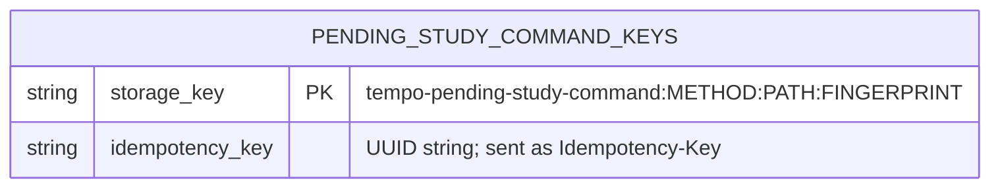

# Authored Studies pending command keys

Current source: [pending-command-keys.ts](pending-command-keys.ts) holds only the existing three session-storage operations used by [the authored Studies API helper](../../../../app/views/studies_view.tsx). Fingerprinting, UUID creation, GET versus mutation decisions, disabled-storage catches, HTTP requests, polling and removal decisions remain in that application helper. These operations are separate from the ordinary UI preferences and from the Learning review outbox.

This conceptual key/value diagram describes a browser `sessionStorage` entry family, not a SQL table:

| Stored part | Type and contents | Owner and lifetime |
| --- | --- | --- |
| Key | String: `tempo-pending-study-command:` followed by the existing method, request path and hexadecimal fingerprint of the serialized request body. No new key normalization or validation. | Authored Studies constructs the key; browser session scope. GET requests create no entry. |
| Value | String: the existing generated idempotency UUID. The request body itself is not stored here. | Existing application reads/reuses it before sending a mutation, attempts to retain it, and removes it on a successful direct response or a polled complete/failed result at the same call points as before. |

There are no relational foreign keys. The value has a logical relationship to the request's `Idempotency-Key` header; this browser map does not enforce server receipt relationships. There is no schema version, migration or TTL. This session-lifetime retry-key ledger is not a full offline payload outbox and is not promised to survive ending the browser session. Existing best-effort disabled-storage behavior is unchanged.

Relocation checks are source reconstruction, targeted TypeScript and a browser bundle only. No actual browser/provider, session values, server, database or command was accessed; current live stored state is unverified.
