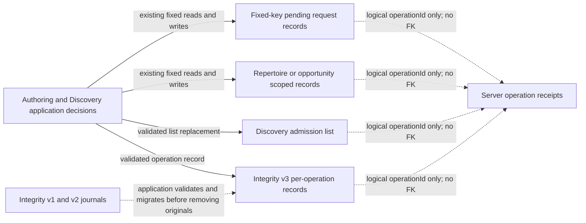

# Durable authoring request storage

These fixed WebStorage operations persist existing authoring and Discovery request
journals. They are durable mutation/recovery records, not SQL tables, IndexedDB
stores or ordinary UI preferences. Application validation, request construction,
receipt replay, migration choices, retry policy, notifications and clocks remain
in the linked application files. Each journal retains its own implementation and
failure behavior; similar outboxes have not been consolidated.

The chart and dictionary describe the **current source format**. No live browser
values or server schema were inspected. `localStorage` enforces one string value
per exact string key. Fields such as `operationId`, `cardId`, `repertoireId`,
`opportunityId`, task IDs and intent IDs are application identities; there are
**no foreign-key constraints** between these browser records or to server data.

All keys below use `localStorage`. `?` marks an optional field. JSON body/request
strings retain their existing serialized request bytes, rather than becoming a
new request schema. Request/replay rules remain with the linked owner.

| Adapter / exact key or formula | Stored payload fields and types | Application owner / logical identity |
| --- | --- | --- |
| [analysis-paste.ts](analysis-paste.ts), `tempo-pending-analysis-paste-v1` | JSON `{ operationId: string, body: string }` | [Pasted repertoire-line admission](../../../../app/lib/analysis-paste-command.ts); replay body identifies the reviewed preview and selections. |
| [branch.ts](branch.ts), `tempo-pending-repertoire-branch-v1` | JSON `{ operationId: string, body: string }` | [Branch admission](../../../../app/lib/branch-command.ts); repertoire/source route is inside the saved body. |
| [branch-removal.ts](branch-removal.ts), `tempo-pending-branch-removal-v1` | JSON `{ operationId: string, body: string }` | [Branch removal](../../../../app/lib/branch-removal-command.ts); saved body contains the selected repertoire/route. |
| [canonical-prefix.ts](canonical-prefix.ts), `tempo-canonical-prefix-${action}-v1:${repertoireId}`, `action = preview \| save` | JSON `{ operationId: string, body: Record<string, string \| number> }` | [Canonical prefix command/recovery](../../../../app/lib/canonical-prefix-command.ts); separate preview/save records per repertoire. |
| [card-delete.ts](card-delete.ts), `tempo-pending-card-delete-v1` | JSON `{ operationId: string, cardId: string, expectedRevision: number }` | [Permanent card deletion](../../../../app/lib/card-delete-command.ts); original card identity/revision. Existing edit-conflict reads inspect revision/split keys without decoding them. |
| [card-revision.ts](card-revision.ts), `tempo-pending-card-revision-v1` | JSON `{ operationId: string, request: string }` | [Card revision](../../../../app/lib/card-revision-command.ts); request preserves original card/revision/history-mode choices. |
| [coverage-refresh.ts](coverage-refresh.ts), `tempo-pending-coverage-refresh-v1:${repertoireId}` | Raw operation identity `string`, **not JSON** | [Coverage refresh](../../../../app/lib/coverage-refresh-command.ts). |
| [discovery-admission.ts](discovery-admission.ts), `tempo-pending-discovery-admissions-v1` | JSON array of [PendingDiscoveryAdmission](../../../../app/domain/authoring-discovery-admission-record.ts): `opportunityId`, `selectedMoveUci`, `evidenceFingerprint`, `operationId`: string; `intentId?`, `error?`: string; `state`: pending/accepted/failed; `retryCount?`, `nextAttemptAt?`, `confirmationPollOrder?`: number | [Discovery admission delivery](../../../../app/lib/discovery-admission-outbox.ts); opportunity/evidence selection and server intent are logical references. Application retains legacy missing-operation-ID upgrade and notifications. |
| [integrity-repair.ts](integrity-repair.ts), `tempo-pending-integrity-repairs-v3:${operationId}` | JSON [PendingIntegrityRepair and schema](../../../../app/lib/integrity-repair-outbox.ts): `repertoireId`, `issueId`, `signature`, `selectedMoveUci`, `operationId`: string; `queuedAt`, `attempts`, `nextAttemptAt`, `pollOrder`: number; `phase`: queued/saving/validating/failed/blocked/stale; optional `taskId`, `retryOperationId`, `error`: string; `taskGeneration?`: number; `retryTaskId?`: string/null; `terminalOperationFailure?`: boolean; `retry?`: tagged record described below | [Integrity repair application/migration](../../../../app/lib/integrity-repair-outbox.ts); key must match the parsed operation ID. Task/generation and issue signature are logical progress/source facts. |
| [integrity-repair.ts](integrity-repair.ts), legacy `tempo-pending-integrity-repairs-v2` | JSON array of the existing repair records, with application schema defaults for omitted counters/times | Same integrity owner. Application validates all recovered choices/progress and writes v3 records before removing either legacy journal. |
| [integrity-repair.ts](integrity-repair.ts), legacy `tempo-pending-integrity-repair-v1` | JSON `{ operationId: string, fingerprint: string }`; fingerprint is a JSON tuple `[repertoireId: string, issueId: string, body: string]`, whose request body contains `signature: string`, `selected_move_uci: string` | Same integrity owner; decoding and choice reconciliation retain their original order and error scope. |
| [opportunity.ts](opportunity.ts), `tempo-pending-opportunity-v1:${opportunityId}` | JSON `{ operationId: string, repertoireId: string, action: dismiss/acknowledge/snooze/train, evidenceFingerprint?: string }` | [Opportunity actions](../../../../app/lib/opportunity-command.ts); training evidence validation remains application-owned. |
| [opportunity-refresh.ts](opportunity-refresh.ts), `tempo-pending-opportunity-refresh-v1:${repertoireId}` | Raw operation identity `string`, **not JSON** | [Opportunity refresh](../../../../app/lib/opportunity-refresh-command.ts). |
| [pgn-import.ts](pgn-import.ts), `tempo-pending-pgn-import-v1` | JSON `{ operationId: string, fingerprint: string }` | [PGN repertoire import/recovery/discard](../../../../app/lib/pgn-import-command.ts); fingerprint binds original file bytes/name/color/depth. The file itself is not stored here. |
| [prefix-split.ts](prefix-split.ts), `tempo-pending-prefix-split-v1` | JSON `{ operationId: string, decision: accept/reject, cardId: string, revision: number }` | [Prefix split decision](../../../../app/lib/prefix-split-command.ts); original card/revision and chosen decision. |
| [repertoire-delete.ts](repertoire-delete.ts), `tempo-pending-repertoire-delete-v1` | JSON `{ operationId: string, repertoireId: string, learnedCards: keep/delete }`; legacy missing `learnedCards` is interpreted as delete by the application | [Repertoire deletion](../../../../app/lib/repertoire-delete-command.ts). |
| [repertoire-rename.ts](repertoire-rename.ts), `tempo-pending-repertoire-rename-v1` | JSON `{ operationId: string, repertoireId: string, name: string }` | [Repertoire rename](../../../../app/lib/repertoire-rename-command.ts). |
| [repertoire-settings.ts](repertoire-settings.ts), `tempo-pending-repertoire-settings-v1:${repertoireId}` | JSON `{ operationId: string, body: string }`; saved request body contains `new_cards_per_day: number/null` | [Repertoire daily-limit save](../../../../app/lib/repertoire-settings-save.ts); body/response validation remains application-owned. |

Integrity `retry` is either `{ kind: "operation", baselineRetryCycle: number,
baselineAttemptCount: number, deliveryAccepted: boolean }` or `{ kind: "task",
taskId: string, taskResetConfirmed: boolean }`. Its state transitions remain in
the existing application schema/workflow; storage only writes its validated JSON.

PGN and settings intentionally expose separate fixed byte-read and JSON-decode
operations: their original `getItem` happens outside the application catch that
translates decode/validation errors. Integrity's write takes one validation
callback so validation still executes at the original write-argument point after
resolving Storage. No schema validation or repair decisions moved into this tree.
Integrity enumeration preserves native key order; sorting/choice validation stays
outside, and storage writes still precede application change events.

The pure Discovery record type has one home and is re-exported from its previous
module. Adapters import no application implementation. There are no key, payload,
version, migration, authentication, delivery or lifecycle changes. Other owners'
storage and ordinary UI preferences are outside this slice.
