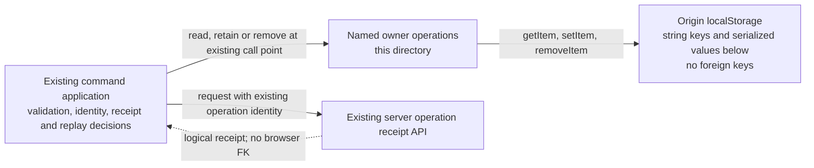

# Durable sync and retained practice command outboxes

Current source definitions for the legacy game synchronization, Endgames and
Tactics command outboxes. Each adapter owns only its existing `localStorage`
read, JSON write or deletion. The corresponding application module still owns
validation, request bytes, operation identity, receipt interpretation, replay,
errors and when an entry is removed. There is no new shared dispatcher, store
instance or cross-domain runtime. Existing application dependencies are unchanged;
this placement alone does not establish feature independence.

These records retain unresolved mutations across a reload. They are distinct from
ordinary UI preferences, OAuth/session metadata and the optional Explorer response
cache, which remain outside this directory. Existing browser values and live
server schemas were not inspected or migrated.

## Keys, stored data and ownership

`localStorage` enforces one string value per origin/key. The full browser key is
the record identity; suffixes are parts of that key, not relational columns or
foreign keys. JSON field shapes below come from the linked application source,
not a browser schema constraint. Existing legacy keys are preserved; configured
product Games uses its separate scoped recovery key below. There is no index.

| Owner / adapter | Exact key or formula | Serialized value and existing application contract |
| --- | --- | --- |
| Endgames attempt — [endgame-attempt.ts](endgame-attempt.ts) | `tempo-pending-endgame-attempt-v1` | JSON `{ operationId: string, templateId: string }`; [attempt command](../../../../app/lib/endgame-attempt-command.ts). |
| Endgames template admission — [endgame-template.ts](endgame-template.ts) | `tempo-pending-endgame-template-v1` | JSON `{ operationId: string, body: string }`. `body` is the exact request JSON for `name`, `white_material`, `black_material`, `trained_color`, `goal_mix` (all strings); [template command](../../../../app/lib/endgame-template-command.ts). |
| Game synchronization — [game-sync.ts](game-sync.ts) | `tempo-pending-game-sync-command-v1` | JSON `{ operationId: string, body: string }`. `body` is exact request JSON from `Record<string, unknown>`; [sync command](../../../../app/lib/game-sync-command.ts). |
| Configured product Games — [game-sync.ts](game-sync.ts) | `tempo-pending-product-game-sync-v1:${encodeURIComponent(scope)}`, where scope is the Game Review endpoint plus workspace ID | One unresolved `{kind:"save",operationId,body}` or `{kind:"run",provider,operation_id}` record; [Games settings](../../../../app/product-composition/GameSyncSettings.tsx) owns validation and recovery. Save bytes and run identity survive tab unmount/reload. Only a confirmed terminal response removes the matching operation; loading current settings does not imply success. |
| Tactic capture — [tactic-capture.ts](tactic-capture.ts) | `tempo-pending-tactic-capture-v1` | JSON `{ body: string }` containing exact transport JSON. Inner request fields: `capture_id: UUID string`, `starting_fen: string`, `moves: string[]`, `source_kind: "puzzle_rush", "game", "manual" or "other"`, optional nullable `source_ref/source_url: string`, `note: string`; [capture request schema and command](../../../../app/lib/tactic-capture-command.ts). The inner `capture_id` is the operation identity. |

Operation IDs, template/game/finding IDs and guided-review session IDs have only
logical relationships to server resources. An operation may not yet have a server
receipt after a lost send. No browser foreign key proves its existence or permits
deleting an unresolved entry. Application receipt handling retains that authority.

Storage access and serialization exceptions still propagate to the same existing
callers; adapters add no catch, fallback, notification, clock or UUID generation.
JSON encoding stays inside each write so storage-object/method lookup still
precedes serialization. Reads return unchanged raw strings; existing application
parsers and diagnostics remain outside the database tree.

## Historical relocation evidence

- Historical relocation evidence at [source snapshot 1e7ffb04](https://github.com/aaweaver-actuary/tempo/tree/1e7ffb049b9c5489cd0fa4c145d81ba1771813cb/database/browser/adapters/games-analysis): nine owning pending-command/capture suites passed 42 fake-storage/mocked-transport cases before the browser Games action clients were retired. This is historical evidence, not a claim that all nine suites remain registered.
- At the relocation baseline, task-local source expansion preserved all 56 original
  call sites and the full surrounding application AST. The 30 named operations preserved native-expression
  traces across 150 synthetic normal/error cases, including storage/method lookup
  and JSON exception order.
- Actual browser/session values, provider calls, servers, native databases and
  full-system acceptance were not exercised. These checks do not establish
  deployed storage availability, cross-tab concurrency or server independence.

The broader IndexedDB/portable persistence index remains in the
[browser README](../../README.md). Root metadata and the global browser inventory
have a separate integration owner.

## Retired browser Games action journals

The unused finding-card, exclusion, finding-decision, defensive-scan and guided-review
browser clients and their five exclusive adapters are retired. The retained
game-sync, Endgames attempt/template and Tactics capture adapters above are unchanged.
Historical implementation and exact payload shapes remain in
[source snapshot 1e7ffb04](https://github.com/aaweaver-actuary/tempo/tree/1e7ffb049b9c5489cd0fa4c145d81ba1771813cb/database/browser/adapters/games-analysis).

Existing `tempo-pending-finding-card-v1:*`, `tempo-pending-game-exclusion-v1:*`,
`tempo-pending-finding-v1:*`, `tempo-pending-game-threat-refresh-v1:*`,
`tempo-pending-guided-review-start-v1:*`, `tempo-pending-guided-review-attempt-v1:*`
and `tempo-pending-guided-review-attempt-v2:*` records are not read, cleared,
reconciled or migrated by this source retirement. They remain cold stored facts.
The [Study connection inspector](../../study-connection-storage.ts) is unchanged;
its existing retained-practice key selection does not cover these optional keys.
This retirement does not inspect or certify their settlement. No live browser
data or server history was inspected or changed.

## On-demand Games refresh recovery

`game-sync.ts` also owns `tempo-pending-game-refresh-v1:<encoded scope>:<provider>`.
The scope includes the full Games refresh API URL and workspace. The UI persists
`{provider, operation_id, job_id?}` before sending a refresh, then retains the exact
accepted job ID through uncertain responses, unmount and reload. Each provider has
its own record. Only a confirmed rejection or terminal exact-job result clears it;
reading an unrelated latest sync never settles the request.
