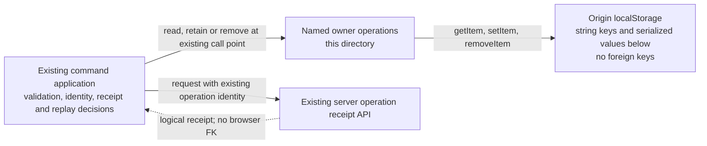

# Durable game and analysis command outboxes

Current source definitions for the legacy browser command outboxes, including
Endgames and Tactics commands. Each adapter owns only its existing `localStorage`
read, JSON write or deletion. The corresponding application module still owns
validation, request bytes, operation identity, receipt interpretation, replay,
errors and when an entry is removed. There is no new shared dispatcher, store
instance or cross-domain runtime. Existing application dependencies are unchanged;
this placement alone does not establish feature independence.

These records retain unresolved mutations across a reload. They are distinct from
ordinary UI preferences, OAuth/session metadata and the optional Explorer response
cache, which remain outside this directory. Existing browser values and live
server schemas were not inspected or migrated.

## Keys, stored data and ownership

`localStorage` enforces one string value per origin/key. The full browser key is
the record identity; suffixes are parts of that key, not relational columns or
foreign keys. JSON field shapes below come from the linked application source,
not a browser schema constraint. No index, new version or key format was added.

| Owner / adapter | Exact key or formula | Serialized value and existing application contract |
| --- | --- | --- |
| Endgames attempt — [endgame-attempt.ts](endgame-attempt.ts) | `tempo-pending-endgame-attempt-v1` | JSON `{ operationId: string, templateId: string }`; [attempt command](../../../../app/lib/endgame-attempt-command.ts). |
| Endgames template admission — [endgame-template.ts](endgame-template.ts) | `tempo-pending-endgame-template-v1` | JSON `{ operationId: string, body: string }`. `body` is the exact request JSON for `name`, `white_material`, `black_material`, `trained_color`, `goal_mix` (all strings); [template command](../../../../app/lib/endgame-template-command.ts). |
| Finding card save — [finding-card.ts](finding-card.ts) | `tempo-pending-finding-card-v1:${findingId}` | JSON `{ operationId: string, body: string }`. `body` retains `save: boolean` and optional `starting_fen: string`, `moves: string[]`, `trained_color: "white" or "black"`; [finding card command](../../../../app/lib/finding-card-command.ts). Preview-only requests do not create an outbox entry. |
| Game exclusion — [game-exclusion.ts](game-exclusion.ts) | `tempo-pending-game-exclusion-v1:${gameId}` | JSON `{ operationId: string, excluded: boolean }`; [exclusion command](../../../../app/lib/game-exclusion-command.ts). |
| Finding curation/decision — [game-finding.ts](game-finding.ts) | `tempo-pending-finding-v1:${findingId}` | JSON `{ kind: "curation" or "decision", value: string, operationId: string }`; [finding command](../../../../app/lib/game-finding-command.ts). Both actions retain the same existing per-finding slot. |
| Game synchronization — [game-sync.ts](game-sync.ts) | `tempo-pending-game-sync-command-v1` | JSON `{ operationId: string, body: string }`. `body` is exact request JSON from `Record<string, unknown>`; [sync command](../../../../app/lib/game-sync-command.ts). |
| Defensive scan request — [game-threat-refresh.ts](game-threat-refresh.ts) | `tempo-pending-game-threat-refresh-v1:${gameId}` | Raw operation ID string, not a JSON object; [threat refresh command](../../../../app/lib/game-threat-refresh-command.ts). |
| Guided review start — [guided-review.ts](guided-review.ts) | `tempo-pending-guided-review-start-v1:${gameId}` | Raw operation ID string; [guided review command](../../../../app/lib/guided-review-command.ts). |
| Guided review attempt — [guided-review.ts](guided-review.ts) | Existing legacy key `tempo-pending-guided-review-attempt-v1:${sessionId}:${currentIndex}` takes precedence when present; otherwise `tempo-pending-guided-review-attempt-v2:${sessionId}:${findingId}` | JSON `{ operationId: string, moveUci: string, findingId?: string }`. The existing reader validates operation/move strings; the application retains its separate finding/revision/rejection decisions. No legacy entry is rewritten by this move; [guided review command](../../../../app/lib/guided-review-command.ts). |
| Tactic capture — [tactic-capture.ts](tactic-capture.ts) | `tempo-pending-tactic-capture-v1` | JSON `{ body: string }` containing exact transport JSON. Inner request fields: `capture_id: UUID string`, `starting_fen: string`, `moves: string[]`, `source_kind: "puzzle_rush", "game", "manual" or "other"`, optional nullable `source_ref/source_url: string`, `note: string`; [capture request schema and command](../../../../app/lib/tactic-capture-command.ts). The inner `capture_id` is the operation identity. |

Operation IDs, template/game/finding IDs and guided-review session IDs have only
logical relationships to server resources. An operation may not yet have a server
receipt after a lost send. No browser foreign key proves its existence or permits
deleting an unresolved entry. Application receipt handling retains that authority.

Storage access and serialization exceptions still propagate to the same existing
callers; adapters add no catch, fallback, notification, clock or UUID generation.
JSON encoding stays inside each write so storage-object/method lookup still
precedes serialization. Reads return unchanged raw strings; existing application
parsers and diagnostics remain outside the database tree.

## Focused relocation evidence

- The nine existing owning pending-command/capture suites pass: 42 tests; fake
  browser storage and mocked transport only.
- Task-local source expansion preserves all 56 original call sites and the full
  surrounding application AST. The 30 named operations preserve native-expression
  traces across 150 synthetic normal/error cases, including storage/method lookup
  and JSON exception order.
- Actual browser/session values, provider calls, servers, native databases and
  full-system acceptance were not exercised. These checks do not establish
  deployed storage availability, cross-tab concurrency or server independence.

The broader IndexedDB/portable persistence index remains in the
[browser README](../../README.md). Root metadata and the global browser inventory
have a separate integration owner.
