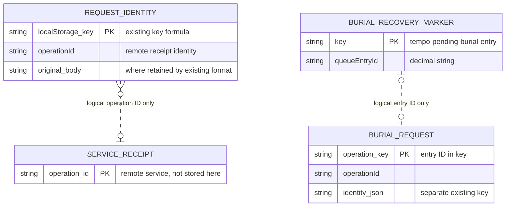
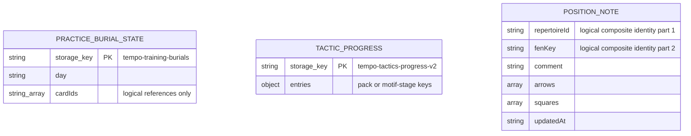

# Durable browser practice records

These adapters contain existing `localStorage` operations for durable request
identities, practice progress and authored notes. They introduce no new format or
storage authority. The callers retain validation, clocks, scheduling, network
requests, receipt/replay decisions and notifications. There are no application
imports, connections, queues, background workers or notifications in this directory.

This describes **current source formats**, not inspected live browser contents.
`localStorage` provides string keys and string values, with no foreign keys,
transactions or multi-key atomicity. The identities below are logical application
relationships only. The records remain scoped to the browser origin.

## Request and receipt identities

| Adapter / key | Stored value and fields | Logical identity / owner |
| --- | --- | --- |
| [activity-control.ts](activity-control.ts): `tempo-pending-activity-control-v1:${source}:${workId}` | JSON `{ operationId: string, action: string }` | One pending activity action per source/work ID. [Caller](../../../../app/lib/activity-control-command.ts) owns action replacement and receipt confirmation. |
| [settings-save.ts](settings-save.ts): `tempo-pending-settings-save-v1` | JSON `{ operationId: string, body: string }`; `body` is the original serialized settings request | One pending settings save. [Caller](../../../../app/lib/settings-save.ts) prevents a different payload overtaking an unresolved operation. |
| [tactical-activation.ts](tactical-activation.ts): `tempo-tactics-activation-pending-v1:${[...packIds].sort().join(",")}:${active}` | Raw operation-ID string | One activation request identity per sorted pack set and boolean action. [Caller](../../../../app/lib/tactical-catalog.ts) constructs the key, performs requests and applies its existing optional-storage fallback. |
| [training-burial-command.ts](training-burial-command.ts): `tempo-bury-operation-${queueEntryId}` | Raw operation-ID string | Legacy burial request identity for one queue entry. |
| Same adapter: `tempo-bury-identity-${queueEntryId}` | Original serialized JSON identity `{ card_id: string, expected_revision?: number }` | Retained request body for that entry, not a newly computed retry body. |
| Same adapter: `tempo-pending-burial-entry` | Decimal queue-entry-ID string | Single recovery marker. [Caller](../../../../app/lib/training-bury-command.ts) owns marker validation, cleanup, retry and independent-Study branching. |
| [position-annotations.ts](position-annotations.ts): `tempo-pending-position-annotation-v1` | JSON `{ operationId: string, body: string, repertoireId: string }`; body contains `fen`, `comment`, `arrows`, `squares` | One pending authored note request. [Caller](../../../../app/utils/position-annotations.ts) owns confirmed-versus-pending publication. |

The following diagram shows logical request identities, **not enforced foreign
keys or newly introduced tables**. The service receipt remains remote; these
adapters do not read it or decide when it is complete.

## Practice state and authored content

| Adapter / key | Stored value and fields | Ownership / logical relationships |
| --- | --- | --- |
| [training-burials.ts](training-burials.ts): `tempo-training-burials` | JSON `{ day: string, cardIds: string[] }` | Browser practice's day-local exclusions. [Caller](../../../../app/lib/browser-training-burials.ts) owns local-day reset, deduplication and queue filtering. Card IDs are references without browser-enforced constraints. |
| [tactics-progress.ts](tactics-progress.ts): `tempo-tactics-progress-v2` | JSON object keyed by pack ID or legacy motif/stage; each value has `clean: number`, `index: number`, optional `cleanIds: string[]`, `discoveredIds: string[]` | Existing [TacticProgress type and advancement](../../../../app/lib/tactics-progress.ts). Payloads are supplied; no advancement policy lives in storage. |
| Same adapter: `tempo-tactic-progress-pack-migration-v1` | Raw string `"true"` | Existing [migration completion marker](../../../../app/lib/tactical-catalog.ts), written after the migrated progress. Separate writes remain non-atomic. |
| [review-archive.ts](review-archive.ts): `tempo-rejected-opening-reviews-v1` | JSON array of existing [PendingReview envelopes](../../../../app/lib/review-outbox.ts): `backendId: string`, `queueEntryId: number`, `outcome: "again" | "correct"`, `guided: boolean`, plus optional attempt/revision/time/evidence/reconciliation fields | Best-effort rejected-opening evidence archive. The original type remains the single field definition; this is not the canonical review outbox or receipt store. Logical attempt/card/queue references have no browser FK. |
| [position-annotations.ts](position-annotations.ts): `tempo-position-annotations` | JSON array of [PositionAnnotation](../../../../app/domain/annotations.ts): `repertoireId: string`, `fenKey: string`, `comment: string`, `arrows: { from, to, color }[]`, `squares: { square, color }[]`, `updatedAt: string` | Authored note identity is `(repertoireId, fenKey)`. [Schema](../../../../app/domain/schemas/index.ts) owns square/color/date validation. The caller owns replacement and empty-note removal. |

## Scope and checks

UI active-pack preferences stay with `tactical-catalog.ts`; notification history,
rebuildable workspace caches, selected-pack preferences and generic validation
helpers stay in their existing logical owners. This directory is not a framework
for every WebStorage access. Existing IndexedDB Study intent/evidence storage
remains in its own root database modules.

Focused existing fake-storage suites cover activity/settings/activation pending
requests, burial retries/recovery, annotation pending state, review replay/evidence
archive and validation compatibility. The source/evaluation audit and browser
bundle checks are relocation evidence only; they do not establish live browser,
service, deployment or optional-feature resource isolation.
