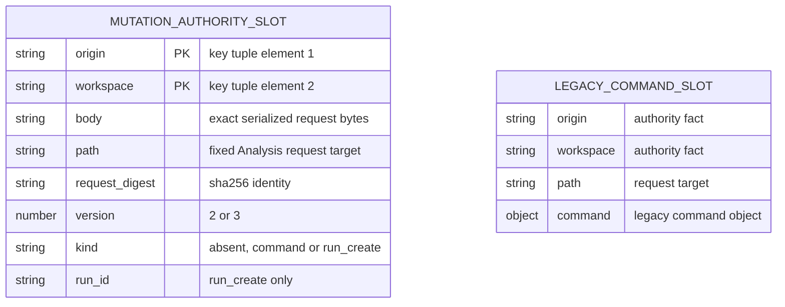

# Workbench mutation outbox storage

Current source storage is implemented in
[`pending-command-storage.mts`](pending-command-storage.mts). The Workbench
[`PendingCommands`](../../../../apps/workbench-web/src/commands.ts) coordinator
supplies its existing injected browser `Storage` (the UI supplies `sessionStorage`).
It owns request construction, digest/authority validation, legacy migration and
conflict decisions, dispatch fences, network retry and authoritative receipt
recovery. The adapter owns the existing concrete reads/writes/deletes, synchronous
read-after-write verification and compare-before-clear fence. Nothing is sent
until persistence succeeds. No connection/session settings move here.

| Storage key | Stored value and owner |
| --- | --- |
| `tempo-analysis-command-v2:` + `JSON.stringify([origin, workspace])` | JSON of `PendingMutation`: `origin`, `workspace`, `path`, `body` and `request_digest` are strings. A command has `version: 2` with no `kind`, or `version: 3`, `kind: "command"`. Run creation has `version: 3`, `kind: "run_create"`, and string `run_id`. The exact `body` string is reused on retry. One unresolved command or run creation shares this authority slot. |
| `tempo-analysis-command-v1` | Legacy JSON with string `origin`, `workspace`, `path` and `command` object containing string `command_id` plus existing request fields. Matching-authority migration and digest calculation remain in `PendingCommands`; the legacy record is removed only after the new record is durably verified. |

The diagram shows logical identities and source fields, not relational tables.
Browser Storage enforces string keys/values only; it has no foreign keys or schema
constraints. The origin/workspace tuple is the application's composite logical
identity. The credential is not part of the outbox payload. Receipt/request
matching is enforced by the coordinator, and storage content is validated before
recovery. No key, payload version, identity, retention policy or browser-storage
API changes are made by this relocation. Actual browser/session contents have
not been inspected.

The package's TypeScript build emits the single canonical adapter at
`lib/database/browser/adapters/workbench/pending-command-storage.mjs`; the public
entry and declarations are under `lib/apps/workbench-web/src/`. The `.mts` source explicitly preserves ESM output in the isolated source copy,
without depending on repository-root package metadata. All relative
runtime imports remain inside the packed `lib/` tree. The finite qualifier source
copy includes this owner directory and the existing Workbench inputs, and removes
the whole copied source tree before installed-package checks. No root app runtime
or other database owner is imported.
