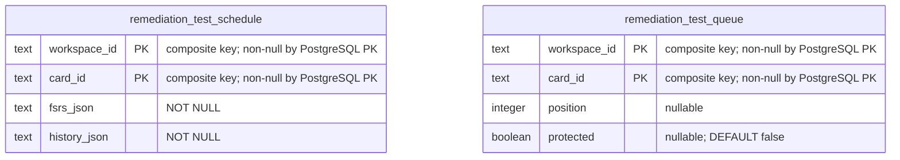

# Disposable database ownership fixture

Existing cross-owner PostgreSQL role-isolation test fixture, relocated intact from `contracts/database-ownership`. It creates task-owned synthetic schemas/roles only when explicitly run. It is test infrastructure, not a shared production runtime or another production store. Existing fixture behavior and assertions are unchanged; the native qualification setup below moves five existing statements into this owner. No fixture was started by this file-move task. [Database index](../README.md).

## Remediation qualification fixture setup

[`prepare_remediation_learning`](fixture.py) is the existing five-statement native setup moved from `scripts/qualify_legacy_bridge.py`. The existing bounded connection subclass also lives here unchanged, retaining its three-second connect timeout, five-second statement timeout and one-second lock timeout. The qualifier still verifies its pinned installed remediation schema **before** calling this function at the same point. It opens the same owned `learning` admin context, applies the same timeout/role/search path, executes the same installed schema and creates the same two test tables. No role, permission, credentials, statements or commit/exception order changes. This function was checked with synthetic contexts only; no fixture or native database ran.

These are **disposable test tables** in the owned `learning` database's `domain` schema, not production Learning tables. The installed remediation tables retain their own [source schema dictionary](../tempo_remediation_database/schema/README.md).

The rows hold synthetic scheduling/review history and queue-position/protection state for remediation acceptance tests. `(workspace_id, card_id)` is each table's complete primary key; matching identities are logical fixture relationships, with **no foreign keys** declared between these tables or to remediation tables. There is no row TTL; the existing verified fixture teardown removes its owned disposable resources. The qualifier's allocation, timing, source hash and cleanup authority remain in the original orchestration tool.
