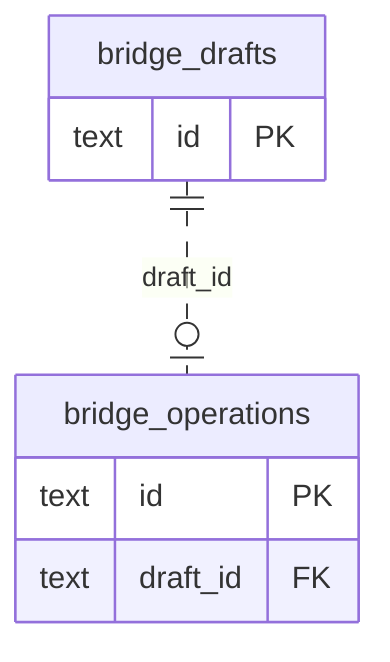

# Content: Bridge

Approved publication/response proposals and their durable command receipts.

**Current source schema, deployment unverified.** Owner: Content; SQL schema `content`. Derived from checked-in DDL at the `14ad5754` baseline with file relocation only. No live database was queried. [Database index](../../README.md).

Charts show primary/foreign key columns; the dictionary lists **every stored field and its SQL type**. `PK` means primary key (all marked fields form one composite key); `FK` means an enforced SQL foreign key. Parent `||`/`o|` means a required/optional parent; child `o{` means zero or more children and `o|` zero or one (a unique referencing tuple). Edges describe allowed SQL cardinality, not an obligation to create children. Nullable components of a composite FK can leave the tuple unlinked under PostgreSQL MATCH SIMPLE. No edge is inferred from a similar field name.

## Data dictionary

### `content.bridge_drafts`

Primary key: (`id`). DDL: [0002_bridge.sql](../../ddl/migrations/0002_bridge.sql).

| Field | SQL type | Null allowed | Keys |
| --- | --- | --- | --- |
| `id` | `text` | no | PK |
| `source_id` | `text` | no |  |
| `source_key` | `text` | no |  |
| `expected_revision` | `integer` | no |  |
| `digest` | `text` | no |  |
| `document` | `jsonb` | no |  |

### `content.bridge_operations`

Primary key: (`id`). DDL: [0002_bridge.sql](../../ddl/migrations/0002_bridge.sql), [0003_bridge_failure.sql](../../ddl/migrations/0003_bridge_failure.sql).

| Field | SQL type | Null allowed | Keys |
| --- | --- | --- | --- |
| `id` | `text` | no | PK |
| `draft_id` | `text` | no | FK draft_id → content.bridge_drafts(`id`) |
| `source_id` | `text` | no |  |
| `state` | `text` | no |  |
| `document` | `jsonb` | no |  |
| `updated_at` | `timestamptz` | no |  |

Unique tuples (including non-partial simple unique indexes): (`draft_id`).

Foreign key delete actions: (`draft_id`) NO ACTION.
