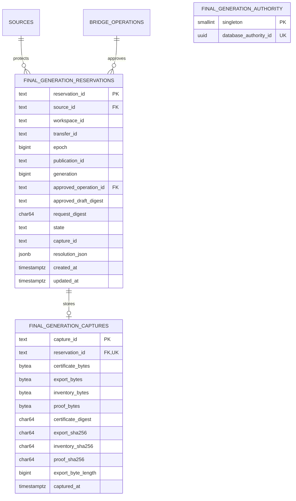

# Content final generation ledger

The additive `0005_content_final_generations` migration owns this ledger in the Content database. The reservation protects a single Content source generation from supported writers; it is not a legacy-source watermark, an administrator-bypass fence, or a target activation receipt. The capture stores original immutable bytes; no retention cleanup is defined here.

`final_generation_authority` contains one migration-owner-generated logical database UUID. A copied database retains this UUID; a separate instance/connection qualification is still necessary. Runtime may only select this table. Reservations have unique `(source_id, epoch)` and `(source_id, transfer_id)` and at most one active row per source. Epochs are source-local and increase under the source lock. Runtime can select, insert and update reservations but cannot delete them. A capture has one reservation and immutable certificate/export/inventory/proof bytes and hashes. Runtime has insert/select only; an owner-installed trigger rejects capture update/delete. Exact types, checks, indexes, grants and triggers are in the migration and migration owner.

Reservations move from `reserved` to `captured` and then `accepted` or `aborted`. `recovery-held` remains an active writer fence. Resolution uses an injected, owner-qualified read-only target-disposition port outside the Content transaction; a missing or uncertain disposition keeps the original reservation. No expiry or browser lifetime releases a fence. Target freshness, actual receipt authority and legacy-source correspondence require their own owner proof.
