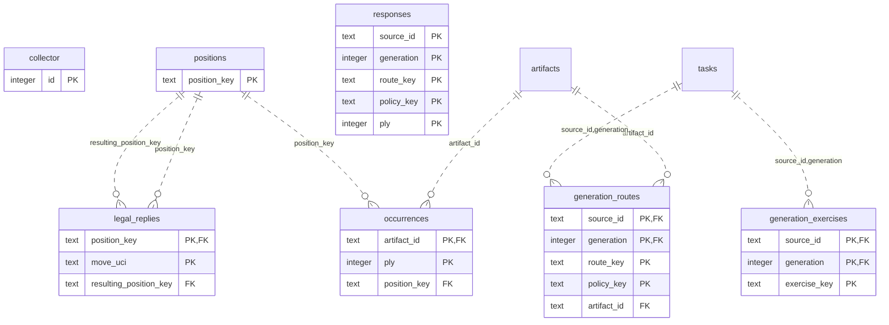

# Content: Inventory

Generated legal positions, routes, replies and exercise occurrences.

**Current source schema, deployment unverified.** Owner: Content; SQL schema `content`. Derived from checked-in DDL at the `14ad5754` baseline with file relocation only. No live database was queried. [Database index](../../README.md).

Charts show primary/foreign key columns; the dictionary lists **every stored field and its SQL type**. `PK` means primary key (all marked fields form one composite key); `FK` means an enforced SQL foreign key. Parent `||`/`o|` means a required/optional parent; child `o{` means zero or more children and `o|` zero or one (a unique referencing tuple). Edges describe allowed SQL cardinality, not an obligation to create children. Nullable components of a composite FK can leave the tuple unlinked under PostgreSQL MATCH SIMPLE. No edge is inferred from a similar field name.

Referenced tables outside this view: `content.artifacts`, `content.tasks`. Follow the [schema index](../README.md) for their full definitions.

## Data dictionary

### `content.collector`

Primary key: (`id`). DDL: [0001_content.sql](../../ddl/migrations/0001_content.sql).

| Field | SQL type | Null allowed | Keys |
| --- | --- | --- | --- |
| `id` | `integer` | no | PK |
| `pending` | `boolean` | no |  |
| `deliveries` | `bigint` | no |  |

### `content.generation_exercises`

Primary key: (`source_id`, `generation`, `exercise_key`). DDL: [0001_content.sql](../../ddl/migrations/0001_content.sql).

| Field | SQL type | Null allowed | Keys |
| --- | --- | --- | --- |
| `source_id` | `text` | no | PK; FK source_id,generation → content.tasks(`source_id`, `generation`) |
| `generation` | `integer` | no | PK; FK source_id,generation → content.tasks(`source_id`, `generation`) |
| `exercise_key` | `text` | no | PK |
| `exercise_revision` | `integer` | no |  |

Foreign key delete actions: (`source_id`, `generation`) NO ACTION.

### `content.generation_routes`

Primary key: (`source_id`, `generation`, `route_key`, `policy_key`). DDL: [0001_content.sql](../../ddl/migrations/0001_content.sql).

| Field | SQL type | Null allowed | Keys |
| --- | --- | --- | --- |
| `source_id` | `text` | no | PK; FK source_id,generation → content.tasks(`source_id`, `generation`) |
| `generation` | `integer` | no | PK; FK source_id,generation → content.tasks(`source_id`, `generation`) |
| `route_key` | `text` | no | PK |
| `policy_key` | `text` | no | PK |
| `repertoire_key` | `text` | no |  |
| `artifact_id` | `text` | no | FK artifact_id → content.artifacts(`id`) |

Foreign key delete actions: (`artifact_id`) NO ACTION, (`source_id`, `generation`) NO ACTION.

### `content.legal_replies`

Primary key: (`position_key`, `move_uci`). DDL: [0001_content.sql](../../ddl/migrations/0001_content.sql).

| Field | SQL type | Null allowed | Keys |
| --- | --- | --- | --- |
| `position_key` | `text` | no | PK; FK position_key → content.positions(`position_key`) |
| `move_uci` | `text` | no | PK |
| `resulting_position_key` | `text` | no | FK resulting_position_key → content.positions(`position_key`) |

Foreign key delete actions: (`position_key`) NO ACTION, (`resulting_position_key`) NO ACTION.

### `content.occurrences`

Primary key: (`artifact_id`, `ply`). DDL: [0001_content.sql](../../ddl/migrations/0001_content.sql).

| Field | SQL type | Null allowed | Keys |
| --- | --- | --- | --- |
| `artifact_id` | `text` | no | PK; FK artifact_id → content.artifacts(`id`) |
| `ply` | `integer` | no | PK |
| `fen` | `text` | no |  |
| `position_key` | `text` | no | FK position_key → content.positions(`position_key`) |
| `opponent` | `boolean` | no |  |
| `authored_move` | `text` | yes |  |

Foreign key delete actions: (`artifact_id`) NO ACTION, (`position_key`) NO ACTION.

### `content.positions`

Primary key: (`position_key`). DDL: [0001_content.sql](../../ddl/migrations/0001_content.sql).

| Field | SQL type | Null allowed | Keys |
| --- | --- | --- | --- |
| `position_key` | `text` | no | PK |
| `fen` | `text` | no |  |
| `side_to_move` | `text` | no |  |
| `legal_version` | `text` | yes |  |
| `reply_count` | `integer` | yes |  |
| `fingerprint` | `text` | yes |  |

### `content.responses`

Primary key: (`source_id`, `generation`, `route_key`, `policy_key`, `ply`). DDL: [0001_content.sql](../../ddl/migrations/0001_content.sql).

| Field | SQL type | Null allowed | Keys |
| --- | --- | --- | --- |
| `source_id` | `text` | no | PK |
| `generation` | `integer` | no | PK |
| `route_key` | `text` | no | PK |
| `policy_key` | `text` | no | PK |
| `ply` | `integer` | no | PK |
| `exercise_key` | `text` | no |  |
| `position_key` | `text` | no |  |
| `accepted_moves` | `jsonb` | no |  |
