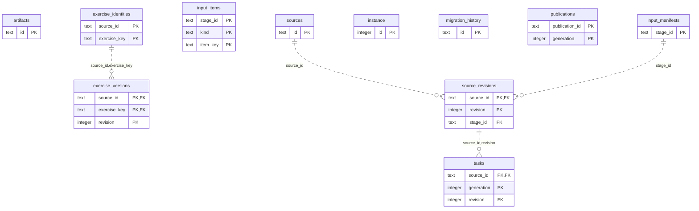

# Content: Sources Publications

Authored source inputs and revisions, exercise identities/versions, immutable publications and task artifacts.

**Current source schema, deployment unverified.** Owner: Content; SQL schema `content`. Derived from checked-in DDL at the `14ad5754` baseline with file relocation only. No live database was queried. [Database index](../../README.md).

Charts show primary/foreign key columns; the dictionary lists **every stored field and its SQL type**. `PK` means primary key (all marked fields form one composite key); `FK` means an enforced SQL foreign key. Parent `||`/`o|` means a required/optional parent; child `o{` means zero or more children and `o|` zero or one (a unique referencing tuple). Edges describe allowed SQL cardinality, not an obligation to create children. Nullable components of a composite FK can leave the tuple unlinked under PostgreSQL MATCH SIMPLE. No edge is inferred from a similar field name.

## Data dictionary

### `content.artifacts`

Primary key: (`id`). DDL: [0001_content.sql](../../ddl/migrations/0001_content.sql).

| Field | SQL type | Null allowed | Keys |
| --- | --- | --- | --- |
| `id` | `text` | no | PK |
| `starting_fen` | `text` | no |  |
| `moves` | `jsonb` | no |  |
| `learner_color` | `text` | no |  |
| `version` | `text` | no |  |
| `cursor` | `integer` | no |  |
| `next_fen` | `text` | no |  |
| `complete` | `boolean` | no |  |
| `epoch` | `bigint` | no |  |

### `content.exercise_identities`

Primary key: (`source_id`, `exercise_key`). DDL: [0001_content.sql](../../ddl/migrations/0001_content.sql).

| Field | SQL type | Null allowed | Keys |
| --- | --- | --- | --- |
| `source_id` | `text` | no | PK |
| `exercise_key` | `text` | no | PK |
| `card_id` | `text` | no |  |
| `policy_key` | `text` | no |  |
| `decision_key` | `text` | no |  |
| `kind` | `text` | no |  |
| `supersedes_key` | `text` | yes |  |

Unique tuples (including non-partial simple unique indexes): (`card_id`).

### `content.exercise_versions`

Primary key: (`source_id`, `exercise_key`, `revision`). DDL: [0001_content.sql](../../ddl/migrations/0001_content.sql).

| Field | SQL type | Null allowed | Keys |
| --- | --- | --- | --- |
| `source_id` | `text` | no | PK; FK source_id,exercise_key → content.exercise_identities(`source_id`, `exercise_key`) |
| `exercise_key` | `text` | no | PK; FK source_id,exercise_key → content.exercise_identities(`source_id`, `exercise_key`) |
| `revision` | `integer` | no | PK |
| `digest` | `text` | no |  |

Foreign key delete actions: (`source_id`, `exercise_key`) NO ACTION.

### `content.input_items`

Primary key: (`stage_id`, `kind`, `item_key`). DDL: [0001_content.sql](../../ddl/migrations/0001_content.sql).

| Field | SQL type | Null allowed | Keys |
| --- | --- | --- | --- |
| `stage_id` | `text` | no | PK |
| `kind` | `text` | no | PK |
| `item_key` | `text` | no | PK |
| `ordinal` | `integer` | no |  |
| `payload` | `jsonb` | no |  |

Unique tuples (including non-partial simple unique indexes): (`stage_id`, `kind`, `ordinal`).

### `content.input_manifests`

Primary key: (`stage_id`). DDL: [0001_content.sql](../../ddl/migrations/0001_content.sql).

| Field | SQL type | Null allowed | Keys |
| --- | --- | --- | --- |
| `stage_id` | `text` | no | PK |
| `source_id` | `text` | no |  |
| `digest` | `text` | no |  |
| `header` | `jsonb` | no |  |
| `counts` | `jsonb` | no |  |

### `content.instance`

Primary key: (`id`). DDL: [0001_content.sql](../../ddl/migrations/0001_content.sql).

| Field | SQL type | Null allowed | Keys |
| --- | --- | --- | --- |
| `id` | `integer` | no | PK |
| `workspace_id` | `text` | no |  |

### `content.migration_history`

Primary key: (`id`). DDL: [0001_content.sql](../../ddl/migrations/0001_content.sql).

| Field | SQL type | Null allowed | Keys |
| --- | --- | --- | --- |
| `id` | `text` | no | PK |
| `checksum` | `text` | no |  |

### `content.publications`

Primary key: (`publication_id`, `generation`). DDL: [0001_content.sql](../../ddl/migrations/0001_content.sql).

| Field | SQL type | Null allowed | Keys |
| --- | --- | --- | --- |
| `publication_id` | `text` | no | PK |
| `generation` | `integer` | no | PK |
| `source_id` | `text` | no |  |
| `source_revision` | `integer` | no |  |
| `payload` | `text` | no |  |
| `digest` | `text` | no |  |
| `provenance` | `jsonb` | no |  |

### `content.source_revisions`

Primary key: (`source_id`, `revision`). DDL: [0001_content.sql](../../ddl/migrations/0001_content.sql).

| Field | SQL type | Null allowed | Keys |
| --- | --- | --- | --- |
| `source_id` | `text` | no | PK; FK source_id → content.sources(`id`) |
| `revision` | `integer` | no | PK |
| `stage_id` | `text` | no | FK stage_id → content.input_manifests(`stage_id`) |
| `digest` | `text` | no |  |

Foreign key delete actions: (`source_id`) NO ACTION, (`stage_id`) NO ACTION.

### `content.sources`

Primary key: (`id`). DDL: [0001_content.sql](../../ddl/migrations/0001_content.sql).

| Field | SQL type | Null allowed | Keys |
| --- | --- | --- | --- |
| `id` | `text` | no | PK |
| `source_key` | `text` | no |  |
| `requested_revision` | `integer` | no |  |
| `last_complete_revision` | `integer` | no |  |
| `last_complete_generation` | `integer` | no |  |
| `publication_id` | `text` | no |  |

Unique tuples (including non-partial simple unique indexes): (`source_key`).

### `content.tasks`

Primary key: (`source_id`, `generation`). DDL: [0001_content.sql](../../ddl/migrations/0001_content.sql).

| Field | SQL type | Null allowed | Keys |
| --- | --- | --- | --- |
| `source_id` | `text` | no | PK; FK source_id,revision → content.source_revisions(`source_id`, `revision`) |
| `generation` | `integer` | no | PK |
| `revision` | `integer` | no | FK source_id,revision → content.source_revisions(`source_id`, `revision`) |
| `phase` | `text` | no |  |
| `cursor` | `integer` | no |  |
| `exercise_state` | `jsonb` | yes |  |
| `state` | `text` | no |  |
| `lease_token` | `text` | yes |  |
| `lease_until` | `timestamptz` | yes |  |
| `error` | `jsonb` | yes |  |
| `built_at` | `text` | yes |  |

Foreign key delete actions: (`source_id`, `revision`) NO ACTION.
