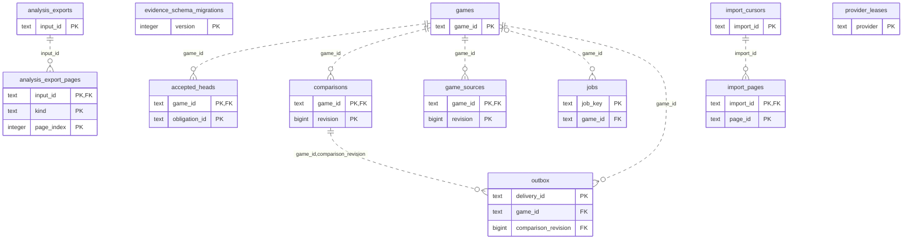

# Game Evidence: Observations Delivery (1)

Imported game source bytes and documents, snapshots, comparison revisions, current heads, reconciliation and delivery outbox.

**Current source schema, deployment unverified.** Owner: Game Evidence; SQL schema `public`. Derived from checked-in DDL at the `14ad5754` baseline with file relocation only. No live database was queried. [Database index](../../README.md).

Charts show primary/foreign key columns; the dictionary lists **every stored field and its SQL type**. `PK` means primary key (all marked fields form one composite key); `FK` means an enforced SQL foreign key. Parent `||`/`o|` means a required/optional parent; child `o{` means zero or more children and `o|` zero or one (a unique referencing tuple). Edges describe allowed SQL cardinality, not an obligation to create children. Nullable components of a composite FK can leave the tuple unlinked under PostgreSQL MATCH SIMPLE. No edge is inferred from a similar field name.

## Data dictionary

### `public.accepted_heads`

Primary key: (`game_id`, `obligation_id`). DDL: [002.sql](../../ddl/migrations/002.sql).

| Field | SQL type | Null allowed | Keys |
| --- | --- | --- | --- |
| `game_id` | `text` | no | PK; FK game_id → public.games(`game_id`) |
| `bucket` | `integer` | no |  |
| `obligation_id` | `text` | no | PK |
| `obligation_revision` | `bigint` | no |  |
| `active` | `boolean` | no |  |
| `obligation` | `jsonb` | no |  |
| `encounter` | `jsonb` | no |  |

Foreign key delete actions: (`game_id`) NO ACTION.

### `public.analysis_export_pages`

Primary key: (`input_id`, `kind`, `page_index`). DDL: [003.sql](../../ddl/migrations/003.sql).

| Field | SQL type | Null allowed | Keys |
| --- | --- | --- | --- |
| `input_id` | `text` | no | PK; FK input_id → public.analysis_exports(`input_id`) |
| `kind` | `text` | no | PK |
| `page_index` | `integer` | no | PK |
| `digest` | `text` | no |  |
| `document` | `jsonb` | no |  |

Foreign key delete actions: (`input_id`) NO ACTION.

### `public.analysis_exports`

Primary key: (`input_id`). DDL: [003.sql](../../ddl/migrations/003.sql).

| Field | SQL type | Null allowed | Keys |
| --- | --- | --- | --- |
| `input_id` | `text` | no | PK |
| `workspace_id` | `text` | no |  |
| `manifest` | `jsonb` | no |  |

### `public.comparisons`

Primary key: (`game_id`, `revision`). DDL: [001.sql](../../ddl/migrations/001.sql).

| Field | SQL type | Null allowed | Keys |
| --- | --- | --- | --- |
| `game_id` | `text` | no | PK; FK game_id → public.games(`game_id`) |
| `revision` | `bigint` | no | PK |
| `input_token` | `text` | no |  |
| `report` | `jsonb` | no |  |

Unique tuples (including non-partial simple unique indexes): (`game_id`, `input_token`).

Foreign key delete actions: (`game_id`) NO ACTION.

### `public.evidence_schema_migrations`

Primary key: (`version`). DDL: [001.sql](../../ddl/migrations/001.sql).

| Field | SQL type | Null allowed | Keys |
| --- | --- | --- | --- |
| `version` | `integer` | no | PK |

### `public.game_sources`

Primary key: (`game_id`, `revision`). DDL: [001.sql](../../ddl/migrations/001.sql).

| Field | SQL type | Null allowed | Keys |
| --- | --- | --- | --- |
| `game_id` | `text` | no | PK; FK game_id → public.games(`game_id`) |
| `revision` | `bigint` | no | PK |
| `input_digest` | `text` | no |  |
| `source_digest` | `text` | no |  |
| `raw_source` | `bytea` | no |  |
| `document` | `jsonb` | no |  |

Foreign key delete actions: (`game_id`) NO ACTION.

### `public.games`

Primary key: (`game_id`). DDL: [001.sql](../../ddl/migrations/001.sql), [002.sql](../../ddl/migrations/002.sql).

| Field | SQL type | Null allowed | Keys |
| --- | --- | --- | --- |
| `game_id` | `text` | no | PK |
| `workspace_id` | `text` | no |  |
| `provider` | `text` | no |  |
| `provider_game_id` | `text` | no |  |
| `player` | `text` | no |  |
| `revision` | `bigint` | no |  |
| `input_digest` | `text` | no |  |
| `source_digest` | `text` | no |  |
| `raw_source` | `bytea` | no |  |
| `document` | `jsonb` | no |  |
| `index_receipt` | `jsonb` | yes |  |
| `positions` | `jsonb` | yes |  |
| `report_revision` | `bigint` | no |  |
| `heads_initialized` | `boolean` | no |  |
| `evidence_revision` | `bigint` | no |  |
| `reconciled_revision` | `bigint` | no |  |
| `reconciliation_status` | `text` | no |  |
| `reconciliation_reason` | `text` | yes |  |

Unique tuples (including non-partial simple unique indexes): (`workspace_id`, `provider`, `provider_game_id`, `player`).

### `public.import_cursors`

Primary key: (`import_id`). DDL: [001.sql](../../ddl/migrations/001.sql).

| Field | SQL type | Null allowed | Keys |
| --- | --- | --- | --- |
| `import_id` | `text` | no | PK |
| `workspace_id` | `text` | no |  |
| `configuration` | `jsonb` | no |  |
| `cursor` | `jsonb` | no |  |
| `next_attempt_at` | `timestamptz` | no |  |
| `status` | `text` | no |  |
| `reason` | `text` | yes |  |
| `lease_token` | `text` | yes |  |
| `leased_until` | `timestamptz` | yes |  |
| `attempts` | `integer` | no |  |

### `public.import_pages`

Primary key: (`import_id`, `page_id`). DDL: [001.sql](../../ddl/migrations/001.sql), [002.sql](../../ddl/migrations/002.sql).

| Field | SQL type | Null allowed | Keys |
| --- | --- | --- | --- |
| `import_id` | `text` | no | PK; FK import_id → public.import_cursors(`import_id`) |
| `page_id` | `text` | no | PK |
| `raw_response` | `bytea` | no |  |
| `source_digest` | `text` | no |  |
| `validation_status` | `text` | no |  |
| `validation_reason` | `text` | yes |  |

Foreign key delete actions: (`import_id`) NO ACTION.

### `public.jobs`

Primary key: (`job_key`). DDL: [001.sql](../../ddl/migrations/001.sql), [002.sql](../../ddl/migrations/002.sql).

| Field | SQL type | Null allowed | Keys |
| --- | --- | --- | --- |
| `job_key` | `text` | no | PK |
| `workspace_id` | `text` | no |  |
| `game_id` | `text` | yes | FK game_id → public.games(`game_id`) |
| `kind` | `text` | no |  |
| `requested` | `bigint` | no |  |
| `published` | `bigint` | no |  |
| `cursor` | `text` | no |  |
| `lease_token` | `text` | yes |  |
| `leased_until` | `timestamptz` | yes |  |
| `next_attempt_at` | `timestamptz` | no |  |
| `attempts` | `integer` | no |  |
| `error` | `text` | yes |  |

Foreign key delete actions: (`game_id`) NO ACTION.

### `public.outbox`

Primary key: (`delivery_id`). DDL: [001.sql](../../ddl/migrations/001.sql), [002.sql](../../ddl/migrations/002.sql).

| Field | SQL type | Null allowed | Keys |
| --- | --- | --- | --- |
| `delivery_id` | `text` | no | PK |
| `game_id` | `text` | no | FK game_id → public.games(`game_id`); FK game_id,comparison_revision → public.comparisons(`game_id`, `revision`) |
| `evidence_revision` | `bigint` | no |  |
| `bucket` | `integer` | no |  |
| `payload` | `jsonb` | yes |  |
| `status` | `text` | no |  |
| `reason` | `text` | yes |  |
| `acknowledgement` | `jsonb` | yes |  |
| `attempts` | `integer` | no |  |
| `next_attempt_at` | `timestamptz` | no |  |
| `lease_token` | `text` | yes |  |
| `leased_until` | `timestamptz` | yes |  |
| `comparison_revision` | `bigint` | no | FK game_id,comparison_revision → public.comparisons(`game_id`, `revision`) |

Unique tuples (including non-partial simple unique indexes): (`game_id`, `evidence_revision`, `bucket`).

Foreign key delete actions: (`game_id`) NO ACTION, (`game_id`, `comparison_revision`) NO ACTION.

### `public.provider_leases`

Primary key: (`provider`). DDL: [001.sql](../../ddl/migrations/001.sql), [002.sql](../../ddl/migrations/002.sql).

| Field | SQL type | Null allowed | Keys |
| --- | --- | --- | --- |
| `provider` | `text` | no | PK |
| `token` | `text` | yes |  |
| `leased_until` | `timestamptz` | yes |  |
| `cooldown_until` | `timestamptz` | no |  |
