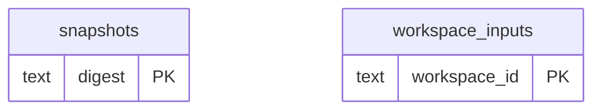

# Game Evidence: Observations Delivery (2)

Imported game source bytes and documents, snapshots, comparison revisions, current heads, reconciliation and delivery outbox.

**Current source schema, deployment unverified.** Owner: Game Evidence; SQL schema `public`. Derived from checked-in DDL at the `14ad5754` baseline with file relocation only. No live database was queried. [Database index](../../README.md).

Charts show primary/foreign key columns; the dictionary lists **every stored field and its SQL type**. `PK` means primary key (all marked fields form one composite key); `FK` means an enforced SQL foreign key. Parent `||`/`o|` means a required/optional parent; child `o{` means zero or more children and `o|` zero or one (a unique referencing tuple). Edges describe allowed SQL cardinality, not an obligation to create children. Nullable components of a composite FK can leave the tuple unlinked under PostgreSQL MATCH SIMPLE. No edge is inferred from a similar field name.

## Data dictionary

### `public.snapshots`

Primary key: (`digest`). DDL: [001.sql](../../ddl/migrations/001.sql).

| Field | SQL type | Null allowed | Keys |
| --- | --- | --- | --- |
| `digest` | `text` | no | PK |
| `workspace_id` | `text` | no |  |
| `snapshot_id` | `text` | no |  |
| `revision` | `bigint` | no |  |
| `document` | `jsonb` | no |  |

Unique tuples (including non-partial simple unique indexes): (`workspace_id`, `snapshot_id`, `revision`).

### `public.workspace_inputs`

Primary key: (`workspace_id`). DDL: [001.sql](../../ddl/migrations/001.sql).

| Field | SQL type | Null allowed | Keys |
| --- | --- | --- | --- |
| `workspace_id` | `text` | no | PK |
| `epoch` | `bigint` | no |  |
| `snapshot_digest` | `text` | yes |  |
| `changed_positions` | `jsonb` | no |  |
