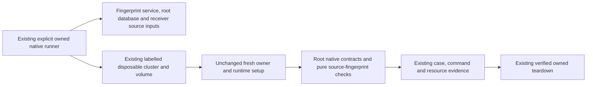

# Game Evidence native database tooling

**Current source; native execution/deployment unverified by this move.** [run_postgres.py](run_postgres.py) is the existing Game Evidence owned disposable PostgreSQL runner, relocated from the service integration directory. It remains source-checkout tooling requiring the owning service and existing Learning remediation sources/toolchain. This move adds no installed native harness and changes no native SQL, role/grant, credential, resource ownership or cleanup behavior.



The owning source-checkout command is now:

```sh
services/game-evidence/.venv/bin/python database/tempo_game_evidence_database/tooling/run_postgres.py EVIDENCE
```

Run this only with the permissions/resources required by the existing component lane. The file still accepts no external database URL, provisions only its fresh labelled resources, redacts generated test credentials and verifies labels before its own teardown. No native runner, Docker, connection, setup, grant, restart or cleanup operation was executed to validate this relocation; source/AST/path and artifact checks are separate evidence.

The runner preserves the service `pyproject.toml`, working directory, default `test-results/native` output, optional test selection, environment filtering, JUnit routing and existing native methods. It now discovers [native contracts](../tests/native/test_postgres.py) and [pure source metadata checks](../tests/test_source_fingerprints.py) from the root owner. Source fingerprints include the root database tree and owner build hooks, plus the existing Learning inputs. The non-database [artifact qualifier](../../../services/game-evidence/integration/qualify_artifacts.py) stays with service build orchestration and now fingerprints the root owner it already copies.

[The existing build hook](../../../services/game-evidence/hatch_build.py) includes the full owner in source distributions; `tooling/` and `tests/` are excluded from runtime wheels. Runtime adapters, migrations, schema resources and independent service imports retain their original package paths. [Source-schema ER charts and field/type/key dictionaries](../schema/README.md) describe unchanged owned storage; this tooling relocation adds no table or relationship. Existing cross-owner receiver fixtures are explicit native protocol proof, not runtime Study dependence or live isolation qualification.
